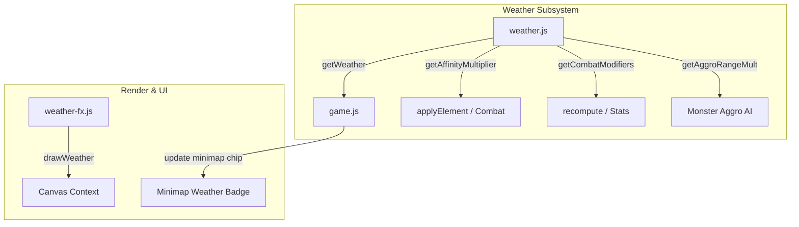

# Dynamic World Weather & Elemental Affinities System Implementation Plan

> **For agentic workers:** REQUIRED SUB-SKILL: Use superpowers:subagent-driven-development to implement this plan task-by-task. Steps use checkbox (`- [ ]`) syntax for tracking.

**Goal:** Implement real-time cyclical weather across Aetheria Online biomes with 16-bit ambient canvas particles (strict zero screen shake), elemental damage affinities, and minimap HUD status.

**Architecture:** A standalone subsystem `js/systems/weather.js` manages weather state transitions, durations, and stat/damage modifiers. An ambient renderer `js/render/weather-fx.js` draws crisp retro particles onto the canvas without camera shake. `js/game.js` wires elemental multipliers into `applyElement()` and displays the active atmospheric condition in the minimap HUD.

**Architecture Diagram:**

**Tech Stack:** Plain ES Modules, HTML5 Canvas 2D, Node `node:test` / `node:assert`.

**Spec:** [`docs/superpowers/specs/2026-10-06-dynamic-weather-system-design.md`](file:///Users/thanananasanthia/Desktop/personal/game-rpg/docs/superpowers/specs/2026-10-06-dynamic-weather-system-design.md)

## Global Constraints

- **Strict Zero Screen Shake:** Camera shake is 0% engine-wide. Weather effects must never cause camera movement.
- **Surface Stability:** Preserve all 255 keys on `window.__AWO`.
- **Zero Build Step:** Plain ES modules in browser and Node runtime.
- **Save Compatibility:** Safely persist `G.weather`; default to map standard if missing in legacy saves.
- **No Remote Push:** Do not run `git push`.

---

### Task 1: Weather Subsystem Core & Unit Tests

**Files:**
- Create: `js/systems/weather.js`
- Create: `js/weather.test.js`

**Interfaces:**
- Produces: `createWeatherSystem({ now, rnd, cycleDurationMs })`
- Methods: `getWeather(mapId)`, `update(dt, mapId)`, `getAffinityMultiplier(element, mapId)`, `getCombatModifiers(mapId)`, `getAggroRangeMult(mapId)`, `setWeatherOverride(mapId, weatherId)`

- [ ] **Step 1: Write unit tests in `js/weather.test.js`**
  Cover weather retrieval, cycle transitions, element affinity calculations, combat stat modifications, and manual overrides.
- [ ] **Step 2: Run test to confirm failure**
  Run `node js/weather.test.js` (expect module missing).
- [ ] **Step 3: Implement `js/systems/weather.js`**
  Implement weather catalog, biome pools, cycle progression, and query methods.
- [ ] **Step 4: Verify unit tests pass**
  Run `node js/weather.test.js`.
- [ ] **Step 5: Commit Task 1**
  `git add js/systems/weather.js js/weather.test.js && git commit -m "feat(weather): implement weather subsystem core and unit tests"`

---

### Task 2: 16-Bit Ambient Weather Particle Renderer

**Files:**
- Create: `js/render/weather-fx.js`
- Create: `js/weather-fx.test.js`

**Interfaces:**
- Produces: `createWeatherRenderer({ getCtx, now, prefersReducedMotion, CANVAS_W, CANVAS_H })`
- Methods: `update(dt)`, `drawWeather(mapId, weather)`

- [ ] **Step 1: Write tests in `js/weather-fx.test.js`**
  Verify particle pooling, lifecycle updates, bounds wrapping, and that camera transform is never shaken.
- [ ] **Step 2: Implement `js/render/weather-fx.js`**
  Implement retro rain streaks, blizzard snow flurries, volcanic ash/ember motes, mist bands, and starlight glints.
- [ ] **Step 3: Verify tests pass**
  Run `node js/weather-fx.test.js`.
- [ ] **Step 4: Commit Task 2**
  `git add js/render/weather-fx.js js/weather-fx.test.js && git commit -m "feat(render): implement 16-bit ambient weather particle renderer"`

---

### Task 3: Combat Integration, Minimap UI Badge & Localization

**Files:**
- Modify: `js/game.js`
- Modify: `js/locale.js`

- [ ] **Step 1: Wire weather system and renderer in `js/game.js`**
  - Import `createWeatherSystem` and `createWeatherRenderer`.
  - Wire `applyElement(attackEl, m, dmg)` with `weatherSystem.getAffinityMultiplier(attackEl, G.mapId)`.
  - Wire `recompute(p)` with weather combat modifiers.
  - Wire monster aggro range with `weatherSystem.getAggroRangeMult(G.mapId)`.
  - Delegate `drawAtmosphere()` to weather renderer.
  - Add `#minimap-weather` badge in HUD and update in `updateHud()`.
  - Add `setweather` admin command.
- [ ] **Step 2: Add Thai & English translations in `js/locale.js`**
  Add all weather names and descriptions to UI and maps categories.
- [ ] **Step 3: Verify localization test**
  Run `node js/locale.test.js`.
- [ ] **Step 4: Commit Task 3**
  `git add js/game.js js/locale.js && git commit -m "feat(weather): wire combat affinities, minimap HUD badge, and localization"`

---

### Task 4: Full Game Integration Testing, Surface Stability & Merge

**Files:**
- Create: `js/weather-integration.test.js`
- Modify: `CLAUDE.md`

- [ ] **Step 1: Create `js/weather-integration.test.js`**
  Verify live engine boot, elemental damage amplification under active weather, minimap badge updates, and admin override.
- [ ] **Step 2: Run surface characterization**
  Run `node js/engine-surface.test.js` (confirm all 255 keys preserved and render fingerprints pass).
- [ ] **Step 3: Run full test suite**
  Run `npm test` (all suites pass).
- [ ] **Step 4: Update `CLAUDE.md`**
  Document `js/systems/weather.js` and `js/render/weather-fx.js`.
- [ ] **Step 5: Merge into `main`**
  Fast-forward merge feature branch into `main` and delete feature branch.
- [ ] **Step 6: Run `npm test` on `main`**
  Final regression verification.
