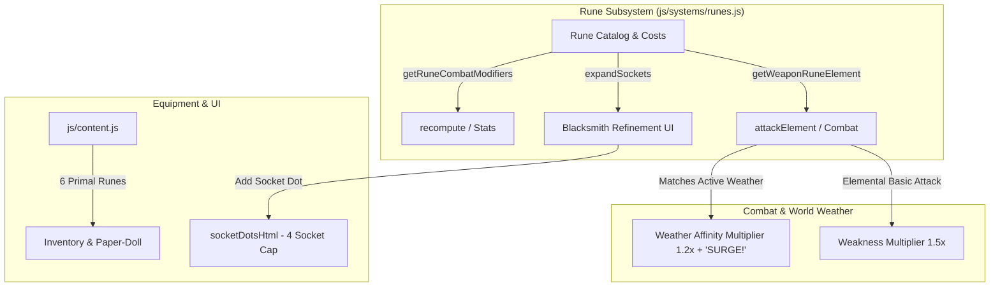

# Elemental Rune Socketing, Socket Expansion & Weapon Infusion Implementation Plan

> **For agentic workers:** REQUIRED SUB-SKILL: Use superpowers:subagent-driven-development to implement this plan task-by-task. Steps use checkbox (`- [ ]`) syntax for tracking.

**Goal:** Implement equipment socket expansion up to 4 sockets via Blacksmith Refinement, 6 primal Elemental Runes, weapon basic attack elemental infusion, and synergies with enemy weaknesses and dynamic weather.

**Architecture:** A standalone subsystem `js/systems/runes.js` manages rune definitions, socket expansion rules/costs, weapon element resolution, and armor warding modifiers. `js/content.js` registers the 6 primal runes as socketable items. `js/game.js` wires weapon infusion into `attackElement()`, expands sockets in the Blacksmith UI, updates colored socket dots in inventory inspection, and applies rune warding stats in `recompute()`.

**Architecture Diagram:**

**Tech Stack:** Plain ES Modules, HTML5 Canvas 2D, Node `node:test` / `node:assert`.

**Spec:** [`docs/superpowers/specs/2026-10-06-elemental-runes-socket-expansion-design.md`](file:///Users/thanananasanthia/Desktop/personal/game-rpg/docs/superpowers/specs/2026-10-06-elemental-runes-socket-expansion-design.md)

## Global Constraints

- **Strict Zero Screen Shake:** Camera shake is strictly 0% engine-wide. Elemental procs, infusions, and surges must never cause camera movement.
- **Surface Stability:** Preserve all 255 keys on `window.__AWO`.
- **Zero Build Step:** Plain ES modules in browser and Node runtime.
- **Save Compatibility:** Safely persist expanded sockets and socketed runes in `awo_save_v1`.
- **No Remote Push:** Do not run `git push`.

---

### Task 1: Elemental Runes & Socket Expansion Subsystem & Unit Tests

**Files:**
- Create: `js/systems/runes.js`
- Create: `js/runes.test.js`

**Interfaces:**
- Produces: `createRuneSystem()`, `RUNE_CATALOG`, `EXPANSION_COSTS`
- Methods: `getSocketExpansionCost(currentCount)`, `expandSockets(inst, zeny, inventory, removeItemFn)`, `getWeaponRuneElement(weaponInst, itemById)`, `getRuneCombatModifiers(equip, itemById)`

- [x] **Step 1: Write unit tests in `js/runes.test.js`**
  Cover cost scaling for 1st, 2nd, 3rd, and 4th sockets, maximum socket clamp (cap 4), inventory/Zeny deduction on expansion, weapon rune element detection, and gear defensive warding bonuses.
- [x] **Step 2: Run test to confirm failure**
  Run `node js/runes.test.js` (expect module missing).
- [x] **Step 3: Implement `js/systems/runes.js`**
  Implement rune catalog, expansion cost tiers, socket expansion logic, weapon rune element lookup, and warding stat accumulation.
- [x] **Step 4: Verify unit tests pass**
  Run `node js/runes.test.js`.
- [x] **Step 5: Commit Task 1**
  `git add js/systems/runes.js js/runes.test.js && git commit -m "feat(runes): implement rune subsystem core and unit tests"`

---

### Task 2: Item Database Registration & Localization

**Files:**
- Modify: `js/content.js`
- Modify: `js/locale.js`

- [x] **Step 1: Register 6 primal runes in `js/content.js`**
  Add `rune_ember`, `rune_glacial`, `rune_storm`, `rune_verdant`, `rune_luminous`, `rune_umbral` with `type: "material"`, `gem: { isRune: true, element: "...", stat: "...", value: ... }`.
- [x] **Step 2: Add Thai & English translations in `js/locale.js`**
  Add all 6 runes and socket expansion labels to items and UI dictionary.
- [x] **Step 3: Verify localization test**
  Run `node js/locale.test.js`.
- [x] **Step 4: Commit Task 2**
  `git add js/content.js js/locale.js && git commit -m "feat(runes): register primal rune items and localization"`

---

### Task 3: Weapon Infusion, Socket Expansion UI & Engine Integration

**Files:**
- Modify: `js/game.js`

- [x] **Step 1: Wire rune system and weapon infusion in `js/game.js`**
  - Import `createRuneSystem` and instantiate `runeSystem`.
  - In `attackElement(p, sk)`: if basic attack or physical skill, check `runeSystem.getWeaponRuneElement(p.equip.weapon, itemById)` and convert to rune element.
  - In `playerBasicAttack(p, m)`: apply elemental on-hit status procs (Fire: burn, Ice: slow, Lightning: stun, Nature: poison).
  - In `recompute(p)`: apply rune warding stats (`runeSystem.getRuneCombatModifiers(p.equip, itemById)`).
  - In `socketDotsHtml(inst)`: update dot colors for all 6 primal runes (Fire: `#ff6b4a`, Ice: `#64c8ff`, Lightning: `#ffd24d`, Nature: `#66dd66`, Holy: `#fff080`, Void: `#ba68c8`).
  - Add `expandSockets(uid)` engine function.
  - In Refine Panel (`refineItemHtml`): add `[Expand Socket (N/4)]` button when `inst.sockets.length < 4` displaying materials/Zeny requirements.
  - In `adminAction`: add `expandall` (adds 4 sockets to all worn gear) and `runes` (gives +5 of each rune).
- [x] **Step 2: Run surface characterization**
  Run `node js/engine-surface.test.js` (confirm 255 keys preserved and golden render fingerprints match).
- [x] **Step 3: Commit Task 3**
  `git add js/game.js && git commit -m "feat(runes): wire weapon infusion, socket expansion UI, and engine integration"`

---

### Task 4: Integration Testing, Surface Stability & Merge

**Files:**
- Create: `js/runes-integration.test.js`
- Modify: `CLAUDE.md`

- [x] **Step 1: Create `js/runes-integration.test.js`**
  Verify live engine boot, socket expansion from 1 to 4 sockets, socketing Storm Rune into weapon, converting basic attack to Lightning, dealing 1.5x weakness damage to water/beast foes, triggering 1.2x `SURGE!` damage under `verdant_rain`, zero camera shake, and save/resume persistence.
- [x] **Step 2: Run engine surface test**
  Run `node js/engine-surface.test.js`.
- [x] **Step 3: Run full test suite**
  Run `npm test` (all 45 suites pass).
- [x] **Step 4: Update `CLAUDE.md`**
  Document `js/systems/runes.js` and socket expansion mechanics.
- [x] **Step 5: Merge into `main`**
  Fast-forward merge feature branch into `main` and delete feature branch.
- [x] **Step 6: Run `npm test` on `main`**
  Final regression verification.
