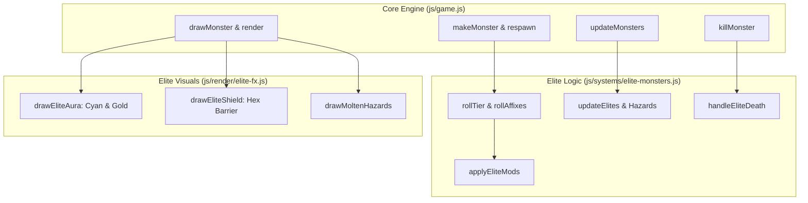

# Elite & Champion Monster Affix System Implementation Plan

> **For agentic workers:** REQUIRED SUB-SKILL: Use superpowers:subagent-driven-development to implement this plan task-by-task. Steps use checkbox (`- [ ]`) syntax for tracking.

**Goal:** Implement a procedural Elite & Champion monster affix system featuring 5 tactical affixes (Molten, Frost Nova, Vortex, Shielding, Avenger), glowing ground auras, bonus loot/gem rewards, and full unit test coverage with zero screen shake.

**Architecture:** Decompose into a modular state machine in [`js/systems/elite-monsters.js`](file:///Users/thanananasanthia/Desktop/personal/game-rpg/js/systems/elite-monsters.js) and visual rendering in [`js/render/elite-fx.js`](file:///Users/thanananasanthia/Desktop/personal/game-rpg/js/render/elite-fx.js), wired into monster lifecycle hooks in [`js/game.js`](file:///Users/thanananasanthia/Desktop/personal/game-rpg/js/game.js).

**Architecture Diagram:**



**Tech Stack:** Plain ES Modules (browser + Node test harness), Canvas 2D API, Zero build step.

**Spec:** [`docs/superpowers/specs/2026-10-06-elite-champion-monster-affixes-design.md`](file:///Users/thanananasanthia/Desktop/personal/game-rpg/docs/superpowers/specs/2026-10-06-elite-champion-monster-affixes-design.md)

## Global Constraints

- Preserve all 255 keys on `window.__AWO` without modification.
- Preserve `awo_save_v1` save key and format.
- Keep all balance tuning values in `js/design.js`.
- Strict zero screen shake (camera remains 100% steady).
- Do not touch legacy files (`index.legacy.html` and `src/*`).
- All test suites (`npm test`) must pass cleanly after each task.

---

### Task 1: Elite Monster System Logic (`js/systems/elite-monsters.js`)

**Files:**
- Create: `js/systems/elite-monsters.js`
- Create: `js/elite-monsters.test.js`

**Interfaces:**
- Produces: `createEliteSystem({ rnd, now, dist, TS })`
  - `rollTier(def)` -> `'champion' | 'elite' | null`
  - `rollAffixes(tier)` -> `string[]`
  - `applyEliteMods(monster, tier, affixes)`
  - `updateElites(monsters, player, dt, context)`
  - `handleEliteDeath(monster, monsters, player, context)`
  - `getHazards()`
  - `clearHazards()`

- [ ] **Step 1: Write the failing unit test for Elite System**

Create `js/elite-monsters.test.js`:
```js
import assert from 'node:assert/strict';
import { test } from 'node:test';
import { createEliteSystem } from './systems/elite-monsters.js';

test('elite-monsters: tier roll ignores bosses and roll rates work', () => {
  const eliteSys = createEliteSystem({ rnd: () => 0.05 });
  const bossDef = { id: 'ruin_golem', sizeTiles: 2 };
  const mobDef = { id: 'slime', sizeTiles: 1 };

  assert.equal(eliteSys.rollTier(bossDef), null, 'Bosses must not roll elite tier');
  assert.equal(eliteSys.rollTier(mobDef), 'champion', 'Low roll should produce champion');
});

test('elite-monsters: applyEliteMods scales HP and ATK correctly', () => {
  const eliteSys = createEliteSystem();
  const mob = {
    def: { id: 'boar', sizeTiles: 1 },
    hp: 100, maxHp: 100,
    atk: 20, atkBase: 20,
    lvl: 5,
  };

  eliteSys.applyEliteMods(mob, 'champion', ['molten']);
  assert.equal(mob.eliteTier, 'champion');
  assert.equal(mob.maxHp, 180);
  assert.equal(mob.hp, 180);
  assert.equal(mob.atk, 25);
  assert.deepEqual(mob.eliteAffixes, ['molten']);
});

test('elite-monsters: shielding reduces damage by 70%', () => {
  const eliteSys = createEliteSystem();
  const mob = {
    def: { id: 'wolf', sizeTiles: 1 },
    hp: 300, maxHp: 300,
    atk: 30, atkBase: 30,
    lvl: 5,
  };
  eliteSys.applyEliteMods(mob, 'champion', ['shielding']);
  mob.shieldActive = true;

  const rawDmg = 100;
  const mitigated = eliteSys.mitigateDamage(mob, rawDmg);
  assert.equal(mitigated, 30, 'Shielding should reduce incoming damage by 70%');
});

test('elite-monsters: avenger gains ATK and heals on nearby monster death', () => {
  const eliteSys = createEliteSystem({ dist: (x1, y1, x2, y2) => Math.hypot(x1 - x2, y1 - y2), TS: 32 });
  const avengerMob = {
    def: { id: 'cultist', sizeTiles: 1 },
    x: 100, y: 100,
    hp: 150, maxHp: 200,
    atk: 40, atkBase: 40,
    lvl: 10,
    alive: true,
  };
  eliteSys.applyEliteMods(avengerMob, 'champion', ['avenger']);

  const dyingMob = { x: 120, y: 100, alive: false };
  eliteSys.handleEliteDeath(dyingMob, [avengerMob], {}, { floatText: () => {} });

  assert.ok(avengerMob.hp > 150, 'Avenger should heal when nearby monster dies');
  assert.ok(avengerMob.atk > 40, 'Avenger should gain ATK when nearby monster dies');
});
```

- [ ] **Step 2: Run test to verify it fails**

Run: `node js/elite-monsters.test.js`  
Expected: FAIL with "Cannot find module './systems/elite-monsters.js'"

- [ ] **Step 3: Implement `js/systems/elite-monsters.js`**

Create `js/systems/elite-monsters.js` implementing:
- Tier roll rules (exempting `def.sizeTiles >= 2` and `def.rare`).
- Affix selection from pool `['molten', 'frost_nova', 'vortex', 'shielding', 'avenger']`.
- Active abilities: molten hazard trail generation, frost nova telegraphing, vortex player pull, shielding activation timer, avenger pack death handler.
- Death rewards: bonus XP, bonus Zeny, guaranteed/chance gem shard rolls (`ruby_shard`, `sapphire_shard`, `emerald_shard`).

- [ ] **Step 4: Run test to verify it passes**

Run: `node js/elite-monsters.test.js`  
Expected: PASS all test cases with exit code 0.

- [ ] **Step 5: Commit**

```bash
git add js/systems/elite-monsters.js js/elite-monsters.test.js
git commit -m "feat(combat): implement elite and champion monster mechanics subsystem"
```

---

### Task 2: Visual Aura & Barrier Rendering (`js/render/elite-fx.js`)

**Files:**
- Create: `js/render/elite-fx.js`
- Create: `js/elite-fx.test.js`

**Interfaces:**
- Produces:
  - `drawEliteAura(ctx, monster, screenX, screenY, size, now)`
  - `drawEliteShield(ctx, monster, screenX, screenY, size, now)`
  - `drawMoltenHazards(ctx, hazards, camX, camY, now)`

- [ ] **Step 1: Write unit tests for `js/render/elite-fx.js`**

Create `js/elite-fx.test.js` verifying aura draw methods execute without error on standard mock 2D contexts.

- [ ] **Step 2: Run test to verify it fails**

Run: `node js/elite-fx.test.js`  
Expected: FAIL with "Cannot find module './render/elite-fx.js'"

- [ ] **Step 3: Implement `js/render/elite-fx.js`**

Implement:
- Rotating dashed cyan circle for Champions (`#5bc0de`).
- Radiant golden halo with outward rays for Elites (`#ffcc00`).
- Hexagonal kinetic barrier over sprite when `m.shieldActive` is true.
- Flickering fire ember pools for molten hazard puddles.

- [ ] **Step 4: Run test to verify it passes**

Run: `node js/elite-fx.test.js`  
Expected: PASS with exit code 0.

- [ ] **Step 5: Commit**

```bash
git add js/render/elite-fx.js js/elite-fx.test.js
git commit -m "feat(render): add elite and champion aura, shield, and hazard renderers"
```

---

### Task 3: Core Engine Wiring & Loot Bonus Integration (`js/game.js`)

**Files:**
- Modify: `js/game.js`
- Test: `npm test`

- [ ] **Step 1: Import modules in `js/game.js`**

Import `createEliteSystem` and render functions.

- [ ] **Step 2: Instantiate `eliteSystem` in `js/game.js`**

Initialize `const eliteSystem = createEliteSystem(...)`.

- [ ] **Step 3: Wire into `makeMonster` & `respawn`**

In `makeMonster` and `respawn`: roll elite tier and apply affixes for eligible field monsters.

- [ ] **Step 4: Wire into `updateMonsters`**

Call `eliteSystem.updateElites(G.monsters, p, dt, context)`.

- [ ] **Step 5: Wire into `drawMonster` & `render`**

Render ground aura beneath monster sprite, shield barrier over sprite, molten puddles in ground pass, and badges on nameplates.

- [ ] **Step 6: Wire into `damageMonster` & `killMonster`**

- In `damageMonster`: apply `eliteSystem.mitigateDamage(m, dmg)` if `m.shieldActive`.
- In `killMonster`: call `eliteSystem.handleEliteDeath(...)`, award bonus XP/Zeny, roll bonus gems, trigger Avenger procs.

- [ ] **Step 7: Run full test suite**

Run: `npm test`  
Expected: All suites pass with exit code 0.

- [ ] **Step 8: Commit**

```bash
git add js/game.js
git commit -m "feat(engine): wire elite monster system, auras, and reward bonuses"
```

---

### Task 4: Characterization, Visual Inspection & Acceptance

**Files:**
- Modify: `CLAUDE.md`
- Test: `node js/engine-surface.test.js`
- Test: `autotest.html` in headless Brave

- [ ] **Step 1: Verify `js/engine-surface.test.js`**

Run: `node js/engine-surface.test.js`  
Expected: All 255 keys on `window.__AWO` match.

- [ ] **Step 2: Headless Brave visual inspection**

Run `autotest.html` with headless Brave, inspect `/tmp/elite_autotest.png` to confirm clean rendering and absence of `#err` banners.

- [ ] **Step 3: Update `CLAUDE.md`**

Document `js/systems/elite-monsters.js` and `js/render/elite-fx.js`.

- [ ] **Step 4: Final commit**

```bash
git add CLAUDE.md autotest.html
git commit -m "docs: document elite monster affix subsystem in CLAUDE.md"
```
