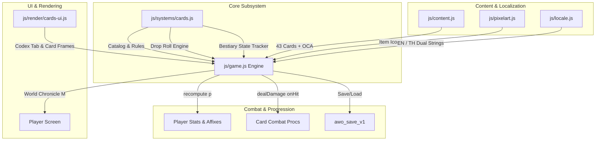

# Monster Cards & Bestiary Codex Implementation Plan

> **For agentic workers:** REQUIRED SUB-SKILL: Use superpowers:subagent-driven-development to implement this plan task-by-task. Steps use checkbox (`- [ ]`) syntax for tracking.

**Goal:** Implement the classic Ragnarok Online-inspired Monster Cards & Bestiary Codex system, featuring 43 unique monster cards socketable into equipment, drop roll mechanics, Old Card Albums, interactive Bestiary Codex UI in World Chronicle (`M`), and zone collection milestones.

**Architecture:** A standalone subsystem in `js/systems/cards.js` manages the 43-card catalog, drop rates, card socketing validation, and bestiary mastery progression. A modular canvas/DOM renderer in `js/render/cards-ui.js` powers the interactive Bestiary Codex tab and card inspection modals with strict zero screen shake. `js/game.js` integrates monster kill and loot hooks, aggregates card stat mods in `recompute(p)`, triggers on-hit combat procs, and serializes state into `awo_save_v1`.

**Architecture Diagram:**

**Tech Stack:** Plain ES modules (ES2022+), Web Audio API, HTML5 Canvas 2D, Node.js test runner (`script/run-tests.mjs`).

**Spec:** [`docs/superpowers/specs/2026-10-06-monster-cards-and-bestiary-codex-design.md`](file:///Users/thanananasanthia/Desktop/personal/game-rpg/docs/superpowers/specs/2026-10-06-monster-cards-and-bestiary-codex-design.md)

## Global Constraints

- **Strict ZERO Screen Shake**: Zero camera displacement (`cam.x`, `cam.y` remain steady at all times). No camera shake on card drop toasts, album openings, or combat procs.
- **Engine Surface Invariant**: Strictly preserve all 255 keys on `window.__AWO` without removing or renaming existing exports.
- **Save Compatibility**: Store bestiary kill tallies, drops, collected cards, and slotted cards safely in `awo_save_v1` under `p.bestiary` and item `sockets`.
- **Dual Bilingual Localization**: Complete English and Thai translations for all cards, descriptions, affixes, and codex UI.
- **Zero-Build Plain ES Modules**: Browser and Node.js test runner compatibility.
- **Remote Git Safety**: Do NOT push commits to remote (`git push`) without explicit user permission.

---

## Tasks

### Task 1: Card Subsystem Core & Unit Tests

**Files:**
- Create: `js/systems/cards.js`
- Test: `js/cards.test.js`

**Interfaces:**
- Produces:
  - `CARD_CATALOG`: Map of all 43 card definitions (`id`, `monsterId`, `name`, `rarity`, `targetSlot`, `statMods`, `onHit`, `flavor`, `collectionBonus`).
  - `ZONE_ALBUM_MILESTONES`: Map of zone milestones (Woods, Ruins, Tundra, Caldera, Rift, Grandmaster).
  - `createCardsSystem({ now, rnd })`:
    - `getCardDef(cardId)` -> Object | null
    - `getCardForMonster(monsterId)` -> Object | null
    - `rollCardDrop(monsterDef, { isElite, isBoss, luck })` -> String (cardId) | null
    - `rollOldCardAlbum()` -> String (cardId)
    - `canSocketCard(itemInst, cardId, slotIndex)` -> `{ canSocket: boolean, reason?: string }`
    - `socketCard(itemInst, cardId, slotIndex)` -> `{ success: boolean, reason?: string }`
    - `unsocketCard(itemInst, slotIndex, { cost, zeny, deductZeny })` -> `{ success: boolean, cardId?: string }`
    - `recordBestiaryKill(bestiaryState, monsterId)` -> `{ firstKill: boolean, masteryLevel: number }`
    - `recordBestiaryDrop(bestiaryState, monsterId, itemId)` -> `{ firstDrop: boolean }`
    - `recordCardAcquired(bestiaryState, cardId)` -> `{ firstCard: boolean }`
    - `calculateCollectionBonuses(bestiaryState)` -> Object (stat bonuses)
    - `serialize(bestiaryState)` -> Object
    - `deserialize(data)` -> Object

- [ ] **Step 1: Write the failing unit tests (`js/cards.test.js`)**
  - Verify `CARD_CATALOG` contains all 43 monster cards.
  - Verify drop rate calculations for normal (1%), elite (3.5%), and boss (10%) with LUK scaling.
  - Verify Old Card Album roll produces valid card IDs with rarity distribution.
  - Verify card socketing constraints (weapon card only into weapon, armor card into armor).
  - Verify bestiary kill tracking and mastery star calculation (10, 50, 200 kills).
  - Verify bestiary drop tracking.
  - Verify zone collection milestone bonus computation.
  - Verify serialization and deserialization.
- [ ] **Step 2: Run test to confirm failure**
  - `node js/cards.test.js` (must fail: module not found).
- [ ] **Step 3: Implement `js/systems/cards.js`**
  - Implement full `CARD_CATALOG` with 43 cards.
  - Implement `createCardsSystem` factory and methods.
- [ ] **Step 4: Run test to confirm pass**
  - `node js/cards.test.js` (must pass with exit code 0).
- [ ] **Step 5: Commit**
  - `git add js/systems/cards.js js/cards.test.js && git commit -m "feat(cards): implement monster cards subsystem core and unit tests"`

---

### Task 2: Content Registration, Crafting Recipe, Icon Mappings & Dual Bilingual Localization

**Files:**
- Modify: `js/content.js`
- Modify: `js/pixelart.js`
- Modify: `js/locale.js`

**Interfaces:**
- Consumes: Card IDs from `CARD_CATALOG` in `js/systems/cards.js`.
- Produces:
  - 43 `card_<monsterId>` items in `CONTENT.items` with `type: 'card'`, `rarity`, `desc`, `price`.
  - `old_card_album` consumable item in `CONTENT.items` with `type: 'consumable'`.
  - `r_old_card_album` recipe in `CONTENT.recipes`.
  - Icon mapping in `ITEM_ICON` for all cards and OCA.
  - Full EN/TH translations in `js/locale.js`.

- [ ] **Step 1: Update `js/content.js`**
  - Register 43 card items: `card_slime`, `card_goblin`, ..., `card_nullking`.
  - Register `old_card_album` consumable item.
  - Add `r_old_card_album` recipe to `CONTENT.recipes` requiring `caldera_crystal`, `essence_night`, `blessed_ore`, `golem_core`.
- [ ] **Step 2: Update `js/pixelart.js`**
  - Map `old_card_album` and all 43 `card_*` items in `ITEM_ICON` to valid `PX.item` sprite keys (e.g. `scroll`, `book`, `gem_diamond`).
- [ ] **Step 3: Update `js/locale.js`**
  - Add English and Thai translations for all cards, descriptions, affixes, OCA, and Bestiary UI strings.
- [ ] **Step 4: Verify Content Integrity & Locale Tests**
  - `node js/locale.test.js` (must pass with exit code 0).
  - Verify `node -e "import('./js/selfcheck.js').then(s => s.selfCheck())"` passes.
- [ ] **Step 5: Commit**
  - `git add js/content.js js/pixelart.js js/locale.js && git commit -m "feat(cards): register card items, oca recipe, icon mappings, and dual localization"`

---

### Task 3: Bestiary Codex UI Renderer & Visual Unit Tests

**Files:**
- Create: `js/render/cards-ui.js`
- Test: `js/cards-ui.test.js`

**Interfaces:**
- Produces:
  - `createCardsUIRenderer({ T })`:
    - `renderBestiaryTab(containerEl, bestiaryState, { selectedZone, selectedMonsterId, onSelectMonster })`
    - `renderCardFrameHtml(cardDef, { isCollected = true })`
    - `renderCardInspectionModal(cardDef, itemInst, { onSocket, onClose })`
    - `drawAlbumOpeningFanfare(ctx, viewW, viewH, progress)` (Strict ZERO screen shake canvas particles)

- [ ] **Step 1: Write the failing unit tests (`js/cards-ui.test.js`)**
  - Test `renderCardFrameHtml` generates valid HTML structure with rarity styling.
  - Test `renderBestiaryTab` creates zone navigation buttons, monster list, and details pane.
  - Test `drawAlbumOpeningFanfare` renders golden sparkle particles without modifying camera coordinates.
  - Test strict ZERO screen shake: assert camera `x` and `y` before and after render calls are strictly identical.
- [ ] **Step 2: Run test to confirm failure**
  - `node js/cards-ui.test.js` (must fail).
- [ ] **Step 3: Implement `js/render/cards-ui.js`**
  - Build HTML generator functions and canvas particle fanfare.
- [ ] **Step 4: Run test to confirm pass**
  - `node js/cards-ui.test.js` (must pass with exit code 0).
- [ ] **Step 5: Commit**
  - `git add js/render/cards-ui.js js/cards-ui.test.js && git commit -m "feat(cards): implement bestiary codex ui renderer and visual tests"`

---

### Task 4: Game Engine Integration, On-Hit Combat Procs, recompute(p) & Save State

**Files:**
- Modify: `js/game.js`
- Modify: `js/engine-surface.test.js`

**Interfaces:**
- Consumes: `createCardsSystem` from `js/systems/cards.js`, `createCardsUIRenderer` from `js/render/cards-ui.js`.
- Produces:
  - `G.bestiary`: Live bestiary state on game state.
  - Monster kill hook in `killMonster(m)`: records kill, updates mastery, rolls card drop into `dropLoot`.
  - Item drop hook in `dropLoot(m)`: records dropped items in `G.bestiary`.
  - Consumable handler for `old_card_album`: opens album, rolls card, awards to player with fanfare.
  - `recompute(p)` integration: iterates equipped item `sockets`, looks up card definitions, applies `statMods` and active `calculateCollectionBonuses(G.bestiary)`.
  - Combat on-hit hook in `dealDamage`: checks slotted weapon/armor cards for procs (e.g. Entangle, Frost Nova, Meteor, Void Tear).
  - Bestiary Codex Tab added to World Chronicle panel (`M`).
  - Save/Load serialization in `saveGame` / `resumeGame` under `awo_save_v1`.
  - Admin commands: `givecard:<id>`, `givecardalbum`.
  - Preservation of all 255 keys on `window.__AWO`.

- [x] **Step 1: Wire `cardsSystem` and `cardsUI` into `js/game.js`**
  - Initialize `G.bestiary = cardsSystem.deserialize(savedData?.bestiary)`.
  - Wire `recompute(p)` card bonuses and collection milestones.
  - Wire monster kill and loot drop bestiary hooks.
  - Wire `old_card_album` opening action in `useItem`.
  - Wire on-hit card procs in `dealDamage` / `attack` without screen shake.
  - Wire Bestiary Tab in World Chronicle modal (`M`).
  - Update `saveGame` and `resumeGame` to persist `G.bestiary`.
  - Expose debug methods on `window.__AWO` if needed while preserving existing 255 keys.
- [x] **Step 2: Run engine surface test and update fingerprints if needed**
  - `node js/engine-surface.test.js` (must pass and verify all 255 keys on `window.__AWO`).
- [x] **Step 3: Run existing unit tests**
  - `npm test` (verify no regressions).
- [x] **Step 4: Commit**
  - `git add js/game.js js/engine-surface.test.js && git commit -m "feat(cards): wire monster card drops, codex ui, stat buffs, and combat procs into engine"`

---

### Task 5: End-to-End Integration Suite & Documentation

**Files:**
- Create: `js/cards-integration.test.js`
- Modify: `CLAUDE.md`

**Interfaces:**
- Exercises the complete card lifecycle via `window.__AWO`:
  - 43 card definitions and OCA item in `CONTENT.items`.
  - Monster kills record bestiary kills and mastery stars.
  - Card drops roll and deposit cards into player inventory.
  - Equipment socketing: socket card into weapon/armor, verify `recompute(p)` updates player stats.
  - Old Card Album consumption: opening OCA awards a random card.
  - On-hit combat procs: attack trigger executes card proc without camera shake.
  - Zone collection milestones award permanent bonuses when zone album is completed.
  - Strict ZERO screen shake verification (`G.cam.x` and `G.cam.y` remain steady).
  - Save/Resume persistence: `saveGame` -> `resumeGame` preserves bestiary progress and socketed cards.

- [x] **Step 1: Implement `js/cards-integration.test.js`**
  - Use `installBrowserEnv` fixture.
  - Write comprehensive end-to-end integration assertions.
- [x] **Step 2: Run integration test**
  - `node js/cards-integration.test.js` (must pass with exit code 0).
- [x] **Step 3: Update `CLAUDE.md`**
  - Document `js/systems/cards.js` and `js/render/cards-ui.js` in the active game architecture section.
- [x] **Step 4: Run full test suite**
  - `npm test` (all suites must pass).
- [x] **Step 5: Commit**
  - `git add js/cards-integration.test.js CLAUDE.md && git commit -m "test(cards): add comprehensive integration test suite and document architecture"`

---

## Verification Plan

### Automated Tests
1. **Unit Tests**:
   - `node js/cards.test.js` (Catalog completeness, drop rate formulas, socketing logic, bestiary progress).
   - `node js/cards-ui.test.js` (HTML generation, canvas particles, strict zero camera shake).
2. **Integration Tests**:
   - `node js/cards-integration.test.js` (End-to-end card drops, equipment socketing, OCA opening, stat bonuses, save/load).
   - `node js/engine-surface.test.js` (Strict preservation of all 255 keys on `window.__AWO`).
3. **Full Suite**:
   - `npm test` (all suites must pass with exit code 0).
