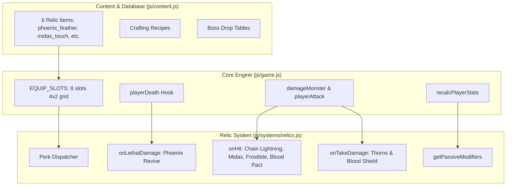

# Relic & Artifact Equipment System Implementation Plan

> **For agentic workers:** REQUIRED SUB-SKILL: Use superpowers:subagent-driven-development to implement this plan task-by-task. Steps use checkbox (`- [ ]`) syntax for tracking.

**Goal:** Implement a dedicated 8th equipment slot (`relic`) featuring 6 legendary artifacts with unique combat perks (Phoenix Feather lethal revive, Hand of Midas gold bursts, Storm Conduit chain lightning, Bramble Carapace thorns, Frostbite slow, and Chalice of the Undying blood shield), full unit test coverage, and zero screen shake.

**Architecture:** Decompose into a modular state machine in [`js/systems/relics.js`](file:///Users/thanananasanthia/Desktop/personal/game-rpg/js/systems/relics.js) wired into combat lifecycle hooks in [`js/game.js`](file:///Users/thanananasanthia/Desktop/personal/game-rpg/js/game.js), with item definitions and recipes in [`js/content.js`](file:///Users/thanananasanthia/Desktop/personal/game-rpg/js/content.js) and 4×2 symmetrical paper-doll UI layout.

**Architecture Diagram:**



**Tech Stack:** Plain ES Modules (browser + Node test harness), Canvas 2D API, Zero build step.

**Spec:** [`docs/superpowers/specs/2026-10-06-relic-artifact-system-design.md`](file:///Users/thanananasanthia/Desktop/personal/game-rpg/docs/superpowers/specs/2026-10-06-relic-artifact-system-design.md)

## Global Constraints

- Preserve all 255 keys on `window.__AWO` without modification.
- Preserve `awo_save_v1` save key and format (`sp.equip.relic || null`).
- Keep all balance tuning values in `js/design.js` / `js/content.js`.
- Strict zero screen shake (camera remains 100% steady at all times).
- Do not touch legacy files (`index.legacy.html` and `src/*`).
- All test suites (`npm test`) must pass cleanly after each task.

---

### Task 1: Relic Content & Subsystem Logic (`js/systems/relics.js`, `js/content.js`, `js/relics.test.js`)

**Files:**
- Create: `js/systems/relics.js`
- Create: `js/relics.test.js`
- Modify: `js/content.js`

**Interfaces:**
- Produces: `createRelicSystem({ now, dist, TS })`
  - `getEquippedRelic(player)` -> `ItemInstance | null`
  - `getPassiveModifiers(player)` -> `{ hpPct: number, defPct: number, lifesteal: number }`
  - `onHit(player, target, damage, isCrit, context)` -> `{ chainTargets: Monster[], bonusZeny: number }`
  - `onTakeDamage(player, attacker, damage, context)` -> `{ absorbed: number, reflectedDamage: number }`
  - `onLethalDamage(player, rawDamage, context)` -> `boolean` (true if death prevented)
  - `onKill(player, monster, context)` -> `{ zenyMult: number }`

- [ ] **Step 1: Write failing unit tests for Relic System**

Create `js/relics.test.js` testing:
1. `getPassiveModifiers` extracts stats from equipped Bramble Carapace (+12% Max HP) and Chalice of the Undying (+6% lifesteal).
2. `onLethalDamage` negates death with Phoenix Feather, restores 40% HP, enters 180s cooldown, and prevents second revive during cooldown.
3. `onTakeDamage` reflects 35% damage back to attacker when wearing Bramble Carapace.
4. `onHit` grants bonus Zeny on critical hit with Hand of Midas.
5. `onHit` procs chain lightning to nearby monsters with Storm Conduit.
6. `onKill` applies 1.30× Zeny multiplier with Hand of Midas.

- [ ] **Step 2: Run test to verify it fails**

Run: `node js/relics.test.js`  
Expected: FAIL with "Cannot find module './systems/relics.js'"

- [ ] **Step 3: Add relic items, recipes, and drop tables to `js/content.js`**

Add:
- 6 relic item entries (`phoenix_feather`, `midas_touch`, `storm_conduit`, `thornmail_carapace`, `frostbite_pendant`, `vampiric_grail`).
- 3 crafting recipes (`phoenix_feather`, `storm_conduit`, `thornmail_carapace`).
- Drop chances on `flame_dragon`, `nullking`, `zenith_warden`, and `ruin_golem`.

- [ ] **Step 4: Implement `js/systems/relics.js`**

Implement `createRelicSystem` with all perk logic, cooldown management, and float text cues.

- [ ] **Step 5: Run test to verify it passes**

Run: `node js/relics.test.js`  
Expected: PASS all test cases with exit code 0.

- [ ] **Step 6: Commit**

```bash
git add js/systems/relics.js js/content.js js/relics.test.js
git commit -m "feat(relics): implement relic subsystem and legendary artifact items"
```

---

### Task 2: Equipment Paper-Doll & UI Support (`js/game.js`, `js/pixelart.js`, `js/equipment-features.js`)

**Files:**
- Modify: `js/game.js`
- Modify: `js/pixelart.js` (if new icons or icon mappings needed)
- Modify: `js/equipment.test.js`

**Interfaces:**
- `EQUIP_SLOTS` includes `'relic'`.
- `SLOT_LABEL.relic = 'Relic'`.
- `SLOT_ICON.relic = 'core'`.
- `itemSlot(it)` maps `it.type === 'relic'` to `'relic'`.
- `ITEM_ICON` contains entries for all 6 relics.

- [ ] **Step 1: Write unit tests for Relic slot equipping**

In `js/equipment.test.js` or a new test, assert that a relic item can be equipped into the `'relic'` slot, swapped, unequipped, and serialized.

- [ ] **Step 2: Update `EQUIP_SLOTS` and `itemSlot` in `js/game.js`**

- Update `EQUIP_SLOTS = ['weapon', 'head', 'body', 'hands', 'cloak', 'feet', 'accessory', 'relic']`.
- Update `SLOT_LABEL` and `SLOT_ICON`.
- Update `itemSlot(it)`.
- Update `ITEM_ICON` mappings for all 6 relics.
- Update `makePlayer` initial `equip` state to include `relic: null`.
- Update save deserialization to default `relic: null` for legacy saves.

- [ ] **Step 3: Run equipment tests**

Run: `node js/equipment.test.js`  
Expected: PASS with exit code 0.

- [ ] **Step 4: Commit**

```bash
git add js/game.js js/equipment.test.js
git commit -m "feat(ui): add relic slot to paper-doll equipment and item slot resolution"
```

---

### Task 3: Core Combat Hooks & Engine Wiring (`js/game.js`)

**Files:**
- Modify: `js/game.js`
- Test: `npm test`

- [ ] **Step 1: Import and instantiate `createRelicSystem` in `js/game.js`**

Initialize `relicSystem = createRelicSystem({ now, dist, TS })`.

- [ ] **Step 2: Wire `recalcPlayerStats`**

Incorporate passive modifiers from `relicSystem.getPassiveModifiers(p)` into `p.maxHp`, `p.armorDef`, and `p.lifesteal`.

- [ ] **Step 3: Wire `onHit` into `damageMonster` and attacks**

Call `relicSystem.onHit(p, m, dmg, isCrit, context)` to trigger Chain Lightning, Hand of Midas Zeny, Frostbite slow, and Blood Pact healing.

- [ ] **Step 4: Wire `onTakeDamage` into incoming damage**

Call `relicSystem.onTakeDamage(p, attacker, dmg, context)` to process Bramble Carapace thorns reflection and Blood Shield absorption.

- [ ] **Step 5: Wire `onLethalDamage` into `playerDeath`**

In `playerDeath()`, check `if (relicSystem.onLethalDamage(p, dmg, context)) return;` before dying.

- [ ] **Step 6: Wire `onKill` into `killMonster`**

Factor in `relicSystem.onKill(p, m, context).zenyMult` on monster death.

- [ ] **Step 7: Run full test suite**

Run: `npm test`  
Expected: All 39 test suites pass with exit code 0.

- [ ] **Step 8: Commit**

```bash
git add js/game.js
git commit -m "feat(combat): wire relic combat triggers, lethal revive, and thorns reflection"
```

---

### Task 4: Verification, Visual Smoke Inspection & Merging

**Files:**
- Modify: `CLAUDE.md`
- Test: `node js/engine-surface.test.js`
- Test: `autotest.html` in headless Brave

- [ ] **Step 1: Verify `js/engine-surface.test.js`**

Run: `node js/engine-surface.test.js`  
Expected: All 255 keys on `window.__AWO` match without change.

- [ ] **Step 2: Visual inspection with headless Brave**

Run `autotest.html?panel=char&gear=1` in headless Brave, inspect screenshot to verify symmetrical 4×2 paper-doll layout with Relic slot, and absence of `#err` banners.

- [ ] **Step 3: Update `CLAUDE.md`**

Document `js/systems/relics.js` and the new `relic` equipment slot.

- [ ] **Step 4: Commit**

```bash
git add CLAUDE.md autotest.html
git commit -m "docs: document relic and artifact equipment subsystem"
```

- [ ] **Step 5: Fast-forward merge `feat/relic-equipment-system` to `main` and verify**

Merge to `main`, run `npm test`, verify zero regressions.
