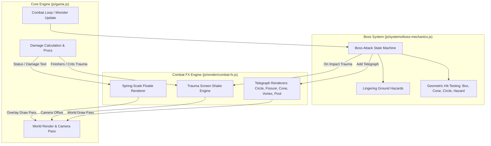

# Tactical Boss Mechanics & Combat Juice Implementation Plan

> **For agentic workers:** REQUIRED SUB-SKILL: Use superpowers:subagent-driven-development to implement this plan task-by-task. Steps use checkbox (`- [ ]`) syntax for tracking.

**Goal:** Implement unique geometric boss telegraph patterns (lines, cones, vortexes, pools) for all 5 zone guardians and roaming bosses, add trauma-based screen shake on heavy impacts and Tier-3 finishers, and enhance floating combat text with spring-scaled arcade status/elemental tags.

**Architecture:** Decompose into two modular subsystems: [`js/render/combat-fx.js`](file:///Users/thanananasanthia/Desktop/personal/game-rpg/js/render/combat-fx.js) for screen shake, telegraph rendering, and spring-scaled combat floaties; and [`js/systems/boss-mechanics.js`](file:///Users/thanananasanthia/Desktop/personal/game-rpg/js/systems/boss-mechanics.js) for boss attack patterns, hazard tracking, and geometric hit testing. Integrate both into [`js/game.js`](file:///Users/thanananasanthia/Desktop/personal/game-rpg/js/game.js) while preserving all 255 keys on `window.__AWO` and full `prefers-reduced-motion` accessibility.

**Architecture Diagram:**



**Tech Stack:** Plain ES Modules (browser + Node test harness), Canvas 2D API, Web Audio API, Zero build step.

**Spec:** [`docs/superpowers/specs/2026-10-06-tactical-boss-mechanics-and-combat-juice-design.md`](file:///Users/thanananasanthia/Desktop/personal/game-rpg/docs/superpowers/specs/2026-10-06-tactical-boss-mechanics-and-combat-juice-design.md)

## Global Constraints

- Preserve all 255 keys on `window.__AWO` without any modification.
- Preserve `awo_save_v1` save key and format.
- Keep all balance tuning values in `js/design.js`.
- Comply strictly with `prefers-reduced-motion: reduce` (zero screen shake displacement, linear floatie animation).
- Do not touch legacy files (`index.legacy.html` and `src/*`).
- All test suites (`npm test`) must pass cleanly after each task.

---

### Task 1: Combat FX Engine (`js/render/combat-fx.js`)

**Files:**
- Create: `js/render/combat-fx.js`
- Create: `js/combat-fx.test.js`

**Interfaces:**
- Produces: `createCombatFx({ getCtx, prefersReducedMotion, now })`
  - `addScreenShake(trauma)`
  - `getScreenShakeOffset()` -> `{ x, y, angle }`
  - `addTelegraph(telegraph)`
  - `update(dt)`
  - `drawTelegraphs(camX, camY)`
  - `addFloatText(worldX, worldY, text, kind, tag)`
  - `drawFloaties(camX, camY)`

- [ ] **Step 1: Write the failing unit test for Combat FX**

Create `js/combat-fx.test.js`:
```js
import assert from 'node:assert/strict';
import { test } from 'node:test';
import { createCombatFx } from './render/combat-fx.js';

test('combat-fx: screen shake trauma accumulation and decay', () => {
  let currentTime = 1000;
  const fx = createCombatFx({
    getCtx: () => null,
    prefersReducedMotion: () => false,
    now: () => currentTime,
  });

  fx.addScreenShake(0.5);
  let offset = fx.getScreenShakeOffset();
  assert.ok(offset.x !== 0 || offset.y !== 0, 'Offset should be non-zero when trauma > 0');

  // Advance time by 1 second (decay rate 1.8/s should clear 0.5 trauma)
  currentTime += 1000;
  fx.update(1.0);
  offset = fx.getScreenShakeOffset();
  assert.equal(offset.x, 0, 'Offset should decay to 0');
  assert.equal(offset.y, 0, 'Offset should decay to 0');
});

test('combat-fx: reduced motion suppresses screen shake', () => {
  const fx = createCombatFx({
    getCtx: () => null,
    prefersReducedMotion: () => true,
    now: () => 1000,
  });

  fx.addScreenShake(1.0);
  const offset = fx.getScreenShakeOffset();
  assert.equal(offset.x, 0);
  assert.equal(offset.y, 0);
});

test('combat-fx: telegraph registration and expiration', () => {
  let currentTime = 2000;
  const fx = createCombatFx({
    getCtx: () => null,
    prefersReducedMotion: () => false,
    now: () => currentTime,
  });

  fx.addTelegraph({
    id: 'test_telegraph',
    kind: 'circle',
    x: 100,
    y: 100,
    radius: 32,
    durationMs: 500,
  });

  assert.equal(fx.getTelegraphs().length, 1);
  currentTime += 600;
  fx.update(0.6);
  assert.equal(fx.getTelegraphs().length, 0, 'Expired telegraph should be removed');
});

test('combat-fx: floatie tags formatting', () => {
  let currentTime = 3000;
  const fx = createCombatFx({
    getCtx: () => null,
    prefersReducedMotion: () => false,
    now: () => currentTime,
  });

  fx.addFloatText(50, 50, '150', 'crit', 'CRIT!');
  const list = fx.getFloaties();
  assert.equal(list.length, 1);
  assert.equal(list[0].tag, 'CRIT!');
  assert.equal(list[0].text, '150');
});
```

- [ ] **Step 2: Run test to verify it fails**

Run: `node js/combat-fx.test.js`  
Expected: FAIL with "Cannot find module './render/combat-fx.js'"

- [ ] **Step 3: Implement `js/render/combat-fx.js`**

Create `js/render/combat-fx.js`:
```js
// js/render/combat-fx.js - Screen shake, geometric boss telegraphs, and arcade floaties.

const FLOAT_CAP = 80;
const FLOAT_LIFE_MS = 850;
const FLOAT_RISE_PX = 24;
const FLOAT_FONT_STACK = 'ui-monospace,"SFMono-Regular",Menlo,Monaco,Consolas,"Liberation Mono","Courier New",monospace';

export function createCombatFx({
  getCtx,
  prefersReducedMotion = () => false,
  now = () => performance.now(),
}) {
  let trauma = 0;
  let telegraphs = [];
  let floaties = [];

  const maxOffsetX = 12;
  const maxOffsetY = 12;
  const maxAngle = 0.03;

  function addScreenShake(amount) {
    if (prefersReducedMotion()) return;
    trauma = Math.min(1.0, trauma + amount);
  }

  function getScreenShakeOffset() {
    if (prefersReducedMotion() || trauma <= 0) return { x: 0, y: 0, angle: 0 };
    const shake = trauma * trauma;
    const t = now();
    return {
      x: Math.round(maxOffsetX * shake * Math.sin(t * 0.045)),
      y: Math.round(maxOffsetY * shake * Math.cos(t * 0.052)),
      angle: maxAngle * shake * Math.sin(t * 0.038),
    };
  }

  function addTelegraph(tg) {
    const t = now();
    telegraphs.push({
      ...tg,
      born: t,
      expiresAt: t + (tg.durationMs || 1000),
    });
  }

  function getTelegraphs() {
    return telegraphs;
  }

  function clearTelegraphs(ownerId) {
    if (ownerId) {
      telegraphs = telegraphs.filter(t => t.ownerId !== ownerId);
    } else {
      telegraphs = [];
    }
  }

  function update(dt) {
    // Decay trauma linearly by 1.8 per second
    if (trauma > 0) {
      trauma = Math.max(0, trauma - dt * 1.8);
    }

    const t = now();
    telegraphs = telegraphs.filter(tg => t < tg.expiresAt);
    floaties = floaties.filter(f => (t - f.born) < FLOAT_LIFE_MS);
  }

  function drawTelegraphs(camX, camY) {
    const ctx = getCtx();
    if (!ctx || !telegraphs.length) return;
    const t = now();

    for (const tg of telegraphs) {
      const progress = Math.min(1, Math.max(0, (t - tg.born) / (tg.durationMs || 1000)));
      const alphaPulse = 0.35 + 0.25 * Math.sin(t * 0.015);
      const color = tg.color || '#ff4433';

      ctx.save();
      if (tg.kind === 'circle') {
        const x = tg.x - camX, y = tg.y - camY;
        const r = tg.radius || 48;
        // Inner fill
        ctx.beginPath();
        ctx.arc(x, y, r, 0, Math.PI * 2);
        ctx.fillStyle = color;
        ctx.globalAlpha = 0.18;
        ctx.fill();
        // Expanding charge indicator
        ctx.beginPath();
        ctx.arc(x, y, r * progress, 0, Math.PI * 2);
        ctx.fillStyle = color;
        ctx.globalAlpha = 0.35;
        ctx.fill();
        // Warning outline
        ctx.beginPath();
        ctx.arc(x, y, r, 0, Math.PI * 2);
        ctx.lineWidth = 2.5;
        ctx.strokeStyle = color;
        ctx.globalAlpha = alphaPulse;
        ctx.stroke();
      } else if (tg.kind === 'line') {
        const x1 = tg.x - camX, y1 = tg.y - camY;
        const angle = tg.angle || 0;
        const length = tg.length || 192;
        const width = tg.width || 48;

        ctx.translate(x1, y1);
        ctx.rotate(angle);
        // Box fill
        ctx.fillStyle = color;
        ctx.globalAlpha = 0.20;
        ctx.fillRect(0, -width / 2, length, width);
        // Charge fill
        ctx.globalAlpha = 0.38;
        ctx.fillRect(0, -width / 2, length * progress, width);
        // Border outline
        ctx.strokeStyle = color;
        ctx.lineWidth = 2;
        ctx.globalAlpha = alphaPulse;
        ctx.strokeRect(0, -width / 2, length, width);
      } else if (tg.kind === 'cone') {
        const x = tg.x - camX, y = tg.y - camY;
        const angle = tg.angle || 0;
        const radius = tg.radius || 160;
        const fov = tg.fov || (Math.PI / 3);

        ctx.beginPath();
        ctx.moveTo(x, y);
        ctx.arc(x, y, radius, angle - fov / 2, angle + fov / 2);
        ctx.closePath();
        ctx.fillStyle = color;
        ctx.globalAlpha = 0.20;
        ctx.fill();

        ctx.lineWidth = 2;
        ctx.strokeStyle = color;
        ctx.globalAlpha = alphaPulse;
        ctx.stroke();
      } else if (tg.kind === 'vortex') {
        const x = tg.x - camX, y = tg.y - camY;
        const r = tg.radius || 100;
        ctx.beginPath();
        ctx.arc(x, y, r, 0, Math.PI * 2);
        ctx.fillStyle = '#7a4fd0';
        ctx.globalAlpha = 0.15;
        ctx.fill();

        // Inward swirling spirals
        ctx.strokeStyle = '#c99aef';
        ctx.lineWidth = 2;
        ctx.globalAlpha = 0.6;
        for (let a = 0; a < 3; a++) {
          const spin = t * 0.008 + (a * (Math.PI * 2 / 3));
          ctx.beginPath();
          ctx.arc(x, y, r * (1 - progress * 0.4), spin, spin + 1.2);
          ctx.stroke();
        }
      }
      ctx.restore();
    }
  }

  function addFloatText(worldX, worldY, text, kind = 'dmg', tag = '') {
    floaties.push({
      x: worldX,
      y: worldY,
      text: String(text),
      kind,
      tag,
      born: now(),
    });
    if (floaties.length > FLOAT_CAP) floaties.shift();
  }

  function getFloaties() {
    return floaties;
  }

  function floatColor(kind) {
    if (kind === 'enemy') return '#ff6b6b';
    if (kind === 'crit') return '#ffcc00';
    if (kind === 'dmg') return '#ffffff';
    if (kind === 'heal') return '#72db85';
    if (kind === 'weakness') return '#5bc0de';
    if (kind === 'resist') return '#aaaaaa';
    if (kind === 'detonate') return '#ff8800';
    if (kind === 'miss') return '#bbb';
    if (kind === 'status') return '#e0a0ff';
    return '#fff';
  }

  function drawFloaties(camX, camY) {
    const ctx = getCtx();
    if (!ctx || !floaties.length) return;
    const t = now();
    const reduced = prefersReducedMotion();

    for (const f of floaties) {
      const elapsed = (t - f.born) / FLOAT_LIFE_MS;
      if (elapsed >= 1) continue;

      // Spring-scale pop curve: rapid scale to 1.35x, settles to 1.0x
      let scale = 1.0;
      if (!reduced) {
        if (elapsed < 0.15) {
          scale = 0.7 + (elapsed / 0.15) * 0.65;
        } else if (elapsed < 0.3) {
          scale = 1.35 - ((elapsed - 0.15) / 0.15) * 0.35;
        }
      }

      const rise = reduced ? 0 : elapsed * FLOAT_RISE_PX;
      const x = f.x - camX;
      const y = f.y - camY - 20 - rise;
      const alpha = elapsed < 0.6 ? 1 : Math.max(0, 1 - (elapsed - 0.6) / 0.4);

      const isSpecial = f.kind === 'crit' || f.kind === 'weakness' || f.kind === 'detonate';
      const displayText = f.tag ? `${f.tag} ${f.text}` : f.text;

      ctx.save();
      ctx.globalAlpha = alpha;
      ctx.translate(x, y);
      ctx.scale(scale, scale);
      ctx.font = `800 ${isSpecial ? 20 : 16}px ${FLOAT_FONT_STACK}`;
      ctx.textAlign = 'center';
      ctx.lineWidth = 3;
      ctx.strokeStyle = 'rgba(0,0,0,.85)';
      ctx.strokeText(displayText, 0, 0);
      ctx.fillStyle = floatColor(f.kind);
      ctx.fillText(displayText, 0, 0);
      ctx.restore();
    }
  }

  return {
    addScreenShake,
    getScreenShakeOffset,
    addTelegraph,
    getTelegraphs,
    clearTelegraphs,
    update,
    drawTelegraphs,
    addFloatText,
    getFloaties,
    drawFloaties,
  };
}
```

- [ ] **Step 4: Run test to verify it passes**

Run: `node js/combat-fx.test.js`  
Expected: All 4 test cases pass with exit code 0.

- [ ] **Step 5: Commit**

```bash
git add js/render/combat-fx.js js/combat-fx.test.js
git commit -m "feat(render): add combat-fx engine for screen shake, telegraphs and spring floaties"
```

---

### Task 2: Boss Mechanics State Machine & Hit-Testing (`js/systems/boss-mechanics.js`)

**Files:**
- Create: `js/systems/boss-mechanics.js`
- Create: `js/boss-mechanics.test.js`

**Interfaces:**
- Produces: `createBossMechanics(deps)`
  - `pointInCircle(px, py, cx, cy, radius)`
  - `pointInOrientedBox(px, py, ox, oy, tx, ty, length, width)`
  - `pointInCone(px, py, ox, oy, tx, ty, radius, fovRadians)`
  - `updateBoss(m, p, dt, context)`
  - `updateHazards(p, dt, context)`
  - `clearBossState(m)`

- [ ] **Step 1: Write the failing unit test for Boss Mechanics**

Create `js/boss-mechanics.test.js`:
```js
import assert from 'node:assert/strict';
import { test } from 'node:test';
import {
  pointInCircle,
  pointInOrientedBox,
  pointInCone,
  createBossMechanics,
} from './systems/boss-mechanics.js';

test('boss-mechanics: pointInCircle collision', () => {
  assert.equal(pointInCircle(10, 10, 10, 10, 20), true);
  assert.equal(pointInCircle(35, 10, 10, 10, 20), false);
});

test('boss-mechanics: pointInOrientedBox collision', () => {
  // Origin (0, 0) towards Target (100, 0), length 100, width 40
  assert.equal(pointInOrientedBox(50, 10, 0, 0, 100, 0, 100, 40), true);
  assert.equal(pointInOrientedBox(50, 30, 0, 0, 100, 0, 100, 40), false); // out of width
  assert.equal(pointInOrientedBox(120, 0, 0, 0, 100, 0, 100, 40), false); // beyond length
});

test('boss-mechanics: pointInCone collision', () => {
  // Origin (0, 0) facing right (100, 0), radius 100, fov 60 deg (PI/3)
  assert.equal(pointInCone(50, 0, 0, 0, 100, 0, 100, Math.PI / 3), true);
  assert.equal(pointInCone(-20, 0, 0, 0, 100, 0, 100, Math.PI / 3), false); // behind
});

test('boss-mechanics: Ruin Golem creates seismic fissure telegraph', () => {
  let telegraphCreated = null;
  const mechanics = createBossMechanics();

  const mockMonster = {
    def: { id: 'ruin_golem', name: 'Ruin Golem', sizeTiles: 2 },
    x: 100,
    y: 100,
    hp: 1000,
    maxHp: 1000,
    atk: 50,
    atkBase: 50,
  };
  const mockPlayer = { x: 200, y: 100, hp: 500, maxHp: 500, physDef: 20 };

  mechanics.updateBoss(mockMonster, mockPlayer, 0.016, {
    now: () => 5000,
    TUNING: { bossEnrageAt: 0.35, bossSlamEveryMs: 4000 },
    COMBAT: { attackSpeedMs: 1000 },
    TS: 32,
    dist: (x1, y1, x2, y2) => Math.hypot(x1 - x2, y1 - y2),
    addTelegraph: (tg) => { telegraphCreated = tg; },
    addScreenShake: () => {},
    calcDamage: () => ({ dmg: 50 }),
    buffMult: () => 1,
    playerAvoidsHit: () => false,
    playerDeath: () => {},
    floatText: () => {},
    playSfx: () => {},
  });

  assert.ok(telegraphCreated, 'Telegraph should be scheduled');
  assert.equal(telegraphCreated.kind, 'line', 'Ruin Golem should use line telegraph');
});
```

- [ ] **Step 2: Run test to verify it fails**

Run: `node js/boss-mechanics.test.js`  
Expected: FAIL with "Cannot find module './systems/boss-mechanics.js'"

- [ ] **Step 3: Implement `js/systems/boss-mechanics.js`**

Create `js/systems/boss-mechanics.js`:
```js
// js/systems/boss-mechanics.js - Guardian encounter state machine, telegraph patterns, and geometric hit testing.

export function pointInCircle(px, py, cx, cy, radius) {
  return Math.hypot(px - cx, py - cy) <= radius;
}

export function pointInOrientedBox(px, py, ox, oy, tx, ty, length, width) {
  const dx = tx - ox;
  const dy = ty - oy;
  const len = Math.hypot(dx, dy) || 1;
  const nx = dx / len;
  const ny = dy / len;

  // Vector from origin to point
  const pxRel = px - ox;
  const pyRel = py - oy;

  // Project onto forward and perpendicular vectors
  const forward = pxRel * nx + pyRel * ny;
  const perp = Math.abs(-pxRel * ny + pyRel * nx);

  return forward >= 0 && forward <= length && perp <= (width / 2);
}

export function pointInCone(px, py, ox, oy, tx, ty, radius, fovRadians) {
  const d = Math.hypot(px - ox, py - oy);
  if (d > radius) return false;
  if (d < 1) return true;

  const targetAngle = Math.atan2(ty - oy, tx - ox);
  const pointAngle = Math.atan2(py - oy, px - ox);

  let diff = pointAngle - targetAngle;
  while (diff < -Math.PI) diff += Math.PI * 2;
  while (diff > Math.PI) diff -= Math.PI * 2;

  return Math.abs(diff) <= (fovRadians / 2);
}

export function createBossMechanics() {
  let activeHazards = [];

  function updateHazards(player, dt, { now, floatText, playerDeath }) {
    const t = now();
    activeHazards = activeHazards.filter(h => t < h.expiresAt);

    for (const h of activeHazards) {
      if (pointInCircle(player.x, player.y, h.x, h.y, h.radius)) {
        if (!h.lastTick || t - h.lastTick >= 800) {
          h.lastTick = t;
          const dmg = Math.max(1, Math.round(player.maxHp * 0.07));
          if (!player.godMode) player.hp -= dmg;
          floatText(player.x, player.y, dmg, 'enemy');
          if (player.hp <= 0) {
            playerDeath();
            return;
          }
        }
      }
    }
  }

  function clearBossState(m) {
    m.enraged = false;
    m.phase = 0;
    m.atk = m.atkBase;
    m.slamAt = null;
    m.nextSlamAt = 0;
    m.attackPattern = null;
    activeHazards = activeHazards.filter(h => h.bossId !== m.def.id);
  }

  function updateBoss(m, p, dt, {
    now,
    TUNING,
    COMBAT,
    TS,
    dist,
    playerAvoidsHit,
    calcDamage,
    buffMult,
    playerDeath,
    floatText,
    playSfx,
    addScreenShake,
    addTelegraph,
  }) {
    const d = dist(m.x, m.y, p.x, p.y);
    const inCombat = now() - (m.lastCombatAt || 0) < 6000;

    // Enrage phase triggers
    if (!m.phase && m.hp < m.maxHp * 0.70) {
      m.phase = 1;
      m.atk = Math.round(m.atkBase * 1.1);
      m.nextSlamAt = now() + 1200;
    }
    if (!m.enraged && m.hp < m.maxHp * (TUNING.bossEnrageAt || 0.35)) {
      m.enraged = true;
      m.atk = Math.round(m.atkBase * 1.4);
      playSfx?.('playerHurt');
    }

    if (!inCombat || d > 9 * TS) return;

    const slamInterval = (TUNING.bossSlamEveryMs || 4000) * (m.phase ? 0.8 : 1) * (m.enraged ? 0.7 : 1);
    const bossId = m.def.id;

    // 1. Telegraph Creation
    if (!m.slamAt && now() >= (m.nextSlamAt || (m.nextSlamAt = now() + slamInterval))) {
      m.slamAt = now() + 1150;
      m.targetX = p.x;
      m.targetY = p.y;
      m.originX = m.x;
      m.originY = m.y;
      m.angle = Math.atan2(p.y - m.y, p.x - m.x);

      if (bossId === 'ruin_golem') {
        m.attackPattern = 'fissure';
        addTelegraph({
          id: `tg_${m.def.id}`,
          ownerId: m.def.id,
          kind: 'line',
          x: m.x,
          y: m.y,
          angle: m.angle,
          length: TS * 6,
          width: TS * 1.5,
          durationMs: 1150,
          color: '#d4883b',
        });
      } else if (bossId === 'frost_revenant') {
        m.attackPattern = 'frost_cone';
        addTelegraph({
          id: `tg_${m.def.id}`,
          ownerId: m.def.id,
          kind: 'cone',
          x: m.x,
          y: m.y,
          angle: m.angle,
          radius: TS * 5,
          fov: Math.PI / 3, // 60 deg
          durationMs: 1150,
          color: '#80c8d8',
        });
      } else if (bossId === 'flame_dragon') {
        m.attackPattern = 'magma_cone';
        addTelegraph({
          id: `tg_${m.def.id}`,
          ownerId: m.def.id,
          kind: 'cone',
          x: m.x,
          y: m.y,
          angle: m.angle,
          radius: TS * 5.5,
          fov: Math.PI * 0.42, // ~75 deg
          durationMs: 1200,
          color: '#e4492c',
        });
      } else if (bossId === 'nullking') {
        m.attackPattern = 'vortex';
        addTelegraph({
          id: `tg_${m.def.id}`,
          ownerId: m.def.id,
          kind: 'vortex',
          x: m.targetX,
          y: m.targetY,
          radius: TS * 3.2,
          durationMs: 1350,
          color: '#7a4fd0',
        });
      } else {
        // Elderwood Treant & generic fallback circle
        m.attackPattern = 'circle';
        addTelegraph({
          id: `tg_${m.def.id}`,
          ownerId: m.def.id,
          kind: 'circle',
          x: m.targetX,
          y: m.targetY,
          radius: TS * 2.0,
          durationMs: 1100,
          color: bossId === 'elderwood_treant' ? '#4f8a48' : '#ff4433',
        });
      }
    }

    // 2. Active Telegraph Pull Effect (Nullking vortex pull)
    if (m.slamAt && m.attackPattern === 'vortex' && now() < m.slamAt) {
      const vDist = dist(p.x, p.y, m.targetX, m.targetY);
      if (vDist > 10 && vDist < TS * 3.5) {
        const pullDirX = (m.targetX - p.x) / vDist;
        const pullDirY = (m.targetY - p.y) / vDist;
        p.x += pullDirX * 32 * dt;
        p.y += pullDirY * 32 * dt;
      }
    }

    // 3. Telegraph Impact Execution
    if (m.slamAt && now() >= m.slamAt) {
      m.slamAt = null;
      m.nextSlamAt = now() + slamInterval;
      playSfx?.('hit');
      addScreenShake?.(m.enraged ? 0.75 : 0.55);

      let isHit = false;
      let hitDmgMult = 1.6;

      if (m.attackPattern === 'fissure') {
        isHit = pointInOrientedBox(p.x, p.y, m.originX, m.originY, m.targetX, m.targetY, TS * 6, TS * 1.5);
        hitDmgMult = 1.7;
      } else if (m.attackPattern === 'frost_cone') {
        isHit = pointInCone(p.x, p.y, m.originX, m.originY, m.targetX, m.targetY, TS * 5, Math.PI / 3);
        hitDmgMult = 1.5;
      } else if (m.attackPattern === 'magma_cone') {
        isHit = pointInCone(p.x, p.y, m.originX, m.originY, m.targetX, m.targetY, TS * 5.5, Math.PI * 0.42);
        hitDmgMult = 1.6;
        // Spawn 2 lingering magma pools
        activeHazards.push(
          { bossId: m.def.id, x: m.targetX - 20, y: m.targetY, radius: TS * 1.2, expiresAt: now() + 4000 },
          { bossId: m.def.id, x: m.targetX + 20, y: m.targetY - 10, radius: TS * 1.2, expiresAt: now() + 4000 }
        );
      } else if (m.attackPattern === 'vortex') {
        isHit = pointInCircle(p.x, p.y, m.targetX, m.targetY, TS * 3.2);
        hitDmgMult = 2.0;
      } else {
        isHit = pointInCircle(p.x, p.y, m.targetX, m.targetY, TS * 2.0);
      }

      if (isHit && !playerAvoidsHit(m)) {
        const { dmg } = calcDamage(m.atk * hitDmgMult, p.physDef * buffMult(p, 'def'), 0);
        if (!p.godMode) p.hp -= dmg;
        playSfx?.('playerHurt');
        addScreenShake?.(0.65);
        floatText(p.x, p.y, p.godMode ? '0' : dmg, 'enemy');

        if (bossId === 'elderwood_treant' || bossId === 'frost_revenant') {
          floatText(p.x, p.y - 14, bossId === 'frost_revenant' ? 'CHILLED!' : 'ROOTED!', 'status');
        }

        if (p.hp <= 0) {
          playerDeath();
          return;
        }
      } else {
        floatText(m.targetX || p.x, m.targetY || p.y, 'dodged!', 'heal');
      }
    }
  }

  return {
    updateBoss,
    updateHazards,
    clearBossState,
    pointInCircle,
    pointInOrientedBox,
    pointInCone,
  };
}
```

- [ ] **Step 4: Run test to verify it passes**

Run: `node js/boss-mechanics.test.js`  
Expected: All 4 test cases pass with exit code 0.

- [ ] **Step 5: Commit**

```bash
git add js/systems/boss-mechanics.js js/boss-mechanics.test.js
git commit -m "feat(combat): implement boss mechanics state machine and geometric hit tests"
```

---

### Task 3: In-Engine Combat Juice Wiring & Telegraph Rendering (`js/game.js`)

**Files:**
- Modify: `js/game.js`
- Test: `npm test`

**Interfaces:**
- Consumes: `createCombatFx` from `./render/combat-fx.js`
- Consumes: `createBossMechanics` from `./systems/boss-mechanics.js`
- Enhances: `floatText`, `render()` camera offset, `updateMonsters()` boss updates

- [ ] **Step 1: Import modules in `js/game.js`**

Add imports near top of `js/game.js`:
```js
import { createCombatFx } from './render/combat-fx.js';
import { createBossMechanics } from './systems/boss-mechanics.js';
```

- [ ] **Step 2: Instantiate `combatFx` and `bossMechanics` in `js/game.js`**

Instantiate systems with dependencies:
```js
const combatFx = createCombatFx({
  getCtx: () => ctx,
  prefersReducedMotion,
  now,
});
const bossMechanics = createBossMechanics();
```

- [ ] **Step 3: Update `render()` camera offset and world pass**

In `render()`:
Apply screen shake offset to `G.cam`:
```js
const shake = combatFx.getScreenShakeOffset();
G.cam.x = clamp(p.x - CANVAS_W / 2, -edgeReveal, Math.max(0, mapW - CANVAS_W) + edgeReveal) + shake.x;
G.cam.y = clamp(p.y - CANVAS_H / 2, -edgeReveal, Math.max(0, mapH - CANVAS_H) + edgeReveal) + shake.y;
```
Render telegraphs in world pass before entities:
```js
combatFx.drawTelegraphs(G.cam.x, G.cam.y);
```
Render floaties in overlay pass:
```js
combatFx.drawFloaties(G.cam.x, G.cam.y);
```

- [ ] **Step 4: Delegate boss update to `bossMechanics`**

In `updateMonsters()`, replace old lines 2248–2305 with:
```js
bossMechanics.updateBoss(m, p, dt, {
  now,
  TUNING,
  COMBAT,
  TS,
  dist,
  playerAvoidsHit,
  calcDamage,
  buffMult,
  playerDeath,
  floatText,
  playSfx: AUDIO.playSfx,
  addScreenShake: combatFx.addScreenShake,
  addTelegraph: combatFx.addTelegraph,
});
```

- [ ] **Step 5: Wire shake triggers on Tier-3 finishers and detonations**

In player skill casting, trigger screen shake for finishers:
```js
if (skill.finisher) combatFx.addScreenShake(0.55);
```
In detonation logic, trigger screen shake and tag:
```js
combatFx.addScreenShake(0.35);
floatText(m.x, m.y, dmg, 'detonate', 'DETONATE!');
```

- [ ] **Step 6: Run full test suite and verify**

Run: `npm test`  
Expected: All 36 suites pass (34 existing + 2 new).

- [ ] **Step 7: Commit**

```bash
git add js/game.js
git commit -m "feat(engine): wire combat-fx shake, telegraph rendering, and boss mechanics"
```

---

### Task 4: Surface Characterization, Visual Inspection & Acceptance

**Files:**
- Modify: `js/engine-surface.test.js`
- Modify: `CLAUDE.md`

- [ ] **Step 1: Verify `engine-surface.test.js`**

Run: `node js/engine-surface.test.js`  
Expected: Clean pass with all 255 `window.__AWO` keys matched.

- [ ] **Step 2: Run headless Brave visual verification**

Serve repo and capture `autotest.html?boss=1&slam=1` in headless Brave:
```bash
python3 -m http.server 8779 &
SERVER_PID=$!
sleep 1
"/Applications/Brave Browser.app/Contents/MacOS/Brave Browser" \
  --headless --disable-gpu --screenshot=/tmp/boss_autotest.png \
  --virtual-time-budget=5000 "http://localhost:8779/autotest.html?boss=1&slam=1"
kill $SERVER_PID
```
Inspect `/tmp/boss_autotest.png` with `view_file` to confirm telegraph renders crisply and `#err` banner is absent.
Remove `/tmp/boss_autotest.png`.

- [ ] **Step 3: Update `CLAUDE.md` architecture section**

Update `CLAUDE.md` to document `js/render/combat-fx.js` and `js/systems/boss-mechanics.js`.

- [ ] **Step 4: Final commit**

```bash
git add CLAUDE.md js/engine-surface.test.js
git commit -m "docs: update CLAUDE.md and verify engine characterization with boss mechanics"
```
