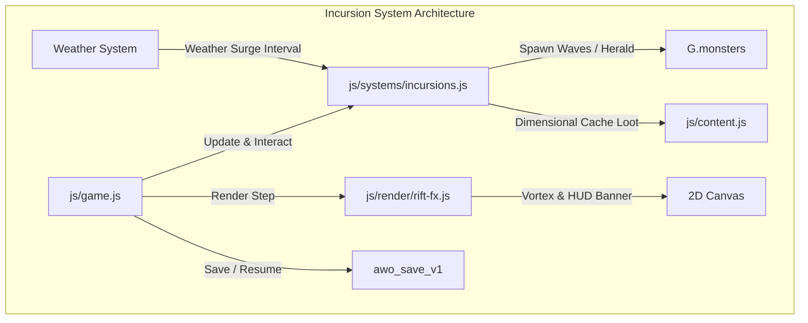

# World Event Rifts & Dimensional Incursions Implementation Plan

> **For agentic workers:** REQUIRED SUB-SKILL: Use superpowers:subagent-driven-development to implement this plan task-by-task. Steps use checkbox (`- [ ]`) syntax for tracking.

**Goal:** Implement Phase 2 of the World Expansion Triad: dynamic open-world Dimensional Tears, 3-wave incursion defense events with mutators, Elite Heralds, and Dimensional Caches yielding Primal Runes and socket expansion materials.

**Architecture:** A standalone incursion subsystem (`js/systems/incursions.js`) manages the incursion lifecycle, wave definitions, and rewards. A dedicated canvas renderer (`js/render/rift-fx.js`) draws the dimensional vortex and incursion HUD banner with strictly zero screen shake. The engine (`js/game.js`) binds the world clock, proximity interaction, monster wave spawning, and save persistence.

**Architecture Diagram:**

**Tech Stack:** Zero-build plain ES modules, HTML5 Canvas 2D, Node test runner (`node:assert/strict`).

**Spec:** [`docs/superpowers/specs/2026-10-06-world-event-rifts-incursions-design.md`](file:///Users/thanananasanthia/Desktop/personal/game-rpg/docs/superpowers/specs/2026-10-06-world-event-rifts-incursions-design.md)

## Global Constraints

- **Strict ZERO Screen Shake:** Camera shake/trauma must remain 0% engine-wide. No camera movement from rift tears, wave spawns, herald appearances, or rift collapsing.
- **Engine Surface Invariant:** Exactly 255 keys exported on `window.__AWO`. No additions or deletions.
- **Save Compatibility:** `G.incursion` serializes cleanly into `awo_save_v1` without breaking older saves.
- **No Remote Git Push:** Do not run `git push` without explicit user permission.
- **Zero Build Step:** Plain ES modules running directly in browsers and Node.js.

---

### Task 1: Incursion Subsystem Core & Unit Tests

**Files:**
- Create: `js/systems/incursions.js`
- Test: `js/incursions.test.js`

**Interfaces:**
- Produces: `createIncursionSystem()`, `INCURSION_STATES`, `MUTATORS`, `WAVE_TEMPLATES`
- Methods: `tick(dt, ctx)`, `triggerTear(mapId, x, y)`, `startIncursion()`, `advanceWave()`, `checkWaveClear(monsters)`, `sealIncursion()`, `collapseIncursion()`, `generateCacheLoot()`

- [ ] **Step 1: Write unit tests in `js/incursions.test.js`**
  Cover state transitions (`IDLE` -> `TEAR_OPEN` -> `INCURSION_ACTIVE` -> `SEALED` / `COLLAPSED`), weather surge spawn acceleration, wave progression, mutator assignment, timeout failure, and Dimensional Cache loot generation.
- [ ] **Step 2: Run test to confirm failure**
  Run `node js/incursions.test.js` (expect module missing).
- [ ] **Step 3: Implement `js/systems/incursions.js`**
  Implement incursion state machine, timer handling, wave definitions, mutator logic, and loot generation.
- [ ] **Step 4: Verify unit tests pass**
  Run `node js/incursions.test.js`.
- [ ] **Step 5: Commit Task 1**
  `git add js/systems/incursions.js js/incursions.test.js && git commit -m "feat(incursions): implement incursion subsystem core and unit tests"`

---

### Task 2: Item & Monster Database Registration & Dual Localization

**Files:**
- Modify: `js/content.js`
- Modify: `js/locale.js`

- [ ] **Step 1: Register rift monsters and items in `js/content.js`**
  Add `void_stalker`, `void_herald` monster definitions and `dimensional_shard`, `rift_cache` item definitions.
- [ ] **Step 2: Add Thai & English translations in `js/locale.js`**
  Add translations for new monsters, items, mutators, and incursion UI strings.
- [ ] **Step 3: Verify localization test**
  Run `node js/locale.test.js`.
- [ ] **Step 4: Commit Task 2**
  `git add js/content.js js/locale.js && git commit -m "feat(incursions): register incursion content and dual localization"`

---

### Task 3: Canvas Vortex Rendering & Strict Zero Screen Shake Visuals

**Files:**
- Create: `js/render/rift-fx.js`
- Test: `js/rift-fx.test.js`

- [ ] **Step 1: Write unit tests in `js/rift-fx.test.js`**
  Test canvas render calls for vortex ellipses, particle orbits, and HUD incursion banner with zero camera displacement.
- [ ] **Step 2: Implement `js/render/rift-fx.js`**
  Implement `createRiftRenderer()` with `drawRiftTear(ctx, incursion, cam, now)` and `drawIncursionHud(ctx, incursion, now)`.
- [ ] **Step 3: Verify render tests pass**
  Run `node js/rift-fx.test.js`.
- [ ] **Step 4: Commit Task 3**
  `git add js/render/rift-fx.js js/rift-fx.test.js && git commit -m "feat(incursions): implement rift vortex canvas renderer"`

---

### Task 4: Game Engine Integration & Save Persistence

**Files:**
- Modify: `js/game.js`

- [ ] **Step 1: Wire incursion system and rendering into `js/game.js`**
  - Import `createIncursionSystem` and `createRiftRenderer`.
  - Initialize `incursionSystem` in `G.incursion`.
  - Wire step tick, proximity interaction, wave spawning, and wave clearance detection.
  - Wire render pass for rift vortex and HUD banner.
  - Wire cache container opening to unpack loot.
  - Add admin actions `spawnrift` and `sealrift`.
  - Serialize/deserialize `G.incursion` in save/load.
- [ ] **Step 2: Run surface characterization**
  Run `node js/engine-surface.test.js` (confirm exact 255 keys preserved).
- [ ] **Step 3: Commit Task 4**
  `git add js/game.js && git commit -m "feat(incursions): integrate incursion lifecycle, waves, and UI into engine"`

---

### Task 5: Integration Testing, Surface Stability & Merge

**Files:**
- Create: `js/incursions-integration.test.js`
- Modify: `CLAUDE.md`

- [ ] **Step 1: Create `js/incursions-integration.test.js`**
  Verify live engine boot, rift tear spawning, player interaction, 3-wave progression, mutator behavior, herald defeat, cache reward granting, zero camera shake, and save/resume persistence.
- [ ] **Step 2: Run engine surface test**
  Run `node js/engine-surface.test.js`.
- [ ] **Step 3: Run full test suite**
  Run `npm test` (all 46 suites pass).
- [ ] **Step 4: Update `CLAUDE.md`**
  Document `js/systems/incursions.js` and `js/render/rift-fx.js`.
- [ ] **Step 5: Merge into `main`**
  Fast-forward merge feature branch into `main` and delete feature branch.
- [ ] **Step 6: Run `npm test` on `main`**
  Final regression verification.
