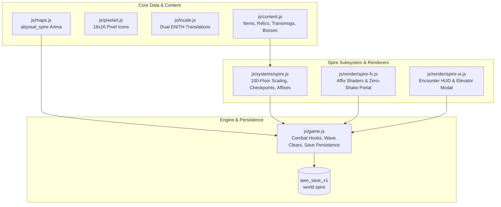

# The Abyssal Spire (100-Floor Challenge Tower) Implementation Plan

> **For agentic workers:** REQUIRED SUB-SKILL: Use `superpowers:subagent-driven-development` to implement this plan task-by-task. Steps use checkbox (`- [ ]`) syntax for tracking.

**Goal:** Build the Abyssal Spire, a 100-floor roguelite endgame challenge tower featuring 5 curated biome tiers, permanent checkpoint elevators every 10 floors, 8 dynamic floor affixes, milestone boss battles, an emblem currency reliquary shop, cosmetic weapon transmogs, prestige titles, and a strict zero-camera-shake renderer with boxing-contained UI.

**Architecture:** A standalone subsystem (`js/systems/spire.js`) manages 100-floor scaling math, affix generation, checkpoint unlocking, and roster selection. Canvas 2D visuals (`js/render/spire-fx.js`) render ambient affix shaders, clear portals, and boss warning crests with immutable camera coordinates. UX/UI (`js/render/spire-ui.js`) renders a top encounter HUD and responsive checkpoint elevator modal with strict boxing containment (`box-sizing: border-box`, `min-width: 0`, `overflow-x: hidden`).

**Architecture Diagram:**

**Tech Stack:** Zero-build plain ES modules, HTML5 Canvas 2D, Web Audio API, Node.js `node:test` harness.

**Spec:** [`docs/superpowers/specs/2026-10-07-abyssal-spire-challenge-tower-design.md`](file:///Users/thanananasanthia/Desktop/personal/game-rpg/docs/superpowers/specs/2026-10-07-abyssal-spire-challenge-tower-design.md)

## Global Constraints

- **Strict ZERO Screen Shake:** `G.cam.x` and `G.cam.y` are never modified by floor clears, boss slams, or affix hazards (`Object.freeze(G.cam)` enforced in tests).
- **Engine Surface Invariant:** Hardcoded **255 keys on `window.__AWO`** must be preserved (`node js/engine-surface.test.js`).
- **Save State Backward Compatibility:** Persisted cleanly under `awo_save_v1` (`world.spire` / `G.spire`).
- **Strict Boxing Containment:** Every HUD and modal element enforces `box-sizing: border-box`, `min-width: 0`, and `overflow-x: hidden`.
- **Dual Bilingual Parity:** 100% complete English (`en`) and Thai (`th`) translations in `js/locale.js`.
- **Subsystem Implementer Model:** Dedicated Gemini Pro implementer subagents (`Model: 'pro'`).
- **Execution Order:** Logic and code first (Tasks 1–4), UX/UI last (Task 5), Integration (Task 6).
- **No Remote Git Push:** Do not push to remote without explicit user command.

---

### Task 1: Core Abyssal Spire Subsystem & Unit Tests

**Files:**
- Create: `js/systems/spire.js`
- Create: `js/spire.test.js`

**Interfaces:**
- Produces:
  - `SPIRE_BIOMES = { DEPTHS, GLACIAL, CALDERA, STORM, VOID }`
  - `SPIRE_AFFIXES = { magma_surge, glacial_chill, mana_drain, sunder_mist, berserk_foes, kinetic_reflect, graviton_well, chrono_haste }`
  - `CHECKPOINT_FLOORS = [1, 11, 21, 31, 41, 51, 61, 71, 81, 91]`
  - `createSpireSystem({ now, rnd })`:
    - `getBiomeForFloor(floor)`
    - `getFloorStatScale(floor, isBoss)`
    - `rollFloorAffixes(floor)`
    - `startRun(startingFloor)`
    - `advanceFloor()`
    - `unlockCheckpoint(milestoneFloor)`
    - `isCheckpointUnlocked(floor)`
    - `getUnlockedCheckpoints()`
    - `calculateFloorEmblems(floor, isFirstClear)`
    - `getActiveRun()`
    - `serialize()` / `deserialize(data)`

- [ ] **Step 1: Write failing unit test (`js/spire.test.js`)**
  Define tests covering 100-floor scaling math, biome boundary routing (1–20, 21–40, 41–60, 61–80, 81–100), affix selection logic (1 affix on F1–40, 2 affixes on F41–100), checkpoint elevator unlocking at milestone floors (10, 20... 90), emblem payouts, and serialization.
- [ ] **Step 2: Run test to verify it fails**
  Run: `node js/spire.test.js`
  Expected: FAIL (Cannot find module `./systems/spire.js`)
- [ ] **Step 3: Implement `js/systems/spire.js`**
  Implement `createSpireSystem`, biome catalogs, scaling multipliers, elevator checkpoint state machine, and clean serialization.
- [ ] **Step 4: Run test to verify it passes**
  Run: `node js/spire.test.js`
  Expected: PASS (exit code 0)
- [ ] **Step 5: Commit**
  Run: `git add js/systems/spire.js js/spire.test.js && git commit -m "feat(spire): implement core abyssal spire subsystem and unit tests"`

---

### Task 2: Content Registration, Relics, Transmogs, Recipes, Pixel Art & Dual Bilingual Localization

**Files:**
- Modify: `js/content.js`
- Modify: `js/pixelart.js`
- Modify: `js/locale.js`
- Modify: `js/locale.test.js`
- Modify: `js/selfcheck.js` (if needed)

**Interfaces:**
- Produces:
  - `CONTENT.items`: `spire_emblem`, `crown_of_the_ascendant`, `abyssal_compass`, `spire_sigil`, `spire_blade`, `spire_scythe`, `spire_greatsword`, `spire_staff`, `spire_bow`, `spire_knuckles`, `title_spire_challenger`, `title_abyssal_sovereign`.
  - `CONTENT.monsters`: 10 milestone boss entries (`corrupted_treant_boss`, `frost_alpha_boss`, `caldera_avatar_boss`, `nullking_spire_boss`, etc.).
  - `PX.item` & `ITEM_ICON`: 16×16 pixel art mappings for Spire Emblems, Crown, Compass, Sigil, and Spire Transmogs.
  - `L10N.en` & `L10N.th`: 100% complete translations for all new biomes, affixes, bosses, items, titles, and UI strings.

- [ ] **Step 1: Write item and boss definitions in `js/content.js`**
  Register `spire_emblem`, 3 relics/accessories, 6 transmog weapons, 2 titles, and milestone boss definitions.
- [ ] **Step 2: Register pixel art icons in `js/pixelart.js`**
  Add icon matrices and map `ITEM_ICON`.
- [ ] **Step 3: Add dual English and Thai translations in `js/locale.js`**
  Translate all 5 biomes, 8 affixes, 10 bosses, 12 items, and Spire UI strings in `L10N.en` and `L10N.th`.
- [ ] **Step 4: Add localization assertions in `js/locale.test.js`**
  Verify all new entries pass `T(key, section) !== key`.
- [ ] **Step 5: Run tests & selfCheck**
  Run: `node js/locale.test.js` and `node -e "import('./js/selfcheck.js').then(s => s.selfCheck())"`
  Expected: PASS (exit code 0)
- [ ] **Step 6: Commit**
  Run: `git add js/content.js js/pixelart.js js/locale.js js/locale.test.js && git commit -m "feat(spire): register spire items, transmogs, pixel icons, and dual localization"`

---

### Task 3: Canvas 2D Visual Effects, Affix Particles & Zero-Shake Renderer

**Files:**
- Create: `js/render/spire-fx.js`
- Create: `js/spire-fx.test.js`

**Interfaces:**
- Produces:
  - `createSpireRenderer({ T, PX })`:
    - `drawSpireAffixFx(ctx, activeAffixes, cam, now, viewW, viewH)`
    - `drawAscendancePortal(ctx, portalPos, cam, now, viewW, viewH)`
    - `drawMilestoneBossFanfare(ctx, bossEntity, cam, now, viewW, viewH)`
    - `drawGravitonVortex(ctx, centerX, centerY, cam, now)`
    - `updateFx(dt)`
    - Strict Zero Screen Shake: Camera coordinates are never altered.

- [ ] **Step 1: Write failing visual unit tests (`js/spire-fx.test.js`)**
  Mock Canvas 2D context tracking calls (`arc`, `fill`, `stroke`, `beginPath`, `save`, `restore`, `fillRect`). Enforce camera invariance with `Object.freeze(cam)`.
- [ ] **Step 2: Run test to verify it fails**
  Run: `node js/spire-fx.test.js`
  Expected: FAIL (Cannot find module `./render/spire-fx.js`)
- [ ] **Step 3: Implement `js/render/spire-fx.js`**
  Implement ambient affix particle shaders (`magma_surge`, `glacial_chill`, `sunder_mist`, `graviton_well`), ascendance floor-clear portal with concentric rings, milestone boss alert crest, and strict zero-shake rendering.
- [ ] **Step 4: Run test to verify it passes**
  Run: `node js/spire-fx.test.js`
  Expected: PASS (exit code 0)
- [ ] **Step 5: Commit**
  Run: `git add js/render/spire-fx.js js/spire-fx.test.js && git commit -m "feat(spire): implement canvas spire visual effects and zero-shake renderer"`

---

### Task 4: Game Engine Integration (Combat Hooks, Wave Clears & Save State)

**Files:**
- Modify: `js/maps.js`
- Modify: `js/game.js`
- Test: `node js/engine-surface.test.js`

**Interfaces:**
- Consumes: `createSpireSystem`, `createSpireRenderer`.
- Produces:
  - Arena map `abyssal_spire` in `js/maps.js`.
  - Game state: `G.spireSystem`, `G.spireFx`, `G.spireState`.
  - Spire wave clear and floor progression in `killMonster`.
  - Environmental affix effects (Magma Surge fissures, Graviton pull, Chrono Haste CDR) in `step(dt)`.
  - Spire death penalty handling (clean return to town, preserving highest floor).
  - Admin hooks: `adminAction('spirefloor', { floor })` and `adminAction('spireclear')`.
  - Save/resume persistence under `awo_save_v1` (`world.spire`).
  - Preserves exact 255 keys on `window.__AWO`.

- [ ] **Step 1: Add `abyssal_spire` map to `js/maps.js`**
  Define arena map geometry, portals, and legend markers.
- [ ] **Step 2: Wire Spire subsystem into `js/game.js`**
  Mount `G.spireSystem` and `G.spireFx`. Add `startSpireRun(floor)` and `spawnSpireWave()`.
- [ ] **Step 3: Wire combat, affix ticks, and floor clear progression**
  Add affix execution in `step(dt)` and wave clear detection in `killMonster()`.
- [ ] **Step 4: Wire save/resume persistence and admin actions**
  Serialize/deserialize in `saveGame` and `resumeGame`. Add admin hooks.
- [ ] **Step 5: Verify engine surface and test suites**
  Run: `node js/engine-surface.test.js` (must pass with 255 keys).
- [ ] **Step 6: Commit**
  Run: `git add js/maps.js js/game.js && git commit -m "feat(spire): wire arena map, floor progression, affix combat ticks, and save persistence"`

---

### Task 5: UX/UI Spire Encounter HUD & Checkpoint Elevator Modal with Boxing Containment

**Files:**
- Create: `js/render/spire-ui.js`
- Create: `js/spire-ui.test.js`
- Modify: `js/game.js`

**Interfaces:**
- Produces:
  - `createSpireUIRenderer({ T, SPIRE_BIOMES, SPIRE_AFFIXES, CHECKPOINT_FLOORS })`:
    - `renderSpireHudHtml(spireState)`: Top Encounter HUD bar with floor number, biome badge, active affix pills, remaining monsters, and Spire Emblems tally.
    - `renderElevatorModalHtml(spireData)`: Checkpoint Elevator Modal displaying grid of 10 checkpoint floors with lock badges and `[Ascend]` action button.
    - Strict boxing containment: `box-sizing: border-box`, `width: 100%`, `max-width: 100%`, `min-width: 0`, `overflow-x: hidden`.

- [ ] **Step 1: Write failing UI unit tests (`js/spire-ui.test.js`)**
  Test top HUD markup, affix badges, elevator modal generation, checkpoint lock/unlock states, and assert strict boxing containment.
- [ ] **Step 2: Run test to verify it fails**
  Run: `node js/spire-ui.test.js`
  Expected: FAIL (Cannot find module `./render/spire-ui.js`)
- [ ] **Step 3: Implement `js/render/spire-ui.js`**
  Implement top HUD bar and responsive checkpoint elevator modal with strict boxing containment.
- [ ] **Step 4: Wire HUD & Modal into `js/game.js`**
  Mount `#spire-hud-slot` in `buildHud()` and wire in `updateHud()`. Wire elevator click handlers.
- [ ] **Step 5: Run tests and verify engine surface**
  Run: `node js/spire-ui.test.js` and `node js/engine-surface.test.js` (255 keys preserved).
- [ ] **Step 6: Commit**
  Run: `git add js/render/spire-ui.js js/spire-ui.test.js js/game.js && git commit -m "feat(spire): implement encounter hud and elevator modal with boxing containment"`

---

### Task 6: Comprehensive End-to-End Integration Suite & Documentation

**Files:**
- Create: `js/spire-integration.test.js`
- Modify: `CLAUDE.md`

**Interfaces:**
- Produces:
  - Full end-to-end integration test driving `window.__AWO`:
    1. Content invariants: all 10 milestone bosses, 12 spire items, transmogs, and pixel art icons exist.
    2. Elevator selection: player selects unlocked checkpoint (e.g. Floor 21) and spawns into Glacial Ascent.
    3. Floor progression: player climbs 10 floors, encountering dynamic affixes.
    4. Milestone boss battle: Floor 30 Frost Alpha encounter, defeat triggers checkpoint unlock (Floor 31).
    5. Spire Emblems economy: earned currency used to purchase `crown_of_the_ascendant` and `spire_blade`.
    6. Strict Zero Screen Shake verification (`Object.freeze(G.cam)`).
    7. Save/Resume persistence under `awo_save_v1` (`world.spire`).
    8. UX/UI Boxing containment verification.
  - Architecture documentation in `CLAUDE.md`.

- [ ] **Step 1: Write `js/spire-integration.test.js`**
  Use `installBrowserEnv` and drive the live engine through `window.__AWO`.
- [ ] **Step 2: Run integration test**
  Run: `node js/spire-integration.test.js`
  Expected: PASS (exit code 0)
- [ ] **Step 3: Update `CLAUDE.md` architecture section**
  Document `js/systems/spire.js`, `js/render/spire-fx.js`, and `js/render/spire-ui.js`.
- [ ] **Step 4: Run full repository test suite**
  Run: `npm test`
  Expected: All 63+ suites pass cleanly.
- [ ] **Step 5: Commit**
  Run: `git add js/spire-integration.test.js CLAUDE.md && git commit -m "test(spire): add comprehensive end-to-end integration suite and document architecture"`
