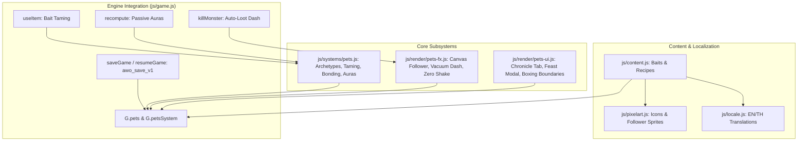

# Companion & Pet Familiars Implementation Plan

> **For agentic workers:** REQUIRED SUB-SKILL: Use `superpowers:subagent-driven-development` to implement this plan task-by-task. Steps use checkbox (`- [ ]`) syntax for tracking.

**Goal:** Implement Phase 2 Companion & Pet Familiars for *Aetheria Online*, enabling wild creature taming via crafted baits, feast bonding, passive aura stat boosts, dynamic Canvas 2D follower pathing with auto-loot vacuum dash, and a responsive World Chronicle management tab and popup modal.

**Architecture:**
A modular design isolating core pet catalog, formulas, and leveling logic into `js/systems/pets.js`, Canvas 2D follower simulation and vacuum particles into `js/render/pets-fx.js`, and HTML Chronicle tab rendering and modal popup into `js/render/pets-ui.js`. Engine hooks in `js/game.js` connect combat taming, drop auto-looting, stat aura recalculations in `recompute()`, and clean persistence under `awo_save_v1`. Content registration in `js/content.js`, `js/pixelart.js`, and `js/locale.js` provides full bilingual English and Thai support.

**Architecture Diagram:**



**Tech Stack:** Zero-build plain ES-modules, Canvas 2D rendering, Node.js test harness with `installBrowserEnv()`.

**Spec:** [`docs/superpowers/specs/2026-10-07-companion-and-pet-familiars-design.md`](file:///Users/thanananasanthia/Desktop/personal/game-rpg/docs/superpowers/specs/2026-10-07-companion-and-pet-familiars-design.md)

## Global Constraints

- **Strict ZERO Screen Shake:** Camera coordinates (`G.cam.x`, `G.cam.y`) are never altered by pet summoning, dashing, vacuuming, or feeding.
- **Surface Preservation:** All 255 keys on `window.__AWO` must remain unchanged (`node js/engine-surface.test.js`).
- **Save Compatibility:** Save format `awo_save_v1` preserved; pet data stored under `G.pets` with default initialization fallback.
- **Implementation Order:** Core logic, formulas, content, and engine integration FIRST; UX/UI panel and window popup LAST.
- **Bilingual Parity:** All new items, companions, notifications, and UI strings localized in both English and Thai.

---

### Task 1: Core Pet Subsystem & Unit Tests

**Files:**
- Create: [`js/systems/pets.js`](file:///Users/thanananasanthia/Desktop/personal/game-rpg/js/systems/pets.js)
- Test: [`js/pets.test.js`](file:///Users/thanananasanthia/Desktop/personal/game-rpg/js/pets.test.js)

**Interfaces:**
- Consumes: Standard JS Math, `Date.now()`.
- Produces: `PET_CATALOG`, `BAIT_TO_PET_MAP`, `FEAST_VALUES`, `createPetsSystem({ now, rnd })` exporting `getPetDef(id)`, `attemptTame(player, monster, baitId)`, `feedPet(petState, feastItemId)`, `computeAuraStats(petState)`, `getAutoLootRadius(petState)`, `serialize(petsState)`, `deserialize(data)`.

- [ ] **Step 1: Write the failing unit tests in `js/pets.test.js`**

```javascript
import test from 'node:test';
import assert from 'node:assert/strict';
import {
  PET_CATALOG,
  BAIT_TO_PET_MAP,
  FEAST_VALUES,
  createPetsSystem,
} from './systems/pets.js';

test('PET_CATALOG defines 5 distinct companions', () => {
  assert.equal(Object.keys(PET_CATALOG).length, 5);
  const slime = PET_CATALOG.pet_slime;
  assert.equal(slime.name, 'Gel Slime');
  assert.equal(slime.targetMonster, 'slime');
  assert.equal(slime.requiredBait, 'bait_sweet_gelatin');
  assert.ok(slime.auras.hpRegen);
});

test('attemptTame validates HP threshold and bait compatibility', () => {
  const sys = createPetsSystem({ rnd: () => 0.1 });
  const p = { stats: { luk: 10 } };
  const mHealthy = { id: 'slime', hp: 80, maxHp: 100 };
  const mWeak = { id: 'slime', hp: 20, maxHp: 100 };

  const resHealthy = sys.attemptTame(p, mHealthy, 'bait_sweet_gelatin');
  assert.equal(resHealthy.success, false);
  assert.match(resHealthy.reason, /weakened/i);

  const resWrongBait = sys.attemptTame(p, mWeak, 'bait_magma_fruit');
  assert.equal(resWrongBait.success, false);

  const resSuccess = sys.attemptTame(p, mWeak, 'bait_sweet_gelatin');
  assert.equal(resSuccess.success, true);
  assert.equal(resSuccess.petId, 'pet_slime');
});

test('feedPet increases loyalty and advances bond levels', () => {
  const sys = createPetsSystem();
  const pet = { id: 'pet_slime', bondLevel: 1, loyalty: 20, exp: 0 };
  const res = sys.feedPet(pet, 'grilled_trout');
  assert.equal(res.success, true);
  assert.equal(pet.loyalty, 35);
  assert.equal(pet.exp, 50);

  // Feed high tier dish to trigger level up
  sys.feedPet(pet, 'golden_carp_sashimi'); // +50 loyalty, +300 exp -> total 350 exp (threshold for lv2 is 100, lv3 is 250)
  assert.equal(pet.bondLevel, 3);
  assert.equal(pet.loyalty, 85);
});

test('computeAuraStats calculates scaled stats including Devoted bonus', () => {
  const sys = createPetsSystem();
  const petNormal = { id: 'pet_wolf', bondLevel: 1, loyalty: 50 };
  const statsNormal = sys.computeAuraStats(petNormal);
  assert.equal(statsNormal.physAtkPct, 0.06);

  const petDevoted = { id: 'pet_wolf', bondLevel: 5, loyalty: 85 };
  const statsDevoted = sys.computeAuraStats(petDevoted);
  // Base bond 5 is 0.18, with +10% devotion bonus -> 0.198
  assert.ok(statsDevoted.physAtkPct > 0.19);
});

test('serialize and deserialize preserve companion records', () => {
  const sys = createPetsSystem();
  const state = {
    activePetId: 'pet_slime',
    owned: {
      pet_slime: { id: 'pet_slime', bondLevel: 2, loyalty: 60, exp: 120 },
    },
  };
  const json = sys.serialize(state);
  const restored = sys.deserialize(json);
  assert.equal(restored.activePetId, 'pet_slime');
  assert.equal(restored.owned.pet_slime.bondLevel, 2);
});
```

- [ ] **Step 2: Run test to verify it fails**

Run: `node js/pets.test.js`  
Expected: FAIL (`Cannot find module './systems/pets.js'`)

- [ ] **Step 3: Implement `js/systems/pets.js`**

Implement `PET_CATALOG`, `BAIT_TO_PET_MAP`, `FEAST_VALUES`, `BOND_EXP_THRESHOLDS`, and `createPetsSystem` with exact formulas from the design spec.

- [ ] **Step 4: Run test to verify it passes**

Run: `node js/pets.test.js`  
Expected: PASS with 5 passing tests.

- [ ] **Step 5: Commit**

```bash
git add js/systems/pets.js js/pets.test.js
git commit -m "feat(pets): implement core companion subsystem and unit tests"
```

---

### Task 2: Content Registration, Taming Baits, Pixel Icons & Bilingual Localization

**Files:**
- Modify: [`js/content.js`](file:///Users/thanananasanthia/Desktop/personal/game-rpg/js/content.js)
- Modify: [`js/pixelart.js`](file:///Users/thanananasanthia/Desktop/personal/game-rpg/js/pixelart.js)
- Modify: [`js/locale.js`](file:///Users/thanananasanthia/Desktop/personal/game-rpg/js/locale.js)
- Modify: [`js/selfcheck.js`](file:///Users/thanananasanthia/Desktop/personal/game-rpg/js/selfcheck.js) (if item types checked)
- Test: [`js/locale.test.js`](file:///Users/thanananasanthia/Desktop/personal/game-rpg/js/locale.test.js)

**Interfaces:**
- Consumes: `PET_CATALOG` from `js/systems/pets.js`.
- Produces: 5 bait items (`bait_sweet_gelatin`, `bait_tender_jerky`, `bait_luminous_nectar`, `bait_glacial_salmon`, `bait_magma_fruit`) and 5 bait recipes in `CONTENT.recipes`, pixel art icons in `ITEM_ICON`, and full EN/TH translations.

- [ ] **Step 1: Write failing checks in `js/locale.test.js` (or verify missing keys)**

Ensure `bait_sweet_gelatin`, `pet_slime`, etc. are tested for EN/TH presence.

- [ ] **Step 2: Add bait items & crafting recipes to `js/content.js`**

Register the 5 taming baits with `type: 'taming_bait'` and recipes requiring herbs, ores, and fish.

- [ ] **Step 3: Register pixel art icons in `js/pixelart.js`**

Add 16×16 pixel art matrices and map `bait_*` and `pet_*` items in `ITEM_ICON`.

- [ ] **Step 4: Add bilingual translations to `js/locale.js`**

Provide English and Thai localization for all 5 companions, 5 baits, recipes, UI badges, and taming notifications.

- [ ] **Step 5: Verify self-check and tests pass**

Run: `node -e "import('./js/selfcheck.js').then(s => s.selfCheck())"`  
Run: `node js/locale.test.js`  
Expected: PASS

- [ ] **Step 6: Commit**

```bash
git add js/content.js js/pixelart.js js/locale.js js/selfcheck.js js/locale.test.js
git commit -m "feat(pets): register taming baits, crafting recipes, pixel icons, and dual localization"
```

---

### Task 3: Canvas Follower Entity, Vacuum Particle FX & Zero-Shake Renderer

**Files:**
- Create: [`js/render/pets-fx.js`](file:///Users/thanananasanthia/Desktop/personal/game-rpg/js/render/pets-fx.js)
- Test: [`js/pets-fx.test.js`](file:///Users/thanananasanthia/Desktop/personal/game-rpg/js/pets-fx.test.js)

**Interfaces:**
- Consumes: Follower coordinates, player position, canvas context.
- Produces: `createPetsRenderer({ T })` exporting:
  - `updateFollower(petEntity, playerPos, dt)`: updates lerp position and idle/move cycle.
  - `triggerAutoLoot(petEntity, targetPos)`: starts dash-and-vacuum particle state.
  - `triggerEmote(petEntity, emoteType)`: spawns floating heart or sparkle emote.
  - `drawFollower(ctx, petEntity, cam, now)`: renders 16×16 follower sprite, shadows, aura particles, vacuum motes, and floating emotes. Strict ZERO camera shake.

- [ ] **Step 1: Write the failing tests in `js/pets-fx.test.js`**

```javascript
import test from 'node:test';
import assert from 'node:assert/strict';
import { createPetsRenderer } from './render/pets-fx.js';

test('createPetsRenderer updates follower kinematics towards player', () => {
  const fx = createPetsRenderer();
  const pet = { x: 100, y: 100, vx: 0, vy: 0, state: 'idle' };
  const player = { x: 200, y: 100, facing: 'right' };

  fx.updateFollower(pet, player, 0.1);
  assert.ok(pet.x > 100, 'Pet should move toward player');
});

test('triggerAutoLoot sets dash target and spawns vacuum motes', () => {
  const fx = createPetsRenderer();
  const pet = { x: 100, y: 100, motes: [] };
  fx.triggerAutoLoot(pet, { x: 150, y: 120 });
  assert.equal(pet.dashTarget?.x, 150);
  assert.ok(pet.motes.length > 0);
});

test('drawFollower maintains strict ZERO screen shake', () => {
  const fx = createPetsRenderer();
  const cam = { x: 50, y: 50 };
  const initialCam = { ...cam };
  const pet = { x: 60, y: 60, id: 'pet_slime', motes: [], emotes: [] };
  const mockCtx = {
    save: () => {}, restore: () => {}, beginPath: () => {},
    arc: () => {}, fill: () => {}, stroke: () => {}, fillRect: () => {},
    drawImage: () => {}, fillText: () => {}
  };

  fx.drawFollower(mockCtx, pet, cam, Date.now());
  assert.deepEqual(cam, initialCam, 'Camera coords must remain strictly identical');
});
```

- [ ] **Step 2: Run test to verify it fails**

Run: `node js/pets-fx.test.js`  
Expected: FAIL

- [ ] **Step 3: Implement `js/render/pets-fx.js`**

Implement smooth spring-lerp kinematics, 16×16 pixel art rendering, suction particles, and heart emotes without touching camera coordinates.

- [ ] **Step 4: Run test to verify it passes**

Run: `node js/pets-fx.test.js`  
Expected: PASS

- [ ] **Step 5: Commit**

```bash
git add js/render/pets-fx.js js/pets-fx.test.js
git commit -m "feat(pets): implement follower kinematics, vacuum dash fx, and zero-shake canvas renderer"
```

---

### Task 4: Game Engine Integration (Combat Hooks, Taming, recompute & Save State)

**Files:**
- Modify: [`js/game.js`](file:///Users/thanananasanthia/Desktop/personal/game-rpg/js/game.js)
- Test: [`js/engine-surface.test.js`](file:///Users/thanananasanthia/Desktop/personal/game-rpg/js/engine-surface.test.js)

**Interfaces:**
- Consumes: `createPetsSystem` (`js/systems/pets.js`) and `createPetsRenderer` (`js/render/pets-fx.js`).
- Produces:
  - Wire `G.petsSystem` and `G.petsFx` on initialization.
  - In `useItem(itemId)`: support `it.type === 'taming_bait'`.
  - In `killMonster(m)`: trigger `petsFx.triggerAutoLoot` and apply bond zeny/material bonuses.
  - In `recompute(p)`: apply companion passive auras into player stats.
  - In `saveGame()` / `resumeGame()`: serialize/deserialize `G.pets`.
  - In game loop: update and draw follower entity on canvas overlay.

- [ ] **Step 1: Check baseline engine surface before edits**

Run: `node js/engine-surface.test.js`  
Expected: PASS (255 keys on `window.__AWO`).

- [ ] **Step 2: Integrate `petsSystem` and `petsFx` into `js/game.js`**

Wire the subsystem instances onto `G`, hook `useItem`, `killMonster`, `recompute`, and save serialization.

- [ ] **Step 3: Verify surface preservation and test suite**

Run: `node js/engine-surface.test.js`  
Run: `npm test`  
Expected: All suites passing.

- [ ] **Step 4: Commit**

```bash
git add js/game.js
git commit -m "feat(pets): wire companion combat taming, auto-loot, recompute auras, and save persistence"
```

---

### Task 5: Companion Chronicle Tab & Modal UI with Boxing Containment

**Files:**
- Create: [`js/render/pets-ui.js`](file:///Users/thanananasanthia/Desktop/personal/game-rpg/js/render/pets-ui.js)
- Modify: [`js/game.js`](file:///Users/thanananasanthia/Desktop/personal/game-rpg/js/game.js) (tab in `worldChronicleHtml` and modal pause check)
- Test: [`js/pets-ui.test.js`](file:///Users/thanananasanthia/Desktop/personal/game-rpg/js/pets-ui.test.js)

**Interfaces:**
- Consumes: `G.pets`, `PET_CATALOG`, `FEAST_VALUES`.
- Produces: `createPetsUIRenderer({ T })` exporting:
  - `renderCompanionsTab(petsState, inventory)`: returns structured HTML for World Chronicle Tab 3.
  - `renderFeedModalHtml(petState, inventory)`: returns popup modal HTML for feeding meals.
  - Enforces strict boxing boundaries (`width: 100%`, `box-sizing: border-box`, `min-width: 0`).

- [ ] **Step 1: Write failing UI tests in `js/pets-ui.test.js`**

Verify HTML output for Active Companion Banner, Feast Tray, 5 Roster Cards, and Modal shell with focus trap and light dismiss markup.

- [ ] **Step 2: Implement `js/render/pets-ui.js`**

Implement the HTML renderers adhering to the UX/UI containment rules from Section 7 of the design spec.

- [ ] **Step 3: Wire into `worldChronicleHtml()` and event handlers in `js/game.js`**

Add the `🐾 Companions & Familiars` button to the Chronicle tabs and connect button clicks for Summon, Dismiss, and Feed.

- [ ] **Step 4: Run UI test suite and full tests**

Run: `node js/pets-ui.test.js`  
Run: `npm test`  
Expected: PASS

- [ ] **Step 5: Commit**

```bash
git add js/render/pets-ui.js js/pets-ui.test.js js/game.js
git commit -m "feat(pets): implement companion chronicle tab and popup modal with boxing containment"
```

---

### Task 6: Comprehensive End-to-End Integration Suite & Documentation

**Files:**
- Create: [`js/pets-integration.test.js`](file:///Users/thanananasanthia/Desktop/personal/game-rpg/js/pets-integration.test.js)
- Modify: [`CLAUDE.md`](file:///Users/thanananasanthia/Desktop/personal/game-rpg/CLAUDE.md)

**Interfaces:**
- Consumes: Live `window.__AWO` via `installBrowserEnv()`.
- Produces: End-to-end acceptance tests verifying:
  1. Wild creature taming via crafted bait under 30% HP.
  2. Feast feeding raising loyalty and bond level.
  3. Stat buffs injected via `recompute()`.
  4. Auto-loot dash and bonus zeny applied on monster kill.
  5. Strict ZERO camera shake invariant during all actions.
  6. Persistence across `saveGame()` and `resumeGame()`.

- [ ] **Step 1: Create `js/pets-integration.test.js`**

Write thorough integration tests covering the complete companion lifecycle.

- [ ] **Step 2: Run integration tests**

Run: `node js/pets-integration.test.js`  
Expected: PASS with 100% assertions green.

- [ ] **Step 3: Update `CLAUDE.md` architecture guide**

Document `js/systems/pets.js`, `js/render/pets-fx.js`, and `js/render/pets-ui.js` in the engine architecture section.

- [ ] **Step 4: Run full project test suite**

Run: `npm test`  
Expected: 55/55+ test suites passing.

- [ ] **Step 5: Commit**

```bash
git add js/pets-integration.test.js CLAUDE.md
git commit -m "test(pets): add comprehensive end-to-end integration suite and document architecture"
```
