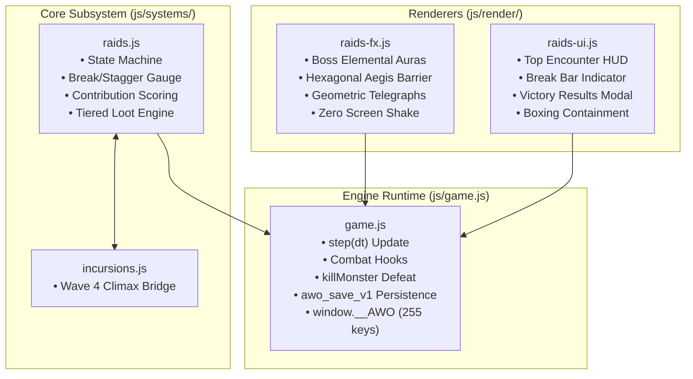

# World Boss Raids & Incursion Climax Implementation Plan

> **For agentic workers:** REQUIRED SUB-SKILL: Use superpowers:subagent-driven-development to implement this plan task-by-task. Steps use checkbox (`- [ ]`) syntax for tracking.

**Goal:** Implement Phase 3: World Boss Raids & Incursion Climax (Wave 4 Incursion Escalation, Overworld Apex Titans, 3-Phase Combat with Break/Stagger Gauge, Contribution Scoring, Tiered Loot, Zero Camera Shake Canvas FX, and Boxing-Contained UX/UI).

**Architecture:** A modular subsystem trio (`js/systems/raids.js`, `js/render/raids-fx.js`, `js/render/raids-ui.js`) bridged into `js/game.js` and `js/systems/incursions.js`. The raid state machine handles encounters, add spawns, break shield resilience, and contribution grading. The canvas renderer renders geometric telegraphs and boss auras with strict zero camera shake. The UI module provides a top encounter banner and post-battle Victory Modal with strict boxing boundaries.

**Architecture Diagram:**

**Tech Stack:** Plain ES Modules (browser + Node), HTML5 Canvas 2D, Web Audio SFX, `installBrowserEnv` test harness.

**Spec:** [`docs/superpowers/specs/2026-10-07-world-boss-raids-and-incursion-climax-design.md`](file:///Users/thanananasanthia/Desktop/personal/game-rpg/docs/superpowers/specs/2026-10-07-world-boss-raids-and-incursion-climax-design.md)

## Global Constraints

- **Strict ZERO Screen Shake:** `G.cam.x` and `G.cam.y` are never modified or displaced by raid boss actions, slams, barrier shatter, or victory events.
- **Engine Surface:** Preserve exact hardcoded **255 keys** on `window.__AWO` (`node js/engine-surface.test.js`).
- **Save State Compatibility:** Persisted cleanly under `awo_save_v1` (`world.raids` / `G.raids`).
- **Zero-Build ES Modules:** Pure ES modules, no bundler or runtime compilation dependencies.
- **Dual Bilingual Parity:** 100% complete English and Thai translations in `js/locale.js`.
- **Strict Boxing Containment:** Container `box-sizing: border-box`, `min-width: 0`, and `overflow-x: hidden` to eliminate layout blowout.
- **Implementation Order:** Logic first (Tasks 1–4), UX/UI last (Task 5), Integration & Acceptance (Task 6).
- **No Remote Push:** Do not push to remote repository without explicit user instructions.

---

### Task 1: Core Raid & World Boss Subsystem & Unit Tests

**Files:**
- Create: `js/systems/raids.js`
- Create: `js/raids.test.js`

**Interfaces:**
- Produces:
  - `RAID_STATES = { IDLE: 'IDLE', ANNOUNCING: 'ANNOUNCING', ENGAGED: 'ENGAGED', BREAK_STAGGER: 'BREAK_STAGGER', ENRAGED: 'ENRAGED', DEFEATED: 'DEFEATED', COLLAPSED: 'COLLAPSED' }`
  - `CONTRIBUTION_TIERS = { BRONZE: 'bronze', SILVER: 'silver', GOLD: 'gold', PARAGON: 'paragon' }`
  - `WORLD_BOSS_CATALOG = { voidmaw_sovereign, caldera_colossus, ancient_behemoth }`
  - `createRaidsSystem({ now, rnd }):`
    - `startRaid(bossId, { mapId, x, y, durationMs })`
    - `getActiveRaid()`
    - `applyDamage(amount, { isBreak = false })`
    - `recordAddKill()`
    - `recordHazardDodge()`
    - `update(dt)`
    - `resolveVictory()`
    - `generateRaidCache(tier)`
    - `serialize()` / `deserialize(data)`

- [ ] **Step 1: Write the failing unit tests (`js/raids.test.js`)**
  Cover boss catalog completeness, raid state transitions, break gauge resilience math, staggered duration (+40% vulnerability) vs barrier detonation, contribution score calculations, tiered loot generation, and serialization.

- [ ] **Step 2: Run test to verify it fails**
  Run: `node js/raids.test.js`
  Expected: FAIL (Cannot find module `./systems/raids.js`)

- [ ] **Step 3: Write minimal implementation (`js/systems/raids.js`)**
  Implement `WORLD_BOSS_CATALOG`, `RAID_STATES`, `CONTRIBUTION_TIERS`, `createRaidsSystem`, state machine, break gauge mechanics, add tracking, contribution scoring, and loot tables.

- [ ] **Step 4: Run test to verify it passes**
  Run: `node js/raids.test.js`
  Expected: PASS (all unit tests pass with exit code 0)

- [ ] **Step 5: Commit**
  Run: `git add js/systems/raids.js js/raids.test.js && git commit -m "feat(raids): implement core raid subsystem and unit tests"`

---

### Task 2: Content Registration, Crafting Recipes, Pixel Art & Bilingual Localization

**Files:**
- Modify: `js/content.js`
- Modify: `js/pixelart.js`
- Modify: `js/locale.js`
- Modify: `js/selfcheck.js`
- Test: `node js/locale.test.js` & `node -e "import('./js/selfcheck.js').then(s => s.selfCheck())"`

**Interfaces:**
- Consumes: Items and recipe schemas from `js/content.js`.
- Produces:
  - Items: `titan_horn`, `titan_heart`, `voidmaw_eye`, `titan_pendant`, `voidmaw_edge`.
  - Recipes: `r_titan_horn`, `r_titan_pendant`, `r_voidmaw_edge`.
  - Pixel sprites: `titan_horn`, `titan_heart`, `voidmaw_eye` in `PX.item` and `ITEM_ICON`.
  - Full EN/TH translations in `L10N.en` and `L10N.th`.

- [ ] **Step 1: Write items, recipes, and icon registrations**
  Add items in `CONTENT.items`, recipes in `CONTENT.recipes`, and 16×16 pixel art icons in `PX.item`.

- [ ] **Step 2: Add dual English and Thai translations**
  Register all boss names, raid mechanics, item names, descriptions, and UI text in `js/locale.js`.

- [ ] **Step 3: Verify selfCheck and locale tests**
  Run: `node js/locale.test.js` and `node -e "import('./js/selfcheck.js').then(s => s.selfCheck())"`.

- [ ] **Step 4: Commit**
  Run: `git add js/content.js js/pixelart.js js/locale.js js/selfcheck.js && git commit -m "feat(raids): register raid items, recipes, pixel icons, and dual localization"`

---

### Task 3: Canvas 2D Visual Effects, Geometric Telegraphs & Zero-Shake Renderer

**Files:**
- Create: `js/render/raids-fx.js`
- Create: `js/raids-fx.test.js`

**Interfaces:**
- Produces:
  - `createRaidsRenderer({ T, PX })`:
    - `drawBossAura(ctx, bossEntity, cam, now)`
    - `drawAegisBarrier(ctx, bossEntity, cam, now)`
    - `drawBreakGauge(ctx, raidState, cam, now)`
    - `drawTelegraphs(ctx, telegraphs, cam, now)`
    - `drawStaggerBursts(ctx, particles, cam, now)`
    - `updateFx(dt)`
    - Strict Zero Screen Shake: cam coordinates are never altered.

- [ ] **Step 1: Write failing visual unit tests (`js/raids-fx.test.js`)**
  Mock Canvas 2D context tracking method calls (`arc`, `fill`, `stroke`, `beginPath`, `save`, `restore`). Test aura drawing, hexagonal barrier dome, geometric telegraphs (box, cone, circle), and enforce strict zero camera shake using `Object.freeze(cam)`.

- [ ] **Step 2: Run test to verify it fails**
  Run: `node js/raids-fx.test.js`
  Expected: FAIL (Cannot find module `./render/raids-fx.js`)

- [ ] **Step 3: Implement `js/render/raids-fx.js`**
  Implement elemental ground runes, translucent hexagonal Aegis Barrier, break gauge bar on canvas, geometric telegraphs, and shatter particle bursts with strict zero camera shake.

- [ ] **Step 4: Run test to verify it passes**
  Run: `node js/raids-fx.test.js`
  Expected: PASS (exit code 0)

- [ ] **Step 5: Commit**
  Run: `git add js/render/raids-fx.js js/raids-fx.test.js && git commit -m "feat(raids): implement canvas raid visual renderer and zero-shake tests"`

---

### Task 4: Game Engine Integration (Combat Hooks, Incursion Escalation & Save State)

**Files:**
- Modify: `js/game.js`
- Modify: `js/systems/incursions.js`
- Test: `node js/engine-surface.test.js`

**Interfaces:**
- Consumes: `createRaidsSystem`, `createRaidsRenderer`, `INCURSION_STATES`.
- Produces:
  - `G.raidsSystem`, `G.raidsFx`, `G.raidState`.
  - Incursion Climax bridge: Wave 3 clear in `incursions.js` escalates to Wave 4 (`voidmaw_sovereign`) if weather surge or 35% roll.
  - Titan summoning via `titan_horn` use item.
  - Step updates in `step(dt)`: raid ticks, hazard damage, break gauge updates.
  - Defeat hook in `killMonster`: records raid boss kills, resolves victory, triggers reward cache.
  - Save/resume under `awo_save_v1` (`G.raids`).
  - Preserves exact 255 keys on `window.__AWO`.

- [ ] **Step 1: Wire Incursion Climax escalation in `js/systems/incursions.js`**
  Add `triggerClimax()` and wave 4 definition when wave 3 herald is defeated under intense weather or RNG roll.

- [ ] **Step 2: Wire raid system, update loop, combat hits, and boss death in `js/game.js`**
  Attach `G.raidsSystem` and `G.raidsFx`, integrate damage tracking in combat calculations, handle Phase 2 break shield logic, and wire victory loot cache spawning.

- [ ] **Step 3: Wire save/resume persistence and admin hooks**
  Serialize/deserialize `G.raids` in `saveGame` and `resumeGame`. Add `adminAction('spawnraid')` and `adminAction('endraid')`.

- [ ] **Step 4: Verify engine surface and test suites**
  Run: `node js/engine-surface.test.js` (must pass with 255 keys).

- [ ] **Step 5: Commit**
  Run: `git add js/systems/incursions.js js/game.js && git commit -m "feat(raids): wire incursion climax escalation, combat break gauge, and save persistence"`

---

### Task 5: UX/UI Raid HUD & Victory Modal with Strict Boxing Containment

**Files:**
- Create: `js/render/raids-ui.js`
- Create: `js/raids-ui.test.js`
- Modify: `js/game.js`

**Interfaces:**
- Produces:
  - `createRaidsUIRenderer({ T })`:
    - `renderRaidHud(raidState, player)`
    - `renderVictoryModalHtml(raidState, summary)`
  - Boxing containment: all containers enforce `box-sizing: border-box`, `min-width: 0`, and `overflow-x: hidden`.

- [ ] **Step 1: Write failing UI tests (`js/raids-ui.test.js`)**
  Test top HUD rendering (segmented HP bar, break gauge, contribution tier badge), Victory Summary Modal markup, claim button, and CSS boxing containment assertions.

- [ ] **Step 2: Run test to verify it fails**
  Run: `node js/raids-ui.test.js`
  Expected: FAIL (Cannot find module `./render/raids-ui.js`)

- [ ] **Step 3: Implement `js/render/raids-ui.js`**
  Build top-center encounter HUD and responsive Victory Modal with strict boxing boundaries (`box-sizing: border-box`, `min-width: 0`, `overflow-x: hidden`).

- [ ] **Step 4: Wire UI into `renderHUD()` and modal event handlers in `js/game.js`**
  Add top HUD rendering when `G.raidState?.active`, wire victory modal display on boss defeat, and handle `[data-claim-raid-spoils]` click action.

- [ ] **Step 5: Run tests and verify**
  Run: `node js/raids-ui.test.js` and `node js/engine-surface.test.js`.

- [ ] **Step 6: Commit**
  Run: `git add js/render/raids-ui.js js/raids-ui.test.js js/game.js && git commit -m "feat(raids): implement raid encounter hud and victory modal with boxing containment"`

---

### Task 6: Comprehensive End-to-End Integration Suite & Documentation

**Files:**
- Create: `js/raids-integration.test.js`
- Modify: `CLAUDE.md`

**Interfaces:**
- Consumes: `window.__AWO`, `CONTENT`, `createRaidsSystem`, `createRaidsRenderer`, `createRaidsUIRenderer`.

- [ ] **Step 1: Write comprehensive integration suite (`js/raids-integration.test.js`)**
  Verify:
  a) Content invariants (all raid items, recipes, boss defs exist).
  b) Incursion Climax escalation (wave 3 -> wave 4 Voidmaw Sovereign).
  c) Titan summoning via `titan_horn`.
  d) 3-Phase combat progression (Phase 1 -> Phase 2 Aegis Barrier -> Staggered stun vs Detonation -> Phase 3 Enrage).
  e) Contribution scoring and tier grading (Bronze -> Paragon).
  f) Strict ZERO screen shake invariant (`Object.freeze(G.cam)` throughout).
  g) Save/resume persistence in `awo_save_v1`.
  h) Spoils claiming and inventory transfer.

- [ ] **Step 2: Run integration test and verify 100% pass**
  Run: `node js/raids-integration.test.js`
  Expected: PASS (exit code 0)

- [ ] **Step 3: Update documentation in `CLAUDE.md`**
  Document `js/systems/raids.js`, `js/render/raids-fx.js`, and `js/render/raids-ui.js`.

- [ ] **Step 4: Run full project test suite**
  Run: `npm test`
  Expected: 59+ test suites passed, 0 failures.

- [ ] **Step 5: Commit**
  Run: `git add js/raids-integration.test.js CLAUDE.md && git commit -m "test(raids): add comprehensive end-to-end integration suite and document architecture"`
