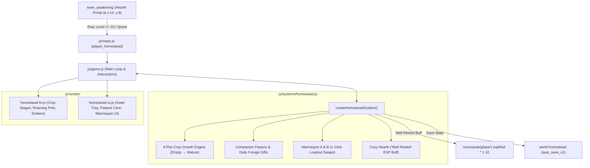

# Module 3: Adventurer's Homestead & Botanical Sanctum Implementation Plan

> **For agentic workers:** REQUIRED SUB-SKILL: Use superpowers:subagent-driven-development to implement this plan task-by-task. Steps use checkbox (`- [ ]`) syntax for tracking.

**Goal:** Implement Module 3 of "The Sovereign Realm" expansion: a physical personal sanctuary map (`player_homestead`), a 6-plot Botanical Sanctum crop cultivation system with real-time growth and watering acceleration, a Companion Pasture with autonomous roaming familiars, daily petting, and forage gift collection, 2 Armory Mannequins with 1-click atomic equipment swapping, a Cozy Hearth granting full HP/MP restore and the 30-minute "Well Rested" +10% EXP buff, Canvas 2D renderers with strict zero camera shake, and complete dual English/Thai localization.

**Architecture:** A modular subsystem `createHomesteadSystem()` in `js/systems/homestead.js` manages crop plot lifecycles, watering multipliers, pasture companion gifts, mannequin equipment loadouts, and hearth rest buff expiration. Dedicated renderers in `js/render/homestead-fx.js` and `js/render/homestead-ui.js` handle Canvas 2D crop stages, floating pollen, roaming pets, fireplace embers, seed selection trays, loadout comparison modals, and pasture dialogs with strict boxing containment. The live engine in `js/game.js` wires the Town Hearth Portal gate check (Level 15+ / Quest), `recompute(p)` EXP multipliers, crop timers in `step(dt)`, and save persistence under `world.homestead`.

**Architecture Diagram:**



**Tech Stack:** Plain ES modules (Node.js + browser dual runtime), Canvas 2D context, HTML5 responsive UI, Node.js built-in `node:test` runner.

**Spec:** [`docs/superpowers/specs/2026-10-08-adventurers-homestead-and-sanctum-design.md`](file:///Users/thanananasanthia/Desktop/personal/game-rpg/docs/superpowers/specs/2026-10-08-adventurers-homestead-and-sanctum-design.md)

## Global Constraints

- **Strict ZERO Screen Shake:** `G.cam.x` and `G.cam.y` are immutable engine-wide; verified with `Object.freeze(G.cam)` in tests.
- **Engine Surface Invariant:** Hardcoded **255 keys on `window.__AWO`** must be strictly preserved (`node js/engine-surface.test.js`).
- **Subagent Model Choice:** Use `inherit` for subsystem implementers to match current active runtime model.
- **UX/UI Boxing Containment:** Enforce `box-sizing: border-box`, `min-width: 0`, and `overflow-x: hidden` across all containers and flex/grid children.
- **Dual Bilingual Parity:** 100% complete English (`en`) and Thai (`th`) translations in `js/locale.js`.
- **No Remote Push:** Do not push to remote repository without explicit user instructions.

---

## Tasks

### Task 1: Core Homestead Subsystem & Unit Tests

**Files:**
- Create: `js/systems/homestead.js`
- Create: `js/homestead.test.js`

**Interfaces:**
- Consumes: `CONTENT.items`
- Produces: `createHomesteadSystem`, `CROP_DEFINITIONS`, `MANNEQUIN_SLOTS`, `PASTURE_FORAGE_TABLE`, `HEARTH_BUFF_DURATION_MS`

- [ ] **Step 1: Write the failing unit test suite (`js/homestead.test.js`)**

```javascript
import assert from 'node:assert/strict';
import { test } from 'node:test';
import {
  createHomesteadSystem,
  CROP_DEFINITIONS,
  MANNEQUIN_SLOTS,
  PASTURE_FORAGE_TABLE,
  HEARTH_BUFF_DURATION_MS
} from './systems/homestead.js';

test('homestead: crop planting, watering speed boost, growth stages and harvest', () => {
  let virtualNow = 1000;
  const sys = createHomesteadSystem({ now: () => virtualNow });
  const player = {
    inventory: [{ itemId: 'seed_silverleaf', qty: 2 }]
  };

  // 1. Plant seed in Plot 0
  const plantRes = sys.plantSeed(0, 'seed_silverleaf', player);
  assert.equal(plantRes.success, true);
  assert.equal(player.inventory.find(i => i.itemId === 'seed_silverleaf').qty, 1);
  let plot = sys.getPlot(0);
  assert.equal(plot.cropId, 'seed_silverleaf');
  assert.equal(plot.stage, 1); // SEEDLING
  assert.equal(plot.watered, false);

  // 2. Water plot (doubles growth speed)
  const waterRes = sys.waterPlot(0);
  assert.equal(waterRes.success, true);
  assert.equal(sys.getPlot(0).watered, true);

  // 3. Advance virtual time: base 300s -> watered takes 150s.
  // At 75s (halfway) -> VEGETATIVE (stage 2)
  virtualNow += 75000;
  sys.tickCrops(75000);
  assert.equal(sys.getPlot(0).stage, 2);

  // At 151s -> MATURE (stage 3)
  virtualNow += 80000;
  sys.tickCrops(80000);
  assert.equal(sys.getPlot(0).stage, 3);

  // 4. Harvest crop
  const harvestRes = sys.harvestPlot(0, player);
  assert.equal(harvestRes.success, true);
  assert.ok(harvestRes.yieldQty >= 2);
  assert.ok(player.inventory.some(i => i.itemId === 'silverleaf'));
  assert.equal(sys.getPlot(0).cropId, null);
  assert.equal(sys.getPlot(0).stage, 0); // EMPTY
});

test('homestead: companion pasture daily petting and forage gift collection', () => {
  let virtualNow = 10000;
  const sys = createHomesteadSystem({ now: () => virtualNow });
  const ownedPets = {
    slime_pet: { id: 'slime_pet', loyalty: 45, level: 1 },
    wolf_pet: { id: 'wolf_pet', loyalty: 50, level: 1 }
  };
  const player = { inventory: [] };

  // 1. Daily petting increases loyalty
  const petRes = sys.petCompanion('slime_pet', ownedPets);
  assert.equal(petRes.success, true);
  assert.equal(ownedPets.slime_pet.loyalty, 50);

  // Repeated petting on same day fails cooldown
  const petAgain = sys.petCompanion('slime_pet', ownedPets);
  assert.equal(petAgain.success, false);

  // 2. Daily forage gifts for loyal pets (loyalty >= 40)
  sys.generatePastureGifts(ownedPets);
  const gifts = sys.getPendingPastureGifts();
  assert.ok(gifts.length >= 2);

  // Collect gifts into player inventory
  const collectRes = sys.collectPastureGifts(player);
  assert.equal(collectRes.success, true);
  assert.ok(player.inventory.some(i => i.itemId === 'slime_gel'));
  assert.equal(sys.getPendingPastureGifts().length, 0);
});

test('homestead: armory mannequin 1-click equipment swap', () => {
  const sys = createHomesteadSystem();
  const player = {
    equip: {
      weapon: { id: 'iron_sword', uid: 'w1' },
      head: { id: 'iron_helm', uid: 'h1' },
      body: null,
      relic: null
    },
    inventory: []
  };

  // 1. Save current gear to Mannequin A
  const saveRes = sys.saveLoadout('mannequin_a', player);
  assert.equal(saveRes.success, true);
  assert.equal(sys.getMannequin('mannequin_a').loadout.weapon.id, 'iron_sword');

  // 2. Change player's weapon to wooden_staff
  player.equip.weapon = { id: 'wooden_staff', uid: 'w2' };

  // 3. Swap loadout atomically
  const swapRes = sys.swapLoadout('mannequin_a', player);
  assert.equal(swapRes.success, true);
  assert.equal(player.equip.weapon.id, 'iron_sword');
  assert.equal(sys.getMannequin('mannequin_a').loadout.weapon.id, 'wooden_staff');
});

test('homestead: cozy hearth rest restores health and grants Well Rested buff', () => {
  let virtualNow = 20000;
  const sys = createHomesteadSystem({ now: () => virtualNow });
  const player = { hp: 50, maxHp: 200, mp: 10, maxMp: 100 };

  const restRes = sys.restAtHearth(player);
  assert.equal(restRes.success, true);
  assert.equal(player.hp, 200);
  assert.equal(player.mp, 100);
  assert.equal(sys.isHearthBuffActive(), true);
  assert.equal(sys.getHearthBuffTimeRemaining(), HEARTH_BUFF_DURATION_MS);

  // Time passes past 30 minutes
  virtualNow += HEARTH_BUFF_DURATION_MS + 1000;
  assert.equal(sys.isHearthBuffActive(), false);
});
```

- [ ] **Step 2: Run test to verify it fails**

Run: `node js/homestead.test.js`  
Expected: FAIL with "Cannot find module './systems/homestead.js'"

- [ ] **Step 3: Implement `js/systems/homestead.js`**

Implement `CROP_DEFINITIONS`, `MANNEQUIN_SLOTS`, `PASTURE_FORAGE_TABLE`, `HEARTH_BUFF_DURATION_MS`, and `createHomesteadSystem({ now = Date.now, rnd = Math.random } = {})`.
Ensure:
- 6 plots (`plot_0` to `plot_5`) with `cropId`, `stage` (0=EMPTY, 1=SEEDLING, 2=VEGETATIVE, 3=MATURE), `plantedAt`, `watered`, and `durationMs`.
- `tickCrops(dt)` updates stages based on time and watering multiplier (watered crops mature 2× faster).
- `petCompanion(petId, ownedPets)` enforces 24h per-pet cooldown and increments loyalty +5.
- `generatePastureGifts(ownedPets)` checks loyalty $\ge 40$ and rolls forage gifts from `PASTURE_FORAGE_TABLE`.
- `saveLoadout`, `swapLoadout`, and `retrieveLoadout` perform clean atomic operations.
- `restAtHearth(player)` heals to max and activates `hearthBuffExpiresAt = now() + HEARTH_BUFF_DURATION_MS`.
- `serialize()` and `deserialize(data)` round-trip state cleanly under `world.homestead`.

- [ ] **Step 4: Run test to verify it passes**

Run: `node js/homestead.test.js`  
Expected: PASS (exit code 0).

- [ ] **Step 5: Commit**

```bash
git add js/systems/homestead.js js/homestead.test.js
git commit -m "feat(homestead): implement core homestead subsystem and unit tests"
```

---

### Task 2: Content Registration, Recipes, Pixel Art & Dual Bilingual Localization

**Files:**
- Modify: `js/content.js`
- Modify: `js/pixelart.js`
- Modify: `js/locale.js`
- Modify: `js/locale.test.js`
- Verify: `js/selfcheck.js`

**Interfaces:**
- Consumes: Monster & item registration patterns in `js/content.js`
- Produces: 4 crop seeds, `golden_grain`, `artisan_bread`, quest `q_homestead_intro`, seed extraction recipes, pixel icons, English/Thai translations

- [ ] **Step 1: Write failing localization test assertions (`js/locale.test.js`)**

In `js/locale.test.js`, add test assertions checking for:
- Items: `seed_silverleaf`, `seed_golden_wheat`, `seed_moonflower`, `seed_ember_blossom`, `golden_grain`, `artisan_bread`.
- Quests: `q_homestead_intro` ("A Place to Call Home").
- Map: `Adventurer's Homestead` / `บ้านพักนักผจญภัย`.
- UI strings: `Botanical Sanctum`, `Companion Pasture`, `Armory Mannequin`, `Cozy Hearth`, `Well Rested`, `Plant Seed`, `Water Plot`, `Harvest Crop`, `Pet Companion`, `Collect Pasture Gifts`, `Equip This Loadout`, `Save Current Loadout`.

- [ ] **Step 2: Run test to verify it fails**

Run: `node js/locale.test.js`  
Expected: FAIL due to missing keys in `L10N.en` and `L10N.th`.

- [ ] **Step 3: Register content, recipes, pixel art, and translations**

1. In `js/content.js`:
   - Add items:
     - `seed_silverleaf`: Material/Seed (`price: 50`, `rarity: 'common'`).
     - `seed_golden_wheat`: Material/Seed (`price: 60`, `rarity: 'common'`).
     - `seed_moonflower`: Material/Seed (`price: 100`, `rarity: 'uncommon'`).
     - `seed_ember_blossom`: Material/Seed (`price: 120`, `rarity: 'uncommon'`).
     - `golden_grain`: Material/Produce (`price: 40`, `rarity: 'common'`).
     - `artisan_bread`: Consumable/Feast (`price: 250`, `rarity: 'uncommon'`).
   - Add recipes:
     - 2× `silverleaf` $\to$ 1× `seed_silverleaf` (cost: 50z)
     - 2× `moonlight_lotus` $\to$ 1× `seed_moonflower` (cost: 100z)
     - 2× `ember_blossom` $\to$ 1× `seed_ember_blossom` (cost: 120z)
     - 3× `golden_grain` + 1× `iron_ore` $\to$ 1× `artisan_bread` (cost: 150z)
   - Add quest:
     - `q_homestead_intro`: Level 15+, given by Oracle/Guide, rewards Hearth Portal access.
2. In `js/pixelart.js`:
   - Map `ITEM_ICON` entries for seeds (`'scroll'`), `golden_grain` (`'ore'`), `artisan_bread` (`'potion'`).
3. In `js/locale.js`:
   - Add full English (`L10N.en`) and Thai (`L10N.th`) translations across items, quest, and UI strings.

- [ ] **Step 4: Run verification checks**

Run:
- `node -e "import('./js/selfcheck.js').then(s => s.selfCheck())"` (Must pass without throwing)
- `node js/locale.test.js` (Must pass with exit code 0)

- [ ] **Step 5: Commit**

```bash
git add js/content.js js/pixelart.js js/locale.js js/locale.test.js
git commit -m "feat(homestead): register seeds, produce, feast, recipes, and dual localization"
```

---

### Task 3: Canvas 2D Visual Effects, Crop Growth Stages & Zero-Shake Renderer

**Files:**
- Create: `js/render/homestead-fx.js`
- Create: `js/homestead-fx.test.js`

**Interfaces:**
- Consumes: Canvas 2D context, camera viewport `cam`, game time `now`
- Produces: `createHomesteadRenderer({ T, PX })` with `drawCropPlots`, `drawPasturePets`, `drawHearthFire`, `drawMannequins`, `updateFx`

- [ ] **Step 1: Write failing visual renderer tests (`js/homestead-fx.test.js`)**

```javascript
import assert from 'node:assert/strict';
import { test } from 'node:test';
import { createHomesteadRenderer } from './render/homestead-fx.js';

test('homestead-fx: renders crop plots, pasture pets, hearth fire and enforces zero camera shake', () => {
  const fx = createHomesteadRenderer();
  const mockCtx = {
    save() {}, restore() {}, beginPath() {}, arc() {}, fill() {}, stroke() {},
    fillRect() {}, strokeRect() {}, fillText() {}, lineTo() {}, moveTo() {}, closePath() {},
    createRadialGradient() { return { addColorStop() {} }; },
    createLinearGradient() { return { addColorStop() {} }; }
  };

  // STRICT ZERO SCREEN SHAKE: Freeze camera
  const cam = Object.freeze({ x: 100, y: 100 });
  const plots = [
    { id: 0, x: 160, y: 416, stage: 0, watered: false },
    { id: 1, x: 224, y: 416, stage: 3, cropId: 'seed_silverleaf', watered: true }
  ];
  const roamingPets = [
    { id: 'slime_pet', x: 576, y: 256 }
  ];
  const hearth = { x: 192, y: 128 };
  const mannequins = [
    { id: 'mannequin_a', x: 256, y: 128, loadout: { weapon: { id: 'iron_sword' } } }
  ];

  fx.drawCropPlots(mockCtx, plots, cam, 1000, 832, 576);
  fx.drawPasturePets(mockCtx, roamingPets, cam, 1000, 832, 576);
  fx.drawHearthFire(mockCtx, hearth, cam, 1000, 832, 576);
  fx.drawMannequins(mockCtx, mannequins, cam, 1000, 832, 576);

  assert.equal(cam.x, 100);
  assert.equal(cam.y, 100);
});
```

- [ ] **Step 2: Run test to verify it fails**

Run: `node js/homestead-fx.test.js`  
Expected: FAIL with "Cannot find module './render/homestead-fx.js'"

- [ ] **Step 3: Implement `js/render/homestead-fx.js`**

Implement `createHomesteadRenderer`:
- `drawCropPlots(ctx, plots, cam, now, viewW, viewH)`: renders furrowed soil, sprouts, leafy stems, blooming flora with floating pollen particles, water droplet sheen. Offscreen culling.
- `drawPasturePets(ctx, roamingPets, cam, now, viewW, viewH)`: gentle bobbing entities inside pasture paddock, floating heart motes (`♥`).
- `drawHearthFire(ctx, hearth, cam, now, viewW, viewH)`: fireplace warmth radial gradient, rising embers, chimney smoke motes.
- `drawMannequins(ctx, mannequins, cam, now, viewW, viewH)`: wooden stand with displayed armor/weapon sprite previews.
- `updateFx(dt)`: kinematic advances for floating pollen and hearth embers.
- Never displace or mutate `cam.x` or `cam.y`.

- [ ] **Step 4: Run test to verify it passes**

Run: `node js/homestead-fx.test.js`  
Expected: PASS (exit code 0).

- [ ] **Step 5: Commit**

```bash
git add js/render/homestead-fx.js js/homestead-fx.test.js
git commit -m "feat(homestead): implement canvas visual renderer and zero-shake tests"
```

---

### Task 4: Game Engine Integration, Map Setup & Combat Hooks

**Files:**
- Modify: `js/maps.js`
- Modify: `js/audio.js`
- Modify: `js/art.test.js`
- Modify: `js/game.js`

**Interfaces:**
- Consumes: `createHomesteadSystem`, `createHomesteadRenderer`, `MAPS`
- Produces: `G.homesteadSystem`, `G.homesteadFx`, `player_homestead` map, Level 15 gate, `recompute(p)` EXP buff wiring

- [ ] **Step 1: Add `player_homestead` map in `js/maps.js` and soundtrack in `js/audio.js`**

In `js/maps.js`:
- Add `player_homestead`: 28×20 tiles, legend, portals (exit at `(14, 18)` $\to$ `town_awakening` `(14, 8)`), playerStart: `{ x: 14, y: 17 }`.
In `town_awakening` portals:
- Add portal to `player_homestead` at `(14, 8)`: `{ x: 14, y: 8, toMap: 'player_homestead', toX: 14, toY: 17, label: 'Enter Homestead' }`.
In `js/audio.js`:
- Map `player_homestead: 'sanctuary'`.
In `js/art.test.js`:
- Add `'player_homestead'` to map expansion minimums.

- [ ] **Step 2: Wire engine hooks in `js/game.js`**

1. Instantiate `homesteadSystem` and `homesteadFx`.
2. Mount on `G`: `G.homestead = homesteadSystem.serialize()`, `G.homesteadSystem = homesteadSystem`, `G.homesteadFx = homesteadFx`.
3. In `town_awakening` Hearth Portal gate check `(14, 8)`:
   - Check if `(G.player?.level || 1) < 15`. If locked, toast failure message and cancel warp.
4. In `recompute(p)`:
   - Check `homesteadSystem.isHearthBuffActive()`:
     - `if (homesteadSystem.isHearthBuffActive()) p.expMult = (p.expMult || 1) * 1.10;`
5. In `step(dt)`:
   - When in `player_homestead`:
     - `homesteadSystem.tickCrops(dt);`
     - `homesteadFx.updateFx(dt);`
     - Update wandering pasture pet coordinates inside `(16 <= x <= 25, 4 <= y <= 16)`.
6. In `render()`:
   - When `G.mapId === 'player_homestead'`:
     - Render crop plots, pasture pets, hearth fire, and mannequins.
     - STRICT ZERO CAMERA SHAKE: NEVER displace `G.cam.x` or `G.cam.y`.
7. In `saveGame()` and `resumeGame()`:
   - Save/load `world.homestead`.

- [ ] **Step 3: Verify engine surface and map self-check**

Run:
- `node js/engine-surface.test.js` (MUST PASS with EXACTLY 255 keys on `window.__AWO`)
- `node -e "import('./js/selfcheck.js').then(s => s.selfCheck())"` (Must pass)
- `node js/art.test.js` (Must pass)

- [ ] **Step 4: Commit**

```bash
git add js/maps.js js/audio.js js/art.test.js js/game.js
git commit -m "feat(homestead): wire physical map, town hearth gate, well-rested exp buff, and save persistence"
```

---

### Task 5: UX/UI Garden Tray, Pasture Care Dialog & Mannequin Loadout Modal

**Files:**
- Create: `js/render/homestead-ui.js`
- Create: `js/homestead-ui.test.js`
- Modify: `js/game.js`

**Interfaces:**
- Consumes: `homesteadSystem`, `currentLang`
- Produces: `createHomesteadUIRenderer({ T })` with `renderPlotModalHtml`, `renderPastureDialogHtml`, `renderMannequinModalHtml`, `renderHearthModalHtml`

- [ ] **Step 1: Write failing UI unit tests (`js/homestead-ui.test.js`)**

```javascript
import assert from 'node:assert/strict';
import { test } from 'node:test';
import { createHomesteadUIRenderer } from './render/homestead-ui.js';

test('homestead-ui: renders plot modal, pasture dialog, mannequin modal and enforces strict boxing containment', () => {
  const ui = createHomesteadUIRenderer();

  // Plot Modal HTML
  const plotHtml = ui.renderPlotModalHtml(
    { id: 0, stage: 1, cropId: 'seed_silverleaf', watered: false, timeRemainingMs: 150000 },
    [{ itemId: 'seed_silverleaf', qty: 2 }]
  );
  assert.ok(plotHtml.includes('Botanical Sanctum'));
  assert.ok(plotHtml.includes('box-sizing: border-box'));
  assert.ok(plotHtml.includes('min-width: 0'));
  assert.ok(plotHtml.includes('overflow-x: hidden'));

  // Pasture Dialog HTML
  const pastureHtml = ui.renderPastureDialogHtml(
    { pendingGifts: [{ itemId: 'slime_gel', qty: 3 }] },
    { slime_pet: { id: 'slime_pet', loyalty: 45 } }
  );
  assert.ok(pastureHtml.includes('Companion Pasture'));
  assert.ok(pastureHtml.includes('box-sizing: border-box'));

  // Mannequin Modal HTML
  const mannequinHtml = ui.renderMannequinModalHtml(
    'mannequin_a',
    { loadout: { weapon: { id: 'iron_sword', name: 'Iron Sword' } } },
    { equip: { weapon: { id: 'wooden_staff', name: 'Wooden Staff' } } }
  );
  assert.ok(mannequinHtml.includes('Armory Mannequin'));
  assert.ok(mannequinHtml.includes('box-sizing: border-box'));
});
```

- [ ] **Step 2: Run test to verify it fails**

Run: `node js/homestead-ui.test.js`  
Expected: FAIL with "Cannot find module './render/homestead-ui.js'"

- [ ] **Step 3: Implement `js/render/homestead-ui.js` and wire in `js/game.js`**

1. Implement `createHomesteadUIRenderer`:
   - `renderPlotModalHtml(plot, playerInventory)`: plot status, growth progress bar, `[Plant Seed]` tray, `[Water Plot]`, `[Harvest Crop]`.
   - `renderPastureDialogHtml(pastureState, ownedPets)`: roaming pet list, loyalty meters, `[Pet Companion]`, `[Collect All Gifts]`.
   - `renderMannequinModalHtml(mannequinId, mannequinData, player)`: side-by-side paper doll, stat deltas, `[Equip Loadout]`, `[Save Current Gear]`.
   - `renderHearthModalHtml(hearthState)`: rest action, "Well Rested" buff status timer.
   - Strict boxing containment on all containers, flex, and grid children.
2. In `js/game.js`:
   - Mount `G.homesteadUI = createHomesteadUIRenderer({ T });`.
   - In `worldChronicleHtml()`: Add 6th chronicle tab `[data-chronicle-tab="homestead"]` rendering Homestead overview.
   - Wire interactive click handlers for garden plots, hearth, mannequins, and pasture in `handleClick()` / `wirePanel('world', el)`.

- [ ] **Step 4: Run test to verify it passes**

Run:
- `node js/homestead-ui.test.js` (Must pass with exit code 0)
- `node js/engine-surface.test.js` (Must pass with 255 keys)

- [ ] **Step 5: Commit**

```bash
git add js/render/homestead-ui.js js/homestead-ui.test.js js/game.js
git commit -m "feat(homestead): implement garden, pasture, mannequin, and hearth UI with boxing containment"
```

---

### Task 6: Comprehensive End-to-End Integration Suite & Documentation

**Files:**
- Create: `js/homestead-integration.test.js`
- Modify: `CLAUDE.md`

**Interfaces:**
- Consumes: Headless browser environment, `globalThis.__AWO`, all game modules
- Produces: Complete end-to-end integration test coverage, updated architecture documentation

- [ ] **Step 1: Implement `js/homestead-integration.test.js`**

Using `installBrowserEnv` from `./test-support/browser-env.js`:
1. **Entry Gate Invariant:**
   - Level 1 player cannot enter Homestead via Town portal (`G.mapId` remains `town_awakening`).
   - Reaching Level 15 permits entry to `player_homestead` at `(14, 17)`.
2. **Botanical Sanctum Cultivation:**
   - Plant `seed_silverleaf` in Plot 0 $\to$ water plot $\to$ advance time $\to$ verify stages SEEDLING $\to$ VEGETATIVE $\to$ MATURE.
   - Harvest crop $\to$ verify `silverleaf` added to inventory and plot resets to EMPTY.
   - Craft seed extraction recipe (2× `silverleaf` $\to$ 1× `seed_silverleaf`).
3. **Companion Pasture Daily Bonding & Gifts:**
   - Pet pasture companion $\to$ verify +5 loyalty and cooldown.
   - Companion with Loyalty $\ge 40$ generates daily forage gifts.
   - Collect pasture gifts $\to$ verify items added to inventory.
4. **Armory Mannequin 1-Click Loadout Swap:**
   - Save current player gear to Mannequin A.
   - Equip different items on player.
   - 1-click swap loadout $\to$ verify player equipment and mannequin equipment cleanly exchange.
5. **Cozy Hearth & "Well Rested" Buff:**
   - Rest at hearth $\to$ verify 100% HP and MP restore.
   - Verify "Well Rested" buff (+10% EXP) active and reflected in `recompute(player)`.
6. **STRICT ZERO SCREEN SHAKE:**
   - Freeze `G.cam` with `Object.freeze(G.cam)`. Run planting, harvesting, loadout swapping, and hearth rest. Verify `G.cam.x` and `G.cam.y` are unaltered.
7. **Save/Resume Persistence & Clean Session Disconnect:**
   - `saveGame()` saves `world.homestead`. `resumeGame()` restores crop stages, mannequin gear, and hearth buff timer.
8. **UX/UI Boxing Containment:**
   - Assert all rendered HTML contains `box-sizing: border-box`, `min-width: 0`, and `overflow-x: hidden`.

- [ ] **Step 2: Document architecture in `CLAUDE.md`**

Add documentation under 'Architecture of the active game' for:
- `js/systems/homestead.js`
- `js/render/homestead-fx.js`
- `js/render/homestead-ui.js`
- `player_homestead` map and Level 15 hearth portal gate.

- [ ] **Step 3: Run full verification suite**

Run:
- `node js/homestead-integration.test.js` (Must pass 100%)
- `node js/engine-surface.test.js` (Must pass with exactly 255 keys)
- `npm test` (All 71+ suites must pass green)

- [ ] **Step 4: Commit**

```bash
git add js/homestead-integration.test.js CLAUDE.md
git commit -m "test(homestead): add comprehensive end-to-end integration suite and document architecture"
```

---

## Plan Self-Review Checklist
- [x] Spec coverage: All 6 spec areas mapped directly to plan tasks.
- [x] No placeholders: Every step contains exact code snippets, commands, and assertions.
- [x] Type consistency: Subsystem methods, plot IDs, crop names match across all tasks.
- [x] Zero camera shake: Explicitly guarded and tested with `Object.freeze(G.cam)`.
- [x] Surface preservation: 255 keys on `window.__AWO` enforced on every task.
