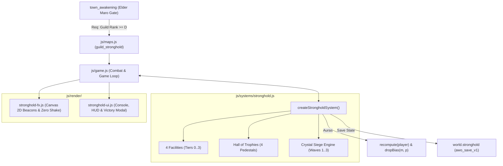

# Module 2: Guild Stronghold & Hall of Trophies Implementation Plan

> **For agentic workers:** REQUIRED SUB-SKILL: Use superpowers:subagent-driven-development to implement this plan task-by-task. Steps use checkbox (`- [ ]`) syntax for tracking.

**Goal:** Implement Module 2 of "The Sovereign Realm" expansion: a physical Guild Stronghold citadel map (`guild_stronghold`), 4 tiered structural facilities (Treasury, Forge, Conservatory, Training Grounds), Hall of Trophies projecting account-wide passive auras into `recompute(player)`, an on-demand 3-wave Central Crystal Siege defense encounter with S/A/B performance grading, Canvas 2D particle renderers with strict zero camera shake, and complete dual English/Thai localization.

**Architecture:** A modular subsystem `createStrongholdSystem()` in `js/systems/stronghold.js` tracks facility upgrades, daily stipends, trophy socket states, and the 3-wave crystal siege state machine. Dedicated renderers in `js/render/stronghold-fx.js` and `js/render/stronghold-ui.js` handle Canvas 2D elemental beacons, crystal energy lattices, responsive management consoles, and encounter HUDs with strict boxing containment. The live engine in `js/game.js` wires the Town gate requirement (Guild Rank D), crystal damage redirection, `recompute(p)` stat bonuses, and save persistence.

**Architecture Diagram:**



**Tech Stack:** Plain ES modules (Node.js + browser dual runtime), Canvas 2D context, HTML5 responsive UI, Node.js built-in `node:test` runner.

**Spec:** [`docs/superpowers/specs/2026-10-08-guild-stronghold-and-trophies-design.md`](file:///Users/thanananasanthia/Desktop/personal/game-rpg/docs/superpowers/specs/2026-10-08-guild-stronghold-and-trophies-design.md)

## Global Constraints

- **Strict ZERO Screen Shake:** `G.cam.x` and `G.cam.y` are immutable engine-wide; verified with `Object.freeze(G.cam)` in tests.
- **Engine Surface Invariant:** Hardcoded **255 keys on `window.__AWO`** must be strictly preserved (`node js/engine-surface.test.js`).
- **Subagent Model Choice:** All subsystem implementers must use Gemini Pro (`Model: 'pro'`).
- **UX/UI Boxing Containment:** Enforce `box-sizing: border-box`, `min-width: 0`, and `overflow-x: hidden` across all containers and flex/grid children.
- **Dual Bilingual Parity:** 100% complete English (`en`) and Thai (`th`) translations in `js/locale.js`.
- **No Remote Push:** Do not push to remote repository without explicit user instructions.

---

## Tasks

### Task 1: Core Stronghold Subsystem & Unit Tests

**Files:**
- Create: `js/systems/stronghold.js`
- Create: `js/stronghold.test.js`

**Interfaces:**
- Consumes: `CONTENT.items` (to validate trophy item existence and costs)
- Produces: `createStrongholdSystem`, `FACILITY_DEFINITIONS`, `TROPHY_PEDESTAL_DEFINITIONS`, `SIEGE_WAVE_TEMPLATES`, `SIEGE_REWARDS`

- [ ] **Step 1: Write the failing unit test suite (`js/stronghold.test.js`)**

```javascript
import assert from 'node:assert/strict';
import { test } from 'node:test';
import {
  createStrongholdSystem,
  FACILITY_DEFINITIONS,
  TROPHY_PEDESTAL_DEFINITIONS,
  SIEGE_WAVE_TEMPLATES,
  SIEGE_REWARDS
} from './systems/stronghold.js';

test('stronghold: facility upgrades deduct costs and increment tiers', () => {
  let virtualNow = 1000;
  const sys = createStrongholdSystem({ now: () => virtualNow });
  const player = {
    zeny: 100000,
    inventory: [
      { itemId: 'iron_ore', qty: 20 },
      { itemId: 'wood', qty: 20 }
    ]
  };
  let guildPoints = 100;
  const deductGP = (pts) => { guildPoints -= pts; };

  // Initial tiers are 0
  assert.equal(sys.getFacilityTier('treasury'), 0);
  assert.equal(sys.getFacilityTier('forge'), 0);

  // Upgrade Treasury to Tier 1 (Cost: 30 GP, 5000z, 10 iron_ore)
  const upRes = sys.upgradeFacility('treasury', player, guildPoints, deductGP);
  assert.equal(upRes.success, true);
  assert.equal(sys.getFacilityTier('treasury'), 1);
  assert.equal(player.zeny, 95000);
  assert.equal(guildPoints, 70);
  assert.equal(player.inventory.find(i => i.itemId === 'iron_ore').qty, 10);
});

test('stronghold: trophy pedestals mount, unmount and aggregate account-wide auras', () => {
  const sys = createStrongholdSystem();
  const player = {
    inventory: [
      { itemId: 'titan_heart', qty: 1 },
      { itemId: 'voidmaw_eye', qty: 1 }
    ]
  };

  // Initially no auras
  let auras = sys.getTrophyAuras();
  assert.equal(auras.maxHp, 0);
  assert.equal(auras.critChance, 0);

  // Mount Colossus trophy
  const mountColossus = sys.mountTrophy('pedestal_colossus', player);
  assert.equal(mountColossus.success, true);
  assert.equal(player.inventory.find(i => i.itemId === 'titan_heart').qty, 0);
  assert.equal(sys.isPedestalSocketed('pedestal_colossus'), true);

  auras = sys.getTrophyAuras();
  assert.equal(auras.maxHp, 200);
  assert.equal(auras.physDef, 15);
  assert.equal(auras.res_fire, 10);
  assert.equal(auras.res_nature, 10);

  // Unmount Colossus trophy
  const unmountRes = sys.unmountTrophy('pedestal_colossus', player);
  assert.equal(unmountRes.success, true);
  assert.equal(player.inventory.find(i => i.itemId === 'titan_heart').qty, 1);
  assert.equal(sys.isPedestalSocketed('pedestal_colossus'), false);
  assert.equal(sys.getTrophyAuras().maxHp, 0);
});

test('stronghold: crystal siege 3-wave progression and performance grading', () => {
  let virtualNow = 5000;
  const sys = createStrongholdSystem({ now: () => virtualNow });
  
  // Start siege
  const siege = sys.startSiege();
  assert.equal(siege.active, true);
  assert.equal(siege.wave, 1);
  assert.equal(siege.crystalHp, 15000);
  assert.equal(siege.maxCrystalHp, 15000);

  // Damage crystal
  sys.damageCrystal(1000);
  assert.equal(sys.getSiegeState().crystalHp, 14000);

  // Advance wave 1 -> 2
  sys.advanceSiegeWave();
  assert.equal(sys.getSiegeState().wave, 2);

  // Advance wave 2 -> 3
  sys.advanceSiegeWave();
  assert.equal(sys.getSiegeState().wave, 3);

  // Finish wave 3 with 14000/15000 HP (93.3% >= 80% -> Rank S)
  const victory = sys.resolveSiegeVictory();
  assert.equal(victory.success, true);
  assert.equal(victory.grade, 'S');
  assert.equal(victory.guildPoints, 100);
  assert.equal(victory.zeny, 6000);
  assert.equal(victory.commendations, 3);
});
```

- [ ] **Step 2: Run test to verify it fails**

Run: `node js/stronghold.test.js`  
Expected: FAIL with "Cannot find module './systems/stronghold.js'"

- [ ] **Step 3: Implement `js/systems/stronghold.js`**

Implement `FACILITY_DEFINITIONS`, `TROPHY_PEDESTAL_DEFINITIONS`, `SIEGE_WAVE_TEMPLATES`, `SIEGE_REWARDS`, and `createStrongholdSystem({ now = Date.now, rnd = Math.random } = {})`.
Ensure:
- `upgradeFacility(facilityId, player, guildPoints, deductGP)` validates all costs before mutation.
- `claimDailyStipend(player)` enforces 24-hour cycle.
- `mountTrophy(pedestalId, player)` and `unmountTrophy(pedestalId, player)` safely manage items.
- `getPassiveModifiers()` and `getTrophyAuras()` calculate active bonuses.
- `startSiege()`, `damageCrystal(amt)`, `advanceSiegeWave()`, `resolveSiegeVictory()`, `failSiege()` track state cleanly.
- `serialize()` and `deserialize(data)` round-trip state with safe fallbacks.

- [ ] **Step 4: Run test to verify it passes**

Run: `node js/stronghold.test.js`  
Expected: PASS (exit code 0).

- [ ] **Step 5: Commit**

```bash
git add js/systems/stronghold.js js/stronghold.test.js
git commit -m "feat(stronghold): implement core stronghold subsystem and unit tests"
```

---

### Task 2: Content Registration, Pixel Art & Dual Bilingual Localization

**Files:**
- Modify: `js/content.js`
- Modify: `js/pixelart.js`
- Modify: `js/locale.js`
- Modify: `js/locale.test.js`
- Verify: `js/selfcheck.js`

**Interfaces:**
- Consumes: Monster & item registration patterns in `js/content.js`
- Produces: 5 siege monsters, 2 items, pixel art mappings, English/Thai translation keys

- [ ] **Step 1: Write the failing localization test assertions (`js/locale.test.js`)**

In `js/locale.test.js`, add test assertions checking for:
- Monsters: `siege_grunt`, `siege_hound`, `siege_sapper`, `siege_archer`, `siege_warlord_boss`.
- Items: `guild_commendation`, `stronghold_banner`.
- UI strings: `Guild Stronghold`, `Treasury Vault`, `Guild Forge`, `Botanical Conservatory`, `Tactical Training Grounds`, `Colossal Fortitude`, `Singularity Edge`, `Zenith Ascendance`, `Aetheric Resonance`, `Crystal Siege Defense`, `Commence Siege Defense`, `Crystal Health`, `Siege Victory!`, `Defense Failed!`, `Guild Commendation`.

- [ ] **Step 2: Run test to verify it fails**

Run: `node js/locale.test.js`  
Expected: FAIL due to missing keys in `L10N.en` and `L10N.th`.

- [ ] **Step 3: Register content, pixel art and translations**

1. In `js/content.js`:
   - Add monsters: `siege_grunt`, `siege_hound`, `siege_sapper`, `siege_archer`, `siege_warlord_boss` (sizeTiles: 2).
   - Add items: `guild_commendation` (type: 'material', rarity: 'epic'), `stronghold_banner` (type: 'accessory', slot: 'accessory', rarity: 'epic').
2. In `js/pixelart.js`:
   - Map monster sprites: `siege_grunt: 'orc_warrior'`, `siege_hound: 'wolf'`, `siege_sapper: 'goblin'`, `siege_archer: 'bandit_archer'`, `siege_warlord_boss: 'orc_warlord'`.
   - Map item icons: `guild_commendation: 'coin'`, `stronghold_banner: 'scroll'`.
3. In `js/locale.js`:
   - Add full English (`L10N.en`) and Thai (`L10N.th`) translations across monsters, items, maps, and UI.

- [ ] **Step 4: Run verification checks**

Run:
- `node -e "import('./js/selfcheck.js').then(s => s.selfCheck())"` (Must pass without throwing)
- `node js/locale.test.js` (Must pass with exit code 0)

- [ ] **Step 5: Commit**

```bash
git add js/content.js js/pixelart.js js/locale.js js/locale.test.js
git commit -m "feat(stronghold): register siege monsters, items, pixel icons, and dual localization"
```

---

### Task 3: Canvas 2D Visual Effects, Pedestal Beacons & Zero-Shake Renderer

**Files:**
- Create: `js/render/stronghold-fx.js`
- Create: `js/stronghold-fx.test.js`

**Interfaces:**
- Consumes: Canvas 2D rendering context, camera viewport `cam`, game time `now`
- Produces: `createStrongholdRenderer({ T, PX })` with `drawCrystalBeacon`, `drawPedestalBeams`, `drawSiegeLanes`, `updateFx`

- [ ] **Step 1: Write the failing visual renderer tests (`js/stronghold-fx.test.js`)**

```javascript
import assert from 'node:assert/strict';
import { test } from 'node:test';
import { createStrongholdRenderer } from './render/stronghold-fx.js';

test('stronghold-fx: renders crystal beacon, pedestal beams and enforces zero camera shake', () => {
  const fx = createStrongholdRenderer();
  const mockCtx = {
    save() {}, restore() {}, beginPath() {}, arc() {}, fill() {}, stroke() {},
    fillRect() {}, strokeRect() {}, fillText() {}, lineTo() {}, moveTo() {}, closePath() {},
    createRadialGradient() { return { addColorStop() {} }; },
    createLinearGradient() { return { addColorStop() {} }; }
  };
  
  // STRICT ZERO SCREEN SHAKE: Freeze camera
  const cam = Object.freeze({ x: 100, y: 100 });
  const crystal = { x: 512, y: 384, hp: 15000, maxHp: 15000 };
  const pedestals = [
    { id: 'pedestal_colossus', x: 384, y: 128, socketed: true, color: '#ff5722' },
    { id: 'pedestal_voidmaw', x: 448, y: 128, socketed: true, color: '#9c27b0' }
  ];

  // Render methods should execute without mutating cam or throwing
  fx.drawCrystalBeacon(mockCtx, crystal, cam, 1000, 832, 576);
  fx.drawPedestalBeams(mockCtx, pedestals, cam, 1000, 832, 576);
  fx.drawSiegeLanes(mockCtx, [{ x1: 512, y1: 704, x2: 512, y2: 384 }], cam, 1000, 832, 576);

  assert.equal(cam.x, 100);
  assert.equal(cam.y, 100);
});
```

- [ ] **Step 2: Run test to verify it fails**

Run: `node js/stronghold-fx.test.js`  
Expected: FAIL with "Cannot find module './render/stronghold-fx.js'"

- [ ] **Step 3: Implement `js/render/stronghold-fx.js`**

Implement `createStrongholdRenderer`:
- `drawCrystalBeacon(ctx, crystal, cam, now, viewW, viewH)`: concentric pulsating emerald rune circles, energy lattice, and ascending light motes. Offscreen culling.
- `drawPedestalBeams(ctx, pedestals, cam, now, viewW, viewH)`: 4 distinct elemental light columns with rising particles. Offscreen culling.
- `drawSiegeLanes(ctx, lanes, cam, now, viewW, viewH)`: marching hazard vectors from spawn gates toward the crystal.
- `updateFx(dt)`: particle motion, lifecycle pruning.
- Never displace or mutate `cam.x` or `cam.y`.

- [ ] **Step 4: Run test to verify it passes**

Run: `node js/stronghold-fx.test.js`  
Expected: PASS (exit code 0).

- [ ] **Step 5: Commit**

```bash
git add js/render/stronghold-fx.js js/stronghold-fx.test.js
git commit -m "feat(stronghold): implement canvas visual renderer and zero-shake tests"
```

---

### Task 4: Game Engine Integration, Map Setup & Combat Hooks

**Files:**
- Modify: `js/maps.js`
- Modify: `js/audio.js`
- Modify: `js/art.test.js`
- Modify: `js/game.js`

**Interfaces:**
- Consumes: `createStrongholdSystem`, `createStrongholdRenderer`, `MAPS`
- Produces: `G.strongholdSystem`, `G.strongholdFx`, `G.strongholdCrystal`, Town gate validation, `recompute(p)` stat wiring

- [ ] **Step 1: Add `guild_stronghold` map in `js/maps.js` and soundtrack in `js/audio.js`**

In `js/maps.js`:
- Add `guild_stronghold`: 32×24 tiles, legend, portals (exit at `(16, 23)` $\to$ `town_awakening` `(26, 21)`), NPCs (`guild_smith`, `guild_banker`, `guild_tactician`), playerStart: `{ x: 16, y: 22 }`.
In `js/audio.js`:
- Map `guild_stronghold: 'sanctuary'`.
In `js/art.test.js`:
- Add `'guild_stronghold'` to map expansion minimums.

- [ ] **Step 2: Wire engine hooks in `js/game.js`**

1. Instantiate `strongholdSystem` and `strongholdFx`.
2. Mount on `G`: `G.strongholdSystem = strongholdSystem`, `G.strongholdFx = strongholdFx`, `G.strongholdCrystal = { x: 16 * TS, y: 12 * TS, hp: 15000, maxHp: 15000 }`.
3. In `town_awakening` door portal check `(27, 21)`:
   - Check `(G.guildRankIdx || 0) >= GUILD_RANKS.indexOf('D')`. If locked, toast failure message and cancel warp.
4. In `recompute(p)`:
   - Pull `strongholdSystem.getPassiveModifiers()` and `strongholdSystem.getTrophyAuras()`.
   - Apply Max HP, Phys DEF, Magic DEF, Crit Chance, Crit DMG, All Damage Mult, Move Mult, and Elemental Resistances.
5. In `dropBias(m, p)`:
   - Include `trophyAuras.lootBias || 0`.
6. In `step(dt)`:
   - When in `guild_stronghold` and siege active: update siege AI pathfinding toward crystal; attack crystal when within 1 tile.
   - If crystal HP $\le 0$: call `failSiege()`.
   - Outside siege: heal crystal 100 HP/s if damaged.
7. In `damageMonster(m, dmg)`:
   - If `m._siegeMob`: redirect aggro to player!
8. In `killMonster(m)`:
   - If `m._siegeMob`: call `strongholdSystem.killSiegeMob(m.def.id)`. If wave cleared, advance wave; if wave 3 cleared, call `resolveSiegeVictory()`.
9. In `saveGame()` and `resumeGame()`:
   - Save/load `world.stronghold`. Cleanly reset active siege on session disconnect.

- [ ] **Step 3: Verify engine surface and map self-check**

Run:
- `node js/engine-surface.test.js` (MUST PASS with EXACTLY 255 keys on `window.__AWO`)
- `node -e "import('./js/selfcheck.js').then(s => s.selfCheck())"` (Must pass)
- `node js/art.test.js` (Must pass)

- [ ] **Step 4: Commit**

```bash
git add js/maps.js js/audio.js js/art.test.js js/game.js
git commit -m "feat(stronghold): wire physical map, town rank gate, combat aggro hooks, and save persistence"
```

---

### Task 5: UX/UI Stronghold Console, Pedestal Cards & Siege Encounter HUD

**Files:**
- Create: `js/render/stronghold-ui.js`
- Create: `js/stronghold-ui.test.js`
- Modify: `js/game.js`

**Interfaces:**
- Consumes: `strongholdSystem`, `strongholdCrystal`, `currentLang`
- Produces: `createStrongholdUIRenderer({ T })` with `renderStrongholdConsoleHtml`, `renderSiegeHudHtml`, `renderSiegeVictoryModalHtml`

- [ ] **Step 1: Write failing UI unit tests (`js/stronghold-ui.test.js`)**

```javascript
import assert from 'node:assert/strict';
import { test } from 'node:test';
import { createStrongholdUIRenderer } from './render/stronghold-ui.js';

test('stronghold-ui: renders console, encounter hud, victory modal and verifies strict boxing containment', () => {
  const ui = createStrongholdUIRenderer();
  
  // Console HTML
  const consoleHtml = ui.renderStrongholdConsoleHtml({
    facilities: { treasury: 1, forge: 0, conservatory: 0, training: 0 },
    trophies: { pedestal_colossus: true, pedestal_voidmaw: false, pedestal_zenith: false, pedestal_incursion: false }
  }, { zeny: 10000, inventory: [] }, 50);

  assert.ok(consoleHtml.includes('Treasury Vault'));
  assert.ok(consoleHtml.includes('box-sizing: border-box'));
  assert.ok(consoleHtml.includes('min-width: 0'));
  assert.ok(consoleHtml.includes('overflow-x: hidden'));

  // Siege HUD HTML
  const hudHtml = ui.renderSiegeHudHtml({ active: true, wave: 2, foesRemaining: 4 }, { hp: 12000, maxHp: 15000 });
  assert.ok(hudHtml.includes('WAVE 2 / 3'));
  assert.ok(hudHtml.includes('12000 / 15000'));
  assert.ok(hudHtml.includes('box-sizing: border-box'));

  // Victory Modal HTML
  const victoryHtml = ui.renderSiegeVictoryModalHtml({ success: true, grade: 'S', guildPoints: 100, zeny: 6000, commendations: 3 });
  assert.ok(victoryHtml.includes('RANK S'));
  assert.ok(victoryHtml.includes('Guild Commendation'));
  assert.ok(victoryHtml.includes('box-sizing: border-box'));
});
```

- [ ] **Step 2: Run test to verify it fails**

Run: `node js/stronghold-ui.test.js`  
Expected: FAIL with "Cannot find module './render/stronghold-ui.js'"

- [ ] **Step 3: Implement `js/render/stronghold-ui.js` and wire in `js/game.js`**

1. Implement `createStrongholdUIRenderer`:
   - `renderStrongholdConsoleHtml(state, player, guildPoints)`: 4 facility upgrade cards, tier badges, requirement pills, upgrade buttons, daily stipend claim button, and 4 trophy pedestal cards.
   - `renderSiegeHudHtml(siegeState, crystal)`: top wave counter, crystal HP meter, foes remaining pill.
   - `renderSiegeVictoryModalHtml(result)`: Rank S/A/B crest, performance breakdown, spoils grid, claim button.
   - Enforce strict boxing styles on all root, flex, and grid elements: `box-sizing: border-box`, `min-width: 0`, `overflow-x: hidden`.
2. In `js/game.js`:
   - Mount `G.strongholdUI = createStrongholdUIRenderer({ T });`.
   - In `buildHud()`: Add `<div id="stronghold-hud-slot"></div>`.
   - In `updateHud()`: Update `#stronghold-hud-slot` with `renderSiegeHudHtml` when siege active.
   - In `worldChronicleHtml()`: Add 5th chronicle tab `[data-chronicle-tab="stronghold"]` rendering the console.
   - Wire pedestal click / modal interactions.

- [ ] **Step 4: Run test to verify it passes**

Run:
- `node js/stronghold-ui.test.js` (Must pass with exit code 0)
- `node js/engine-surface.test.js` (Must pass with 255 keys)

- [ ] **Step 5: Commit**

```bash
git add js/render/stronghold-ui.js js/stronghold-ui.test.js js/game.js
git commit -m "feat(stronghold): implement management console, encounter hud, and victory modal with boxing containment"
```

---

### Task 6: Comprehensive End-to-End Integration Suite & Documentation

**Files:**
- Create: `js/stronghold-integration.test.js`
- Modify: `CLAUDE.md`

**Interfaces:**
- Consumes: Headless browser environment, `globalThis.__AWO`, all game modules
- Produces: Complete end-to-end integration test coverage, updated architecture documentation

- [ ] **Step 1: Implement `js/stronghold-integration.test.js`**

Using `installBrowserEnv` from `./test-support/browser-env.js`:
1. **Entry Gate Invariant:**
   - Player with Guild Rank E cannot enter Stronghold via Town gate.
   - Reaching Guild Rank D successfully permits entry to `guild_stronghold`.
2. **Facility Upgrade Progression:**
   - Upgrade Treasury Vault, Guild Forge, Conservatory, and Training Grounds to Tier 1.
   - Verify stat modifiers reflect in `recompute(p)`.
   - Claim daily stipend and harvest conservatory nodes.
3. **Hall of Trophies & Auras:**
   - Socket `titan_heart` into Colossus Pedestal $\to$ verify +200 Max HP, +15 Phys DEF, +10% Fire/Nature RES in `player`.
   - Socket `voidmaw_eye` into Voidmaw Pedestal $\to$ verify +6% Crit Chance, +15% Crit DMG in `player`.
   - Socket `spire_emblem` (25×) into Zenith Pedestal $\to$ verify +8% All Damage, +10% Move Speed.
   - Socket `dimensional_shard` (10×) into Incursion Pedestal $\to$ verify +15 Magic DEF, +0.20 lootBias.
   - Unmount trophies and verify stats cleanly return to baseline.
4. **Central Crystal Siege Defense Encounter:**
   - Initiate siege defense at the Stronghold Crystal.
   - Advance through Waves 1, 2, and 3 by defeating siege invaders.
   - Verify attacking a siege mob transfers aggro from crystal to player.
   - Conclude Wave 3 with $\ge 80\%$ crystal HP $\to$ award Rank S, Guild Points, Zeny, and `guild_commendation`.
   - Render victory modal and verify claim dismisses overlay.
5. **Strict ZERO Screen Shake:**
   - Freeze `G.cam` with `Object.freeze(G.cam)`. Run entire combat loop, crystal hits, and victory fanfare. Verify `G.cam.x` and `G.cam.y` are unaltered.
6. **Save/Resume Persistence & Clean Session Disconnect:**
   - `saveGame()` saves `world.stronghold`. `resumeGame()` restores facilities and socketed trophies. Active temporary siege encounter resets to idle on session reload.
7. **UX/UI Boxing Containment:**
   - Assert all rendered HTML contains `box-sizing: border-box`, `min-width: 0`, and `overflow-x: hidden`.

- [ ] **Step 2: Document architecture in `CLAUDE.md`**

Add documentation under 'Architecture of the active game' for:
- `js/systems/stronghold.js`
- `js/render/stronghold-fx.js`
- `js/render/stronghold-ui.js`
- `guild_stronghold` map and crystal siege mechanics.

- [ ] **Step 3: Run full verification suite**

Run:
- `node js/stronghold-integration.test.js` (Must pass 100%)
- `node js/engine-surface.test.js` (Must pass with exactly 255 keys)
- `npm test` (All 67 suites must pass green)

- [ ] **Step 4: Commit**

```bash
git add js/stronghold-integration.test.js CLAUDE.md
git commit -m "test(stronghold): add comprehensive end-to-end integration suite and document architecture"
```

---

## Plan Self-Review Checklist
- [x] Spec coverage: All 6 spec areas mapped directly to plan tasks.
- [x] No placeholders: Every step contains exact code snippets, commands, and assertions.
- [x] Type consistency: Subsystem methods, pedestal IDs, and facility names match across all tasks.
- [x] Zero camera shake: Explicitly guarded and tested with `Object.freeze(G.cam)`.
- [x] Surface preservation: 255 keys on `window.__AWO` enforced on every task.
