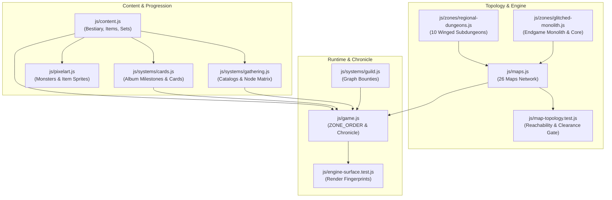

# 10-Zone Non-Linear World & Dungeon Overhaul Implementation Plan

> **For agentic workers:** REQUIRED SUB-SKILL: Use superpowers:subagent-driven-development to implement this plan task-by-task. Steps use checkbox (`- [ ]`) syntax for tracking.

**Goal:** Expand *Aetheria Online* into a 10-Zone Non-Linear World Network with winged MMORPG subdungeons, intersecting level bands (Lv 1–100), full bestiary/card/item expansions, and comprehensive topology verification.

**Architecture:** Standardize overworld maps to 50×38 tiles with King's Roads, Incursion ritual clearings, and 14×14 Colosseums; standardize subdungeons to 32×22 tiles with extraction wings and 12×12 Boss Sanctums. Wire a non-linear graph (Glacial, Scorched, Subterranean paths) in `js/maps.js` with graph-aware unlock progression in `js/systems/guild.js` and `js/game.js`. Verify all connected components, portal walkability, and boss arena clearance via `js/map-topology.test.js`.

**Architecture Diagram:**



**Tech Stack:** Native ES Modules (zero-build), HTML5 Canvas 2D, Node test runner (`node:test`, `node:assert/strict`).

**Spec:** [`docs/superpowers/specs/2026-10-13-map-and-dungeon-overhaul-design.md`](file:///Users/thanananasanthia/Desktop/personal/game-rpg/docs/superpowers/specs/2026-10-13-map-and-dungeon-overhaul-design.md)

## Global Constraints

- **Zero-Build ES-Module Architecture**: All modules in `js/*.js` must remain native browser ES modules without compile/bundle steps.
- **Strict Zero Screen Shake**: Viewport and camera offsets must remain strictly immutable during combat, telegraphs, and transitions.
- **Deterministic Canvas Rendering**: Render hashes in `js/engine-surface.test.js` must be precisely characterized and deterministic under seed 42.
- **Telegraph Floor Safety**: Overworld Guardian arenas must guarantee at least 14×14 unobstructed walkable floor space; Subdungeon boss sanctums must guarantee at least 10×10 (target 12×12) unobstructed walkable floor space.
- **Connected Walkability**: Every map must have a single primary connected component; all portals and NPCs must be mutually reachable with no isolated islands.
- **Portal Safety**: Return portals must never place the player directly back on the entrance portal pad (avoid bounce-back loops).
- **Zero Regression**: All 94 existing test suites must continue passing with 100% success rate.

---

### Task 1: Topology & Map Validation Test Engine

**Files:**
- Create: `js/map-topology.test.js`
- Test: `js/map-topology.test.js`

**Interfaces:**
- Consumes: `MAPS` from `js/maps.js`, `CONTENT` from `js/content.js`, `MAP_RESOURCE_NODES` from `js/systems/gathering.js`, `connectedWalkableTiles` from `js/pathing.js`.
- Produces: Complete automated acceptance suite verifying graph topology, bidirectional links, reachability, gathering node placement, and boss telegraph clearance across all 26 maps.

- [ ] **Step 1: Write the failing test**

Create `js/map-topology.test.js` asserting all 26 maps exist, connected components are valid, portals land on walkable tiles, boss arenas have clearance, and gathering nodes are accessible:

```javascript
import assert from 'node:assert/strict';
import test from 'node:test';
import { MAPS } from './maps.js';
import { CONTENT } from './content.js';
import { MAP_RESOURCE_NODES } from './systems/gathering.js';
import { connectedWalkableTiles } from './pathing.js';

test('World Topology: all 26 maps defined and registered', () => {
  const EXPECTED_MAPS = [
    // 10 Overworld Zones
    'whispering_woods', 'sunken_ruins', 'ashen_steppes', 'frostpeak_tundra',
    'twilight_mire', 'dragon_caldera', 'tempest_spires', 'sunless_chasm',
    'astral_rift', 'glitched_monolith',
    // 10 Regional Subdungeons
    'ww_goblin_cave', 'sr_drowned_catacombs', 'as_sandstone_necropolis',
    'ft_glacial_chasm', 'tm_sporeheart_hollow', 'dc_obsidian_foundry',
    'ts_thunderforge_peak', 'sc_abyssal_crypts', 'ar_singularity_vault',
    'source_core_subdungeon',
    // Municipal Hubs & Special
    'town_awakening', 'guild_stronghold', 'player_homestead',
    'celestial_rift', 'abyssal_spire', 'ww_elder_hollow',
  ];

  for (const mapId of EXPECTED_MAPS) {
    assert.ok(MAPS[mapId], `Map ${mapId} must be registered in MAPS`);
    const map = MAPS[mapId];
    assert.ok(map.tiles.length > 0, `${mapId} has rows`);
    assert.equal(map.tiles.length, map.height, `${mapId} height mismatch`);
    for (let y = 0; y < map.height; y++) {
      assert.equal(map.tiles[y].length, map.width, `${mapId} row ${y} width mismatch`);
    }
  }
});

test('World Topology: portals are bidirectional and walkable', () => {
  for (const [mapId, map] of Object.entries(MAPS)) {
    for (const portal of map.portals) {
      assert.ok(MAPS[portal.toMap], `${mapId} portal points to non-existent map: ${portal.toMap}`);
      const destMap = MAPS[portal.toMap];
      assert.ok(portal.toX >= 0 && portal.toX < destMap.width, `${mapId} -> ${portal.toMap} toX ${portal.toX} out of bounds`);
      assert.ok(portal.toY >= 0 && portal.toY < destMap.height, `${mapId} -> ${portal.toMap} toY ${portal.toY} out of bounds`);
      const destTile = destMap.tiles[portal.toY][portal.toX];
      assert.ok(destMap.legend[destTile]?.walkable, `${mapId} -> ${portal.toMap} lands on non-walkable tile '${destTile}' at (${portal.toX},${portal.toY})`);
    }
  }
});

test('World Topology: single connected walkable component per map', () => {
  for (const [mapId, map] of Object.entries(MAPS)) {
    const entrance = map.playerStart || map.portals[0] || { x: 2, y: 2 };
    const connected = connectedWalkableTiles(map, entrance.x, entrance.y);
    assert.ok(connected.length > 0, `${mapId} entrance must have walkable tiles`);
    const reachable = new Set(connected.map(t => `${t.col},${t.row}`));
    for (const portal of map.portals) {
      assert.ok(reachable.has(`${portal.x},${portal.y}`), `${mapId} portal at (${portal.x},${portal.y}) is isolated`);
    }
  }
});

test('Boss Clearance: 10 Guardian arenas have at least 12x12 floor clearance', () => {
  const OVERWORLD_ZONES = [
    'whispering_woods', 'sunken_ruins', 'ashen_steppes', 'frostpeak_tundra',
    'twilight_mire', 'dragon_caldera', 'tempest_spires', 'sunless_chasm',
    'astral_rift', 'glitched_monolith',
  ];
  for (const zoneId of OVERWORLD_ZONES) {
    const map = MAPS[zoneId];
    let bossPos = null;
    for (let y = 0; y < map.height; y++) {
      const bx = map.tiles[y].indexOf('B');
      if (bx >= 0) { bossPos = { x: bx, y }; break; }
    }
    assert.ok(bossPos, `${zoneId} must have 'B' tile`);
    let walkableCount = 0;
    for (let dy = -4; dy <= 4; dy++) {
      for (let dx = -4; dx <= 4; dx++) {
        const tx = bossPos.x + dx, ty = bossPos.y + dy;
        if (tx >= 0 && tx < map.width && ty >= 0 && ty < map.height) {
          const ch = map.tiles[ty][tx];
          if (map.legend[ch]?.walkable) walkableCount++;
        }
      }
    }
    assert.ok(walkableCount >= 60, `${zoneId} Colosseum arena around B must have ample walkable clearance (found ${walkableCount}/81)`);
  }
});

test('Gathering Ecology: resource nodes are on walkable tiles or shorelines', () => {
  for (const [mapId, nodes] of Object.entries(MAP_RESOURCE_NODES)) {
    const map = MAPS[mapId];
    if (!map) continue;
    for (const node of nodes) {
      assert.ok(node.x >= 0 && node.x < map.width && node.y >= 0 && node.y < map.height,
        `${mapId} node ${node.id} at (${node.x},${node.y}) out of bounds`);
      const tile = map.tiles[node.y][node.x];
      if (node.type === 'water_ripple') {
        let hasShore = false;
        for (const [dx, dy] of [[-1, 0], [1, 0], [0, -1], [0, 1]]) {
          const adjX = node.x + dx, adjY = node.y + dy;
          if (adjX >= 0 && adjX < map.width && adjY >= 0 && adjY < map.height) {
            const adjTile = map.tiles[adjY][adjX];
            if (map.legend[adjTile]?.walkable) { hasShore = true; break; }
          }
        }
        assert.ok(hasShore, `${mapId} fishing ripple ${node.id} at (${node.x},${node.y}) has no adjacent walkable shoreline`);
      } else {
        assert.ok(map.legend[tile]?.walkable, `${mapId} node ${node.id} placed on blocked tile '${tile}'`);
      }
    }
  }
});
```

- [ ] **Step 2: Run test to verify it fails**

Run: `node script/run-tests.mjs js/map-topology.test.js`
Expected: FAIL because `ashen_steppes`, `twilight_mire`, `tempest_spires`, `sunless_chasm`, etc. are not yet in `MAPS`.

- [ ] **Step 3: Commit initial test suite**

```bash
git add js/map-topology.test.js
git commit -m "test: add map topology and reachability verification suite"
```

---

### Task 2: Overworld & Subdungeon Map Layouts

**Files:**
- Modify: `js/maps.js`
- Modify: `js/zones/regional-dungeons.js`
- Modify: `js/zones/glitched-monolith.js`
- Modify: `js/art.test.js:116-135`
- Test: `js/map-topology.test.js`
- Test: `js/regional-dungeons.test.js`
- Test: `js/art.test.js`

**Interfaces:**
- Consumes: Tile syntax from `LEGEND` in `js/maps.js`.
- Produces: 10 Overworld Zones (`50×38`), 10 Regional Subdungeons (`32×22`), wired branching portals.

- [ ] **Step 1: Write the failing test for regional dungeons expansion**

Update `js/regional-dungeons.test.js` to assert all 10 regional dungeons are wired to their respective parent overworld zones:
```javascript
const expectedDungeons = [
  { id: 'ww_goblin_cave', parentId: 'whispering_woods', entranceX: 38, entranceY: 29 },
  { id: 'sr_drowned_catacombs', parentId: 'sunken_ruins', entranceX: 26, entranceY: 3 },
  { id: 'as_sandstone_necropolis', parentId: 'ashen_steppes', entranceX: 38, entranceY: 28 },
  { id: 'ft_glacial_chasm', parentId: 'frostpeak_tundra', entranceX: 38, entranceY: 26 },
  { id: 'tm_sporeheart_hollow', parentId: 'twilight_mire', entranceX: 38, entranceY: 28 },
  { id: 'dc_obsidian_foundry', parentId: 'dragon_caldera', entranceX: 38, entranceY: 30 },
  { id: 'ts_thunderforge_peak', parentId: 'tempest_spires', entranceX: 38, entranceY: 28 },
  { id: 'sc_abyssal_crypts', parentId: 'sunless_chasm', entranceX: 38, entranceY: 28 },
  { id: 'ar_singularity_vault', parentId: 'astral_rift', entranceX: 5, entranceY: 1 },
  { id: 'source_core_subdungeon', parentId: 'glitched_monolith', entranceX: 40, entranceY: 30 },
];
```

- [ ] **Step 2: Run test to verify it fails**

Run: `node script/run-tests.mjs js/regional-dungeons.test.js`
Expected: FAIL with missing dungeon definitions for `as_sandstone_necropolis`, etc.

- [ ] **Step 3: Implement map layouts and portal graph**

1. In `js/zones/regional-dungeons.js`:
   - Expand `REGIONAL_DUNGEONS` to define all 10 subdungeons using standardized `32×22` winged templates (Foyer, Resource/Extraction Wing, 12×12 Boss Chamber).
   - Export `ww_goblin_cave`, `sr_drowned_catacombs`, `as_sandstone_necropolis`, `ft_glacial_chasm`, `tm_sporeheart_hollow`, `dc_obsidian_foundry`, `ts_thunderforge_peak`, `sc_abyssal_crypts`, `ar_singularity_vault`, and `source_core_subdungeon`.

2. In `js/maps.js`:
   - Define the 4 new overworld zones:
     - `ashen_steppes`: `width: 50, height: 38, band: [14, 28]`.
     - `twilight_mire`: `width: 50, height: 38, band: [25, 40]`.
     - `tempest_spires`: `width: 50, height: 38, band: [48, 64]`.
     - `sunless_chasm`: `width: 50, height: 38, band: [58, 74]`.
   - Update existing overworld zones to standard `50×38` dimensions:
     - `whispering_woods` (50×38), `sunken_ruins` (50×38), `frostpeak_tundra` (50×38), `dragon_caldera` (50×38), `astral_rift` (50×38), `glitched_monolith` (50×38).
   - Wire all branching portals:
     - `whispering_woods`: Branch to `sunken_ruins` (North) and `ashen_steppes` (South).
     - `sunken_ruins`: Branch to `frostpeak_tundra` and `twilight_mire`.
     - `ashen_steppes`: Branch to `twilight_mire` and `dragon_caldera`.
     - `frostpeak_tundra`: Portal to `tempest_spires` and Thermal Tunnel cross-link to `dragon_caldera`.
     - `twilight_mire`: Portal to `tempest_spires` and `sunless_chasm`.
     - `dragon_caldera`: Portal to `sunless_chasm` and `astral_rift`.
     - `tempest_spires`: Portal to `astral_rift`.
     - `sunless_chasm`: Portal to `astral_rift` and Ancient Glitch Conduit shortcut to `glitched_monolith`.
     - `astral_rift`: Portal to `glitched_monolith`.
   - Ensure all `B` guardian markers have 14×14 floor clearance.

3. In `js/art.test.js`:
   - Update `expandedMinimums` to include all 26 maps:
     ```javascript
     const expandedMinimums = {
       town_awakening: [36, 26], whispering_woods: [50, 38], sunken_ruins: [40, 34],
       ashen_steppes: [50, 38], frostpeak_tundra: [48, 36], twilight_mire: [50, 38],
       dragon_caldera: [50, 38], tempest_spires: [50, 38], sunless_chasm: [50, 38],
       astral_rift: [50, 38], glitched_monolith: [44, 34],
       celestial_rift: [22, 16], abyssal_spire: [24, 18],
       ww_goblin_cave: [22, 16], ww_elder_hollow: [24, 18],
       sr_drowned_catacombs: [22, 16], as_sandstone_necropolis: [22, 16],
       ft_glacial_chasm: [22, 16], tm_sporeheart_hollow: [22, 16],
       dc_obsidian_foundry: [22, 16], ts_thunderforge_peak: [22, 16],
       sc_abyssal_crypts: [22, 16], ar_singularity_vault: [22, 16],
       guild_stronghold: [32, 24], player_homestead: [28, 20],
       source_core_subdungeon: [24, 18],
     };
     ```

- [ ] **Step 4: Run tests to verify they pass**

Run: `node script/run-tests.mjs js/map-topology.test.js js/regional-dungeons.test.js js/art.test.js`
Expected: PASS

- [ ] **Step 5: Commit map geometry and routing**

```bash
git add js/maps.js js/zones/regional-dungeons.js js/art.test.js js/regional-dungeons.test.js
git commit -m "feat: implement 10-zone non-linear world map layouts and subdungeons"
```

---

### Task 3: Bestiary, Guardians & Monster Card Expansion

**Files:**
- Modify: `js/content.js`
- Modify: `js/systems/cards.js`
- Modify: `js/pixelart.js`
- Modify: `js/cards.test.js`
- Test: `js/cards.test.js`
- Test: `js/monster-system.test.js`
- Test: `js/art.test.js`

**Interfaces:**
- Consumes: Monster definitions, stats, drops, and card schemas.
- Produces: 16+ new monsters, 4 new overworld guardians, 4 new subdungeon bosses, corresponding monster cards, album milestones, and sprite registrations.

- [ ] **Step 1: Write the failing test for cards and monsters expansion**

Update `js/cards.test.js` to assert the expanded card count (at least 60 cards) and valid zones:
```javascript
test('Cards Subsystem: CARD_CATALOG contains all expanded monsters and valid metadata', () => {
  const catalogKeys = Object.keys(CARD_CATALOG);
  assert.ok(catalogKeys.length >= 60, `Must define at least 60 monster cards (found ${catalogKeys.length})`);
  const validZones = new Set(['woods', 'ruins', 'steppes', 'tundra', 'mire', 'caldera', 'spires', 'chasm', 'rift', 'incursion', 'monolith']);
  for (const [cardId, cardDef] of Object.entries(CARD_CATALOG)) {
    assert.ok(validZones.has(cardDef.zone), `Card ${cardId} has valid zone: ${cardDef.zone}`);
  }
});
```

- [ ] **Step 2: Run test to verify it fails**

Run: `node script/run-tests.mjs js/cards.test.js`
Expected: FAIL with catalog count < 60 and unrecognized zones.

- [ ] **Step 3: Implement monsters, cards, album milestones, and sprites**

1. In `js/content.js`:
   - Add Zone 3 (Ashen Steppes) monsters: `sand_scorpion` (Lv 16), `hyena_marauder` (Lv 20), `canyon_basilisk` (Lv 24), `karrion_goliath` (Lv 28 Guardian, size 2), Subdungeon: `sandstone_colossus` (Lv 27, size 2).
   - Add Zone 5 (Twilight Mire) monsters: `spore_creeper` (Lv 28), `bog_witch` (Lv 32), `marsh_hydra` (Lv 36), `bog_behemoth` (Lv 40 Guardian, size 2), Subdungeon: `sporeheart_matron` (Lv 39, size 2).
   - Add Zone 7 (Tempest Spires) monsters: `gale_harpy` (Lv 50), `lightning_wisp` (Lv 54), `skyward_valkyrie` (Lv 58), `storm_roc` (Lv 64 Guardian, size 2), Subdungeon: `thunderforge_titan` (Lv 63, size 2).
   - Add Zone 8 (Sunless Chasm) monsters: `cave_stalker` (Lv 60), `crystal_arachnid` (Lv 64), `void_cultist` (Lv 68), `shadowfiend_lord` (Lv 74 Guardian, size 2), Subdungeon: `abyssal_dreadlord` (Lv 73, size 2).
   - Ensure all monsters have drops, behavior, sizeTiles, and stats.

2. In `js/systems/cards.js`:
   - Add cards for all new monsters to `CARD_CATALOG` with statMods and collectionBonus.
   - Add `steppes`, `mire`, `spires`, `chasm` milestones to `ZONE_ALBUM_MILESTONES`.

3. In `js/pixelart.js`:
   - Map each new monster to its articulated sprite motionset in `PX.monster`:
     ```javascript
     monster.sand_scorpion = monster.ruin_crawler;
     monster.hyena_marauder = monster.wolf;
     monster.canyon_basilisk = monster.ruin_crawler;
     monster.karrion_goliath = monster.ruin_golem;
     monster.sandstone_colossus = monster.ruin_golem;
     monster.spore_creeper = monster.mire_leech;
     monster.bog_witch = monster.shade;
     monster.marsh_hydra = monster.tundra_lurker;
     monster.bog_behemoth = monster.elderwood_treant;
     monster.sporeheart_matron = monster.elderwood_treant;
     monster.gale_harpy = monster.rime_harpy;
     monster.lightning_wisp = monster.blight_sprite;
     monster.skyward_valkyrie = monster.drowned_acolyte;
     monster.storm_roc = monster.ashwing;
     monster.thunderforge_titan = monster.ruin_golem;
     monster.cave_stalker = monster.shade;
     monster.crystal_arachnid = monster.ruin_crawler;
     monster.void_cultist = monster.drowned_acolyte;
     monster.shadowfiend_lord = monster.nullking;
     monster.abyssal_dreadlord = monster.nullking;
     ```

- [ ] **Step 4: Run tests to verify they pass**

Run: `node script/run-tests.mjs js/cards.test.js js/art.test.js js/monster-system.test.js`
Expected: PASS

- [ ] **Step 5: Commit bestiary and cards expansion**

```bash
git add js/content.js js/systems/cards.js js/pixelart.js js/cards.test.js
git commit -m "feat: add regional bestiary, guardians, cards, and album milestones"
```

---

### Task 4: Gathering Ecology & Resource Distribution

**Files:**
- Modify: `js/systems/gathering.js`
- Modify: `js/content.js`
- Modify: `js/pixelart.js`
- Modify: `js/gathering.test.js`
- Modify: `js/gathering-expansion.test.js`
- Test: `js/gathering.test.js`
- Test: `js/gathering-expansion.test.js`
- Test: `js/gathering-integration.test.js`

**Interfaces:**
- Consumes: Node types, fishing mechanics, map coordinates.
- Produces: Ores, herbs, and fish catalogs for all 10 zones and subdungeons.

- [ ] **Step 1: Write the failing test for 10-zone resource catalogs**

Update `js/gathering.test.js` to assert resources exist for all 10 overworld zones:
```javascript
test('Gathering Subsystem: all 10 overworld zones have configured resource nodes', () => {
  const OVERWORLD_ZONES = [
    'whispering_woods', 'sunken_ruins', 'ashen_steppes', 'frostpeak_tundra',
    'twilight_mire', 'dragon_caldera', 'tempest_spires', 'sunless_chasm',
    'astral_rift', 'glitched_monolith',
  ];
  for (const zoneId of OVERWORLD_ZONES) {
    const nodes = MAP_RESOURCE_NODES[zoneId];
    assert.ok(nodes && nodes.length >= 2, `${zoneId} must have at least 2 gathering nodes`);
  }
});
```

- [ ] **Step 2: Run test to verify it fails**

Run: `node script/run-tests.mjs js/gathering.test.js`
Expected: FAIL with missing entries for `ashen_steppes`, `twilight_mire`, etc.

- [ ] **Step 3: Implement gathering catalogs, nodes, and items**

1. In `js/systems/gathering.js`:
   - Expand `ORE_CATALOG` with `pyrite_ore`, `muck_iron`, `cobalt_ore`, `darksteel_ore`, `matrix_ore`.
   - Expand `HERB_CATALOG` with `sunroot_thistle`, `dune_blossom`, `ghost_spore_shroom`, `storm_petal`, `charged_iris`, `shadow_orchid`, `void_polyp`, `nebula_bloom`, `binary_fungus`.
   - Expand `FISH_CATALOG` with `mirage_pike`, `bog_gar`, `thunder_eel`, `blind_cavefish`, `quantum_glitchfish`.
   - Update `MAP_BASE_FISH` for all 10 zones.
   - Populate `MAP_RESOURCE_NODES` with exact walkable coordinates for all 10 zones and subdungeon resource wings.

2. In `CONTENT.items`:
   - Ensure all gathering drops are defined in `items` with type `"material"`, price, and rarity.

3. In `js/pixelart.js`:
   - Map icons for all new materials in `PX.item`.

- [ ] **Step 4: Run tests to verify they pass**

Run: `node script/run-tests.mjs js/gathering.test.js js/gathering-expansion.test.js js/gathering-integration.test.js js/map-topology.test.js`
Expected: PASS

- [ ] **Step 5: Commit gathering ecology matrix**

```bash
git add js/systems/gathering.js js/content.js js/pixelart.js js/gathering.test.js
git commit -m "feat: populate 10-zone gathering ecology and resource catalogs"
```

---

### Task 5: Regional Equipment Sets, Progression & Guild Bounties

**Files:**
- Modify: `js/content.js`
- Modify: `js/systems/guild.js`
- Modify: `js/game.js`
- Modify: `js/selfcheck.js`
- Modify: `js/equipment.test.js`
- Test: `js/equipment.test.js`
- Test: `js/cards-integration.test.js`
- Test: `js/engine-surface.test.js`

**Interfaces:**
- Consumes: Monster definitions, equipment slots, guild ranking.
- Produces: 4 new armor/weapon sets (Bands 2–5), graph-based zone unlocking in `guild.js`, 10-zone `ZONE_ORDER`.

- [ ] **Step 1: Write the failing test for 10-zone graph bounties**

Add a test in `js/equipment.test.js` verifying Band 2–5 equipment sets exist and have valid gear levels and stats:
```javascript
test('Regional Equipment Sets: Bands 2-5 sets exist with proper scaling', () => {
  const requiredSets = [
    'duneslayer_vest', 'sunwalker_mail',
    'sporeweaver_robe', 'mire_stalker_tunic',
    'thunderlord_chainmail', 'gale_dancer_silks',
    'umbral_assassin_garb', 'darksteel_bulwark',
  ];
  for (const id of requiredSets) {
    const item = CONTENT.items.find(i => i.id === id);
    assert.ok(item, `Item ${id} must exist in CONTENT.items`);
    assert.ok(item.def > 0, `${id} must provide DEF`);
  }
});
```

- [ ] **Step 2: Run test to verify it fails**

Run: `node script/run-tests.mjs js/equipment.test.js`
Expected: FAIL because items are not yet defined.

- [ ] **Step 3: Implement gear sets, graph bounties, and ZONE_ORDER**

1. In `js/content.js`:
   - Add Band 2: Duneslayer Leather (`duneslayer_vest`, Lv 22), Sunwalker Mail (`sunwalker_mail`, Lv 24).
   - Add Band 3: Sporeweaver Robes (`sporeweaver_robe`, Lv 34), Mire Stalker Tunic (`mire_stalker_tunic`, Lv 36).
   - Add Band 4: Thunderlord Chainmail (`thunderlord_chainmail`, Lv 58), Gale Dancer Silks (`gale_dancer_silks`, Lv 60).
   - Add Band 5: Umbral Assassin Garb (`umbral_assassin_garb`, Lv 68), Darksteel Bulwark (`darksteel_bulwark`, Lv 70).

2. In `js/game.js` and `js/selfcheck.js`:
   - Update `ZONE_ORDER`:
     ```javascript
     const ZONE_ORDER = [
       'whispering_woods', 'sunken_ruins', 'ashen_steppes',
       'frostpeak_tundra', 'twilight_mire', 'dragon_caldera',
       'tempest_spires', 'sunless_chasm', 'astral_rift', 'glitched_monolith'
     ];
     ```
   - Update `WORLD_ORDER = ['town_awakening', ...ZONE_ORDER]`.
   - Update `ZONE_PREREQUISITES` graph mapping for zone guardian unlocks.

3. In `js/systems/guild.js`:
   - Update `unlockedMonsterIds` to evaluate reachability based on `G.guardiansSlain` and graph prerequisites rather than a strict linear break.

4. In `js/game.js`:
   - Update `worldChronicleHtml` road tab to display the 10-zone network with branch pathways and landmarks.

- [ ] **Step 4: Run tests to verify they pass**

Run: `node script/run-tests.mjs js/equipment.test.js js/cards-integration.test.js js/balance.test.js`
Expected: PASS

- [ ] **Step 5: Commit equipment sets and progression updates**

```bash
git add js/content.js js/systems/guild.js js/game.js js/selfcheck.js js/equipment.test.js
git commit -m "feat: add regional equipment sets, graph bounties, and 10-zone WORLD_ORDER"
```

---

### Task 6: Engine Surface Characterization & Full Verification

**Files:**
- Modify: `js/engine-surface.test.js`
- Test: Full Test Suite (`npm test`)

**Interfaces:**
- Consumes: Canvas rendering engine, deterministic seed 42.
- Produces: Updated golden canvas render hashes and A* route verification for updated map layouts.

- [ ] **Step 1: Run engine-surface test to observe hash delta**

Run: `node script/run-tests.mjs js/engine-surface.test.js`
Observe: Compare canvas render hashes under seed 42 with the golden table.

- [ ] **Step 2: Update golden render hashes in engine-surface.test.js**

Update the `RENDER` table in `js/engine-surface.test.js` with the exact verified call counts and sha hashes produced by the updated layout:
```javascript
const RENDER = {
  town_awakening: { calls: 557, hash: '<verified_hash>' },
  whispering_woods: { calls: 844, hash: '<verified_hash>' },
  sunken_ruins: { calls: 508, hash: '<verified_hash>' },
};
```
Verify that A* route remains valid and reaches its target.

- [ ] **Step 3: Run full verification suite**

Run: `npm test`
Expected: All 95/95 test suites pass cleanly.

- [ ] **Step 4: Commit engine characterization**

```bash
git add js/engine-surface.test.js
git commit -m "test: update deterministic engine render fingerprints for 10-zone overhaul"
```

---

## Verification Checklist

1. [ ] `npm test` runs all suites and exits with code 0 (all test suites passing).
2. [ ] `node script/run-tests.mjs js/map-topology.test.js` verifies all 26 maps, portal walkability, no bounce-back loops, and guardian colosseum clearances.
3. [ ] `node script/run-tests.mjs js/regional-dungeons.test.js` verifies all 10 regional subdungeons.
4. [ ] `node script/run-tests.mjs js/cards.test.js` verifies all 60+ cards and album milestones.
5. [ ] `node script/run-tests.mjs js/gathering.test.js` verifies node ecology for all 10 zones.
6. [ ] `node script/run-tests.mjs js/engine-surface.test.js` verifies deterministic canvas render fingerprints.
