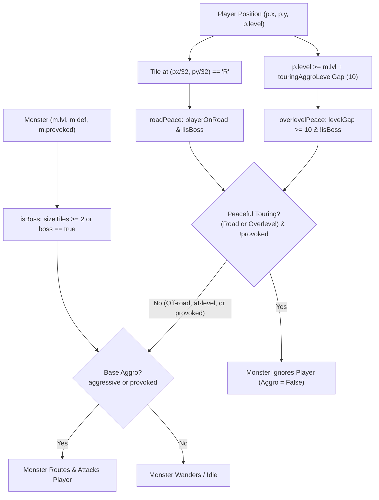

# Touring Aggro Peace, Road Protection & Targeting Plan

## Problem & Requirements
The user requested three features around touring, targeting, and level difference:
1. **Auto-Hunt Targeting Level Cap**: Ensure monsters whose level is significantly higher than the player (`level > player.level + XX`) will not be auto-targeted by Auto-Farm/Hunt unless the player attacks them manually.
2. **Touring / Over-Level Monster Peace**: When the player's level exceeds an aggressive monster's level by XX (e.g. 10 levels), the monster treats the player as neutral/peaceful and will not target or attack the player unless attacked first (`m.provoked`).
3. **Road / Pathway Protection**: When the player is walking along the paved cobblestone roads (`'R'`), aggressive wild monsters will not target or attack the player unless attacked first (`m.provoked`), enabling safe travel/touring between hubs and zones.
4. **Boss / Guardian Sanctum Exception**: Overworld Guardians and Subdungeon Bosses remain territorial and will not grant road/overlevel peace.

## Architecture & Data Flow

## Proposed Changes

### 1. `js/design.js`
- In `DESIGN.tuning`:
  - `autoHuntMaxLevelGap: 5` (preserved: Auto-Farm ignores monsters more than 5 levels above player).
  - `touringAggroLevelGap: 10` (monsters 10+ levels below player ignore player unless provoked).
  - `roadSafeFromAggro: true` (monsters ignore players standing on paved road tiles `'R'` unless provoked).

### 2. `js/selfcheck.js`
- Include `'touringAggroLevelGap'` in numeric `TUNING` verification list.

### 3. `js/game.js`
- In `damageMonster(m, dmg, isCrit, silent)`:
  - Ensure `m.provoked = true` is set for all monsters when taking damage from player (previously only set for `_siegeMob`).
- In `updateMonsters(dt)`:
  - Check player road tile: `const pr = Math.floor(p.y / TS), pc = Math.floor(p.x / TS); const playerOnRoad = G.tiles?.[pr]?.[pc] === 'R';`
  - Check boss status: `const isBoss = m.def.sizeTiles >= 2 || Boolean(m.def.boss);`
  - Compute peaceful touring:
    `const overlevelPeace = !isBoss && (p.level >= m.lvl + (TUNING.touringAggroLevelGap ?? 10));`
    `const roadPeace = !isBoss && Boolean(TUNING.roadSafeFromAggro) && playerOnRoad;`
    `const peacefulTouring = (overlevelPeace || roadPeace) && !m.provoked;`
  - Update `aggro`:
    `const baseAggro = m._siegeMob ? (m._siegeTarget === 'player' || m.provoked) : (m.def.behavior === 'aggressive' || m.provoked);`
    `const aggro = baseAggro && !peacefulTouring;`
  - Provoke decay:
    `if (m.provoked && d > aggroTiles * TS && now() - (m.lastCombatAt || 0) > 5000) m.provoked = false;`

### 4. Tests
- Create `js/touring-aggro.test.js`:
  1. Auto-Hunt level cap (+5): asserts `autoHuntEligible` is false for Lv 11 monster when player is Lv 5, but true for Lv 10.
  2. Over-level touring peace: asserts Lv 8 wolf ignores Lv 20 player when nearby, but attacks Lv 15 player.
  3. Road protection: asserts Lv 8 wolf ignores Lv 8 player when player is on tile `'R'`.
  4. Provocation override: asserts damaging wolf sets `m.provoked = true` and causes it to attack even on road or over-leveled.
  5. Boss immunity: asserts `elderwood_treant` attacks player regardless of road or level gap.
- Run `npm test` across all suites.
