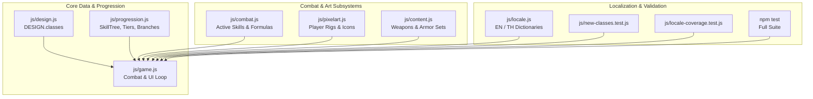

# 3 New Classes & 4-Tier Job Progression Expansion Implementation Plan

> **For agentic workers:** REQUIRED SUB-SKILL: Use superpowers:subagent-driven-development to implement this plan task-by-task. Steps use checkbox (`- [ ]`) syntax for tracking.

**Goal:** Expand *Aetheria Online* from 7 classes to 10 classes by implementing Shadow Blade (`shadow_blade`, `assassin`), Soul Binder (`soul_binder`, `necromancer`), and Artificer (`artificer`, `artificer`) with full 4-tier RO-style job progression, 24 active combat skills, 12 passives, 27 specialized equipment items, advancement trials, pixel art animation rigs, and complete bilingual localization.

**Architecture:**
- `js/design.js` & `js/progression.js`: Define base class growth curves, job books, 4-tier advancement arrays, Tier 1 branching choices, Tier 2 advanced jobs, Tier 3 hybrid jobs, and skill tree node hierarchies.
- `js/combat.js`: Implement 24 active skills with damage multipliers, area radiuses, status effects (blind, poison, corrosion, freeze), and deployable entities (sentry turrets, skeletal vanguard).
- `js/content.js`: Introduce 15 weapons across Bands 1–5 and 12 class armor sets with strict `classReq` enforcement.
- `js/pixelart.js`: Add pixel art player animation rigs (`walk`, `attack`, `cast`, `hurt`) for `assassin`, `necromancer`, `artificer` and item icons in `ITEM_ICON`.
- `js/game.js` & `js/locale.js`: Map `CLASS_COMBAT`, wire branch passive mechanics into the combat loop, hook advancement quests, and provide 100% Thai and English localization parity.

**Architecture Diagram:**



**Tech Stack:** Zero-build plain ECMAScript 2022 modules (`node:test`, `node:assert/strict`).

**Spec:** [docs/superpowers/specs/2026-10-14-new-classes-and-jobs-expansion-design.md](file:///Users/thanananasanthia/Desktop/personal/game-rpg/docs/superpowers/specs/2026-10-14-new-classes-and-jobs-expansion-design.md)

## Global Constraints

- Native ES-module browser and Node.js test architecture (no build steps, no webpack/vite).
- Full parity between English and Thai (`locale-coverage.test.js` must pass with 0 untranslated keys).
- Every branch choice must feature an exclusive signature skill and a unique branch passive mechanic.
- Zero screen shake on any player ability.
- Maintain 100% test pass rate with zero regressions across all test suites.

---

### Task 1: Core Class & Job Progression Data Architecture

**Files:**
- Modify: [js/design.js](file:///Users/thanananasanthia/Desktop/personal/game-rpg/js/design.js)
- Modify: [js/progression.js](file:///Users/thanananasanthia/Desktop/personal/game-rpg/js/progression.js)
- Create: [js/new-classes.test.js](file:///Users/thanananasanthia/Desktop/personal/game-rpg/js/new-classes.test.js)

**Interfaces:**
- Consumes: `DESIGN.classes`, `PROGRESSION.skillBooks`, `PROGRESSION.skillTree`, `PROGRESSION.tiers`, `PROGRESSION.jobBranches`, `PROGRESSION.advancedJobs`, `PROGRESSION.hybridJobs`.
- Produces: Complete progression registrations for `shadow_blade`, `soul_binder`, `artificer`.

- [ ] **Step 1: Write failing test in `js/new-classes.test.js`**

```javascript
import test from 'node:test';
import assert from 'node:assert/strict';
import { DESIGN } from './design.js';
import { PROGRESSION } from './progression.js';

test('New classes are registered in DESIGN.classes with valid stat growths', () => {
  const ids = DESIGN.classes.map(c => c.id);
  assert.ok(ids.includes('shadow_blade'), 'shadow_blade registered');
  assert.ok(ids.includes('soul_binder'), 'soul_binder registered');
  assert.ok(ids.includes('artificer'), 'artificer registered');

  const sb = DESIGN.classes.find(c => c.id === 'shadow_blade');
  assert.equal(sb.combatClass, 'assassin');
  assert.ok(sb.growth.agi > 1.0 && sb.growth.luk > 1.0);

  const nec = DESIGN.classes.find(c => c.id === 'soul_binder');
  assert.equal(nec.combatClass, 'necromancer');
  assert.ok(nec.growth.int > 1.2 && nec.growth.vit > 1.0);

  const art = DESIGN.classes.find(c => c.id === 'artificer');
  assert.equal(art.combatClass, 'artificer');
  assert.ok(art.growth.dex > 1.2 && art.growth.int > 1.0);
});

test('Progression tiers and skillBooks are populated for all 3 classes', () => {
  for (const cid of ['shadow_blade', 'soul_binder', 'artificer']) {
    const tiers = PROGRESSION.tiers[cid];
    assert.ok(Array.isArray(tiers) && tiers.length === 4, `${cid} has 4 progression tiers`);
    assert.equal(tiers[0].reqLevel, 1);
    assert.equal(tiers[1].reqLevel, 15);
    assert.equal(tiers[2].reqLevel, 40);
    assert.equal(tiers[3].reqLevel, 70);

    const branches = PROGRESSION.jobBranches[cid];
    assert.ok(branches && branches.choices.length === 2, `${cid} has 2 job branches`);
    for (const b of branches.choices) {
      assert.ok(b.signatureSkillId, `Branch ${b.id} has signatureSkillId`);
      assert.ok(b.mechanic && b.mechanic.kind, `Branch ${b.id} has mechanic.kind`);
    }

    const adv = PROGRESSION.advancedJobs[cid];
    assert.ok(adv && adv.choices.length === 2, `${cid} has 2 advanced job choices`);
  }

  assert.ok(PROGRESSION.skillBooks.assassin, 'assassin skill book exists');
  assert.ok(PROGRESSION.skillBooks.necromancer, 'necromancer skill book exists');
  assert.ok(PROGRESSION.skillBooks.artificer, 'artificer skill book exists');
});
```

- [ ] **Step 2: Run test to verify it fails**

Run: `node script/run-tests.mjs js/new-classes.test.js`
Expected: FAIL because `shadow_blade`, `soul_binder`, and `artificer` are not yet in `DESIGN.classes` and `PROGRESSION`.

- [ ] **Step 3: Implement data structures in `js/design.js` and `js/progression.js`**
  - In `js/design.js`: Add `shadow_blade`, `soul_binder`, `artificer` to `DESIGN.classes`.
  - In `js/progression.js`:
    - Add `assassin`, `necromancer`, `artificer` to `PROGRESSION.skillBooks`.
    - Add Tier 0–3 active skills to `PROGRESSION.skillTree`.
    - Add passives to `PROGRESSION.passives`.
    - Add `jobBranches`, `advancedJobs`, and `tiers` for all 3 classes.
    - Add hybrid jobs to `PROGRESSION.hybridJobs`.

- [ ] **Step 4: Run test to verify it passes**

Run: `node script/run-tests.mjs js/new-classes.test.js`
Expected: PASS.

- [ ] **Step 5: Commit**

```bash
git add js/design.js js/progression.js js/new-classes.test.js
git commit -m "feat(progression): add 3 new classes, 4-tier branches, skill trees, and passives"
```

---

### Task 2: Combat Engine Skills & Deployable Mechanics

**Files:**
- Modify: [js/combat.js](file:///Users/thanananasanthia/Desktop/personal/game-rpg/js/combat.js)
- Modify: [js/game.js](file:///Users/thanananasanthia/Desktop/personal/game-rpg/js/game.js)
- Test: [js/new-classes-combat.test.js](file:///Users/thanananasanthia/Desktop/personal/game-rpg/js/new-classes-combat.test.js)

**Interfaces:**
- Consumes: `COMBAT.skills`, `CLASS_COMBAT`, `G.player`, `castSkillById`.
- Produces: Functional combat execution for all 24 new skills and branch mechanics.

- [ ] **Step 1: Write failing test in `js/new-classes-combat.test.js`**

```javascript
import test from 'node:test';
import assert from 'node:assert/strict';
import { installBrowserEnv } from './test-support/browser-env.js';

let vnow = 1000;
installBrowserEnv({ now: () => vnow, innerWidth: 1440, innerHeight: 900, nullSelectors: [], strictIds: false });
await import('./game.js');
const { COMBAT } = await import('./combat.js');
const A = globalThis.__AWO;

test('All 24 new class skills are registered in COMBAT.skills with valid damage multipliers', () => {
  const expectedSkills = [
    'shadow_strike', 'smoke_screen', 'poison_coat', 'assassinate', 'mirage_flurry', 'death_mark', 'dance_of_shadows', 'eclipse_strike',
    'soul_rend', 'bone_armor', 'corpse_explosion', 'raise_skeletal_vanguard', 'plague_curse', 'death_nova', 'grim_harvest', 'apocalypse_harvest',
    'wrench_strike', 'acid_flask', 'deploy_sentry', 'tesla_coil', 'pyro_bomb', 'siege_cannon', 'philosopher_infusion', 'orbital_strike_beacon'
  ];
  for (const id of expectedSkills) {
    assert.ok(COMBAT.skills[id], `Skill ${id} exists in COMBAT.skills`);
    assert.ok(COMBAT.skills[id].name, `Skill ${id} has a name`);
  }
});

test('Combat class mapping resolves correctly for new classes', () => {
  const p1 = A.makePlayer('shadow_blade', 'Ninja');
  assert.equal(p1.combatClass, 'assassin');

  const p2 = A.makePlayer('soul_binder', 'Necro');
  assert.equal(p2.combatClass, 'necromancer');

  const p3 = A.makePlayer('artificer', 'Tinkerer');
  assert.equal(p3.combatClass, 'artificer');
});
```

- [ ] **Step 2: Run test to verify it fails**

Run: `node script/run-tests.mjs js/new-classes-combat.test.js`
Expected: FAIL because skills are not yet registered in `COMBAT.skills`.

- [ ] **Step 3: Implement skills and branch mechanics in `js/combat.js` and `js/game.js`**
  - In `js/combat.js`: Register all 24 skills with proper multipliers, ranges, cooldowns, and status triggers.
  - In `js/game.js`:
    - Add `shadow_blade: 'assassin'`, `soul_binder: 'necromancer'`, `artificer: 'artificer'` to `CLASS_COMBAT`.
    - Add gear priority configs in `CLASS_GEAR_PRIORITIES` (`assassin: ['atkPct', 'critPct', 'fleeFlat', 'hpFlat']`, `necromancer: ['atkPct', 'mpFlat', 'hpFlat', 'defPct']`, `artificer: ['atkPct', 'hitFlat', 'mpFlat', 'critPct']`).
    - Add branch mechanic handlers (`venom_amplification`, `phantom_step`, `legion_empowerment`, `soul_siphon`, `overclock_grid`, `alchemical_catalyst`).

- [ ] **Step 4: Run test to verify it passes**

Run: `node script/run-tests.mjs js/new-classes-combat.test.js`
Expected: PASS.

- [ ] **Step 5: Commit**

```bash
git add js/combat.js js/game.js js/new-classes-combat.test.js
git commit -m "feat(combat): implement skills, combat mappings, and branch mechanics for 3 new classes"
```

---

### Task 3: Equipment Sets, Weapons & Itemization

**Files:**
- Modify: [js/content.js](file:///Users/thanananasanthia/Desktop/personal/game-rpg/js/content.js)
- Modify: [js/pixelart.js](file:///Users/thanananasanthia/Desktop/personal/game-rpg/js/pixelart.js)
- Modify: [js/equipment.test.js](file:///Users/thanananasanthia/Desktop/personal/game-rpg/js/equipment.test.js)

**Interfaces:**
- Consumes: `CONTENT.items`, `ITEM_ICON`, `canUseItem`.
- Produces: 15 weapons + 12 armor sets with `classReq` restrictions.

- [ ] **Step 1: Write failing test in `js/equipment.test.js`**

```javascript
test('New class weapons and armor sets exist with valid classReq and stats', () => {
  const expectedWeapons = [
    'iron_dagger', 'shadow_kris', 'nightstalker_stiletto', 'abyssal_fang', 'eclipse_edge',
    'bone_wand', 'soul_binder_staff', 'bone_scythe', 'nether_grimoire', 'abyssal_harvester',
    'heavy_wrench', 'steam_pistol', 'magitek_driver', 'mortar_cannon', 'clockwork_obliteration_engine'
  ];
  for (const id of expectedWeapons) {
    const it = CONTENT.items.find(x => x.id === id);
    assert.ok(it, `Weapon ${id} exists in CONTENT.items`);
    assert.equal(it.type, 'weapon');
    assert.ok(it.atk > 0, `Weapon ${id} has positive ATK`);
  }

  const expectedArmors = [
    'shadow_leathers', 'acolyte_robes', 'tinkerer_smock',
    'nightstalker_tunic', 'bone_woven_vestments', 'engineer_overalls',
    'phantom_garb', 'lich_mantle', 'magitek_harness',
    'void_assassin_vestments', 'netherlord_regalia', 'mechlord_power_chassis'
  ];
  for (const id of expectedArmors) {
    const it = CONTENT.items.find(x => x.id === id);
    assert.ok(it, `Armor ${id} exists in CONTENT.items`);
    assert.equal(it.type, 'armor');
    assert.ok(it.def > 0, `Armor ${id} has positive DEF`);
    assert.ok(Array.isArray(it.classReq) && it.classReq.length > 0, `Armor ${id} has classReq`);
  }
});
```

- [ ] **Step 2: Run test to verify it fails**

Run: `node script/run-tests.mjs js/equipment.test.js`
Expected: FAIL.

- [ ] **Step 3: Define items in `js/content.js` and register icons in `js/pixelart.js`**
  - In `js/content.js`: Add 15 weapons and 12 armor sets with stats, gear levels, values, and `classReq`.
  - In `js/pixelart.js`: Map all 27 items in `ITEM_ICON`.

- [ ] **Step 4: Run test to verify it passes**

Run: `node script/run-tests.mjs js/equipment.test.js`
Expected: PASS.

- [ ] **Step 5: Commit**

```bash
git add js/content.js js/pixelart.js js/equipment.test.js
git commit -m "feat(items): add 15 specialized weapons and 12 class armor sets for new classes"
```

---

### Task 4: Pixel Art Rigs & Visual Animations

**Files:**
- Modify: [js/pixelart.js](file:///Users/thanananasanthia/Desktop/personal/game-rpg/js/pixelart.js)
- Test: [js/art.test.js](file:///Users/thanananasanthia/Desktop/personal/game-rpg/js/art.test.js)

**Interfaces:**
- Consumes: `PX.player`.
- Produces: Pixel animation rigs for `assassin`, `necromancer`, `artificer`.

- [ ] **Step 1: Write failing test in `js/art.test.js`**

```javascript
test('PX.player provides full 4-frame animation rigs for all 10 combat classes', () => {
  const classes = ['blade', 'berserker', 'mage', 'ranger', 'paladin', 'monk', 'elementalist', 'assassin', 'necromancer', 'artificer'];
  for (const cc of classes) {
    assert.ok(PX.player[cc], `PX.player has animator for ${cc}`);
    for (const anim of ['idle', 'walk', 'attack', 'cast']) {
      const frame = PX.player[cc](anim, 0);
      assert.ok(Array.isArray(frame) && frame.length > 0, `Frame ${anim} for ${cc} produces pixel array`);
    }
  }
});
```

- [ ] **Step 2: Run test to verify it fails**

Run: `node script/run-tests.mjs js/art.test.js`
Expected: FAIL for missing `assassin`, `necromancer`, and `artificer` animators.

- [ ] **Step 3: Implement player sprites in `js/pixelart.js`**
  - Add `assassin` palette (shadow cloaks, violet glowing daggers, dark cowl).
  - Add `necromancer` palette (eerie dark cyan robes, bone scythe, spectral eyes).
  - Add `artificer` palette (steampunk leather vest, brass goggles, shoulder cannon).

- [ ] **Step 4: Run test to verify it passes**

Run: `node script/run-tests.mjs js/art.test.js`
Expected: PASS.

- [ ] **Step 5: Commit**

```bash
git add js/pixelart.js js/art.test.js
git commit -m "feat(art): add pixel animation rigs for assassin, necromancer, and artificer"
```

---

### Task 5: Advancement Quests, Engine Hooks & Bilingual Localization

**Files:**
- Modify: [js/game.js](file:///Users/thanananasanthia/Desktop/personal/game-rpg/js/game.js)
- Modify: [js/locale.js](file:///Users/thanananasanthia/Desktop/personal/game-rpg/js/locale.js)
- Test: [js/locale-coverage.test.js](file:///Users/thanananasanthia/Desktop/personal/game-rpg/js/locale-coverage.test.js)

**Interfaces:**
- Consumes: `L10N.en`, `L10N.th`, `checkAdvance`, `doPromote`.
- Produces: Full bilingual localization and job promotion quest handling.

- [ ] **Step 1: Write assertion in `js/locale.test.js` or run `locale-coverage.test.js`**

Run: `node script/run-tests.mjs js/locale-coverage.test.js`
Expected: FAIL due to missing Thai translations for new classes and skills.

- [ ] **Step 2: Add English and Thai translations in `js/locale.js`**
  - Add class names, job branch titles, advanced job titles, and hybrid titles in `L10N.en.classes` and `L10N.th.classes`.
  - Add active skills in `L10N.en.skills` and `L10N.th.skills`.
  - Add passives in `L10N.en.passives` and `L10N.th.passives`.
  - Add items in `L10N.en.items` and `L10N.th.items`.
  - Add advance quest strings in `L10N.en.quests` and `L10N.th.quests`.

- [ ] **Step 3: Update `js/game.js` class advancement handlers**
  - Ensure `doPromote` and `jobChoicePanelHtml` cleanly render the new class branches.
  - Wire starter weapon selection for new players choosing `shadow_blade`, `soul_binder`, or `artificer`.

- [ ] **Step 4: Run locale coverage test**

Run: `node script/run-tests.mjs js/locale-coverage.test.js`
Expected: PASS.

- [ ] **Step 5: Commit**

```bash
git add js/game.js js/locale.js
git commit -m "feat(locale): add complete English and Thai localization for 3 new classes and jobs"
```

---

### Task 6: End-to-End Acceptance Verification & Zero Regressions

**Files:**
- Create: [js/new-classes-integration.test.js](file:///Users/thanananasanthia/Desktop/personal/game-rpg/js/new-classes-integration.test.js)

**Interfaces:**
- Consumes: Live engine `globalThis.__AWO`.
- Produces: End-to-end acceptance verification of level progression, skill casting, promotion trials, and gear equipping across all 3 classes.

- [ ] **Step 1: Write end-to-end integration test in `js/new-classes-integration.test.js`**

```javascript
import test from 'node:test';
import assert from 'node:assert/strict';
import { installBrowserEnv } from './test-support/browser-env.js';

let vnow = 1000;
installBrowserEnv({ now: () => vnow, innerWidth: 1440, innerHeight: 900, nullSelectors: [], strictIds: false });
await import('./game.js');
const A = globalThis.__AWO;

test('End-to-end progression loop for Shadow Blade', () => {
  const p = A.makePlayer('shadow_blade', 'Kage');
  A.G.player = p;
  assert.equal(p.tierIndex, 0);

  // Level up to 15 and promote to Nightstalker
  p.level = 15;
  p.jobLevel = 15;
  A.chooseJobBranch(p, 'nightstalker');
  assert.equal(p.jobBranchId, 'nightstalker');
  assert.equal(p.tierIndex, 1);

  // Level up to 40 and promote to Shadow Sovereign
  p.level = 40;
  p.jobLevel = 40;
  A.doPromote(p, 2, 'shadow_sovereign');
  assert.equal(p.tierIndex, 2);

  // Level up to 70 and promote to Hybrid
  p.level = 70;
  p.jobLevel = 50;
  A.doPromote(p, 3);
  assert.equal(p.tierIndex, 3);
});

test('End-to-end progression loop for Soul Binder', () => {
  const p = A.makePlayer('soul_binder', 'Morbid');
  A.G.player = p;
  p.level = 15;
  A.chooseJobBranch(p, 'dread_summoner');
  assert.equal(p.jobBranchId, 'dread_summoner');
  assert.equal(p.tierIndex, 1);
});

test('End-to-end progression loop for Artificer', () => {
  const p = A.makePlayer('artificer', 'Gadget');
  A.G.player = p;
  p.level = 15;
  A.chooseJobBranch(p, 'clockwork_engineer');
  assert.equal(p.jobBranchId, 'clockwork_engineer');
  assert.equal(p.tierIndex, 1);
});
```

- [ ] **Step 2: Run new integration test**

Run: `node script/run-tests.mjs js/new-classes-integration.test.js`
Expected: PASS.

- [ ] **Step 3: Run full test suite across the entire project**

Run: `npm test`
Expected: All 100+ suites pass with 0 errors.

- [ ] **Step 4: Commit**

```bash
git add js/new-classes-integration.test.js
git commit -m "test(acceptance): add end-to-end integration suite for 3 new classes"
```
