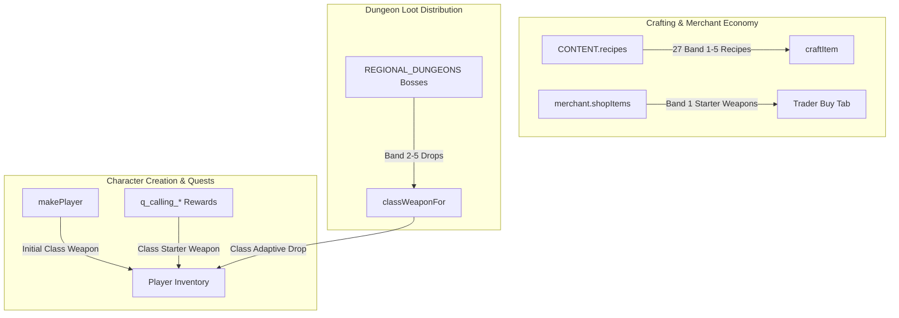

# New Classes Crafting, Starter Kits & Loot Ecology Implementation Plan

> **For agentic workers:** REQUIRED SUB-SKILL: Use superpowers:subagent-driven-development to implement this plan task-by-task. Steps use checkbox (`- [ ]`) syntax for tracking.

**Goal:** Integrate the 3 new classes (`shadow_blade`, `soul_binder`, `artificer`) into Aetheria Online's economic and loot progression with 27 blacksmith crafting recipes, starter equipment kits & merchant stock, and regional dungeon boss loot tables.

**Architecture:**
- Blacksmith recipes in `CONTENT.recipes` in `js/content.js` allowing crafting of all 27 specialized weapons and armors across Bands 1–5 using regional ores, herbs, fabrics, and monster drops.
- Starter equipment kits provided in `makePlayer` (`js/game.js`), calling quest rewards (`q_calling_*`), and Marla the Trader's stock (`npcById.merchant.shopItems`).
- Regional dungeon boss drop expansions in `js/zones/regional-dungeons.js` and `CONTENT.monsters`, fully compatible with dynamic class weapon adaptation via `classWeaponFor()`.

**Architecture Diagram:**



**Tech Stack:** Native ES modules, Vanilla JavaScript, Node.js test runner (`script/run-tests.mjs`).

## Global Constraints
- Zero build steps (pure native ES modules).
- Zero camera shake on item/crafting actions.
- Preserve save compatibility (`awo_save_v1`, `window.__AWO`).
- 100% Thai/English localization parity.
- Zero economic exploit: recipe cost + materials resale must be >= output resale value (no zeny minting).
- Full regression safety: all 102+ suites must pass in `npm test`.

---

### Task 1: Blacksmith Crafting Recipes for 27 New Weapons and Armors

**Files:**
- Modify: `js/content.js`
- Create: `js/new-classes-craft-loot.test.js`
- Test: `js/new-classes-craft-loot.test.js`

**Interfaces:**
- Consumes: `CONTENT.items`, `CONTENT.recipes`, `craftItem`.
- Produces: 27 recipes in `CONTENT.recipes` covering Band 1–5 weapons and Band 2–5 armors.

- [ ] **Step 1: Write failing test in `js/new-classes-craft-loot.test.js`**

```javascript
import test from 'node:test';
import assert from 'node:assert/strict';
import { installBrowserEnv } from './test-support/browser-env.js';

installBrowserEnv({ now: () => 1000, innerWidth: 1440, innerHeight: 900, nullSelectors: [], strictIds: false });
const { CONTENT } = await import('./content.js');
const A = globalThis.__AWO;

test('All 27 new class weapons and armors have valid blacksmith crafting recipes', () => {
  const expectedItems = [
    // Weapons Band 1-5
    'iron_dagger', 'shadow_kris', 'nightstalker_stiletto', 'abyssal_fang', 'eclipse_edge',
    'bone_wand', 'soul_binder_staff', 'bone_scythe', 'nether_grimoire', 'abyssal_harvester',
    'heavy_wrench', 'steam_pistol', 'magitek_driver', 'mortar_cannon', 'clockwork_obliteration_engine',
    // Armors Band 2-5
    'shadow_leathers', 'acolyte_robes', 'tinkerer_smock',
    'nightstalker_tunic', 'bone_woven_vestments', 'engineer_overalls',
    'phantom_garb', 'lich_mantle', 'magitek_harness',
    'void_assassin_vestments', 'netherlord_regalia', 'mechlord_power_chassis'
  ];

  for (const itemId of expectedItems) {
    const r = CONTENT.recipes.find(x => x.out === itemId);
    assert.ok(r, `Recipe for ${itemId} exists in CONTENT.recipes`);
    assert.ok(r.cost > 0, `Recipe ${r.id} has positive zeny cost`);
    assert.ok(Array.isArray(r.mats) && r.mats.length > 0, `Recipe ${r.id} requires materials`);
    for (const m of r.mats) {
      const matDef = CONTENT.items.find(i => i.id === m.itemId);
      assert.ok(matDef, `Material ${m.itemId} exists in CONTENT.items`);
      assert.ok(m.qty > 0, `Material quantity is positive for ${m.itemId}`);
    }

    // No zeny minting: cost + mat resale >= output resale
    const outItem = CONTENT.items.find(i => i.id === itemId);
    const matsResale = r.mats.reduce((sum, m) => {
      const it = CONTENT.items.find(i => i.id === m.itemId);
      return sum + Math.floor((it.value || 0) * 0.4) * m.qty;
    }, 0);
    const outResale = Math.floor((outItem.value || 0) * 0.4);
    assert.ok(r.cost + matsResale >= outResale, `Recipe ${r.id} does not mint zeny`);
  }
});
```

- [ ] **Step 2: Run test to verify it fails**

Run: `node script/run-tests.mjs js/new-classes-craft-loot.test.js`
Expected: FAIL (missing recipes).

- [ ] **Step 3: Add 27 recipes to `CONTENT.recipes` in `js/content.js`**

Add recipes across Bands 1 to 5:
- Band 1 (Awakening): `r_iron_dagger`, `r_bone_wand`, `r_heavy_wrench`.
- Band 2 (Steppes/Ruins): `r_shadow_kris`, `r_soul_binder_staff`, `r_steam_pistol`, `r_shadow_leathers`, `r_acolyte_robes`, `r_tinkerer_smock`.
- Band 3 (Mire/Tundra): `r_nightstalker_stiletto`, `r_bone_scythe`, `r_magitek_driver`, `r_nightstalker_tunic`, `r_bone_woven_vestments`, `r_engineer_overalls`.
- Band 4 (Spires/Caldera): `r_abyssal_fang`, `r_nether_grimoire`, `r_mortar_cannon`, `r_phantom_garb`, `r_lich_mantle`, `r_magitek_harness`.
- Band 5 (Chasm/Rift): `r_eclipse_edge`, `r_abyssal_harvester`, `r_clockwork_obliteration_engine`, `r_void_assassin_vestments`, `r_netherlord_regalia`, `r_mechlord_power_chassis`.

- [ ] **Step 4: Run test to verify it passes**

Run: `node script/run-tests.mjs js/new-classes-craft-loot.test.js`
Expected: PASS.

- [ ] **Step 5: Commit**

```bash
git add js/content.js js/new-classes-craft-loot.test.js
git commit -m "feat(crafting): add 27 blacksmith crafting recipes for new class equipment"
```

---

### Task 2: Starter Kits & Trader Base Inventory

**Files:**
- Modify: `js/game.js`
- Modify: `js/content.js`
- Modify: `js/new-classes-craft-loot.test.js`
- Test: `js/new-classes-craft-loot.test.js`

**Interfaces:**
- Consumes: `makePlayer`, `npcById.merchant.shopItems`, `q_calling_*`.
- Produces: Starter weapon provided on creation and calling quests, sold at Trader.

- [ ] **Step 1: Add failing test assertions in `js/new-classes-craft-loot.test.js`**

```javascript
test('Starter kits, calling quest rewards, and trader inventory include starter weapons', () => {
  // makePlayer provides starter weapon for new classes
  const sb = A.makePlayer('shadow_blade', 'S');
  const nec = A.makePlayer('soul_binder', 'N');
  const art = A.makePlayer('artificer', 'A');

  assert.ok(sb.inventory.some(i => i.itemId === 'iron_dagger'), 'Shadow blade starts with iron_dagger');
  assert.ok(nec.inventory.some(i => i.itemId === 'bone_wand'), 'Soul binder starts with bone_wand');
  assert.ok(art.inventory.some(i => i.itemId === 'heavy_wrench'), 'Artificer starts with heavy_wrench');

  // Calling quest rewards contain starter weapons
  const qSb = CONTENT.quests.find(q => q.id === 'q_calling_shadow_blade');
  const qNec = CONTENT.quests.find(q => q.id === 'q_calling_soul_binder');
  const qArt = CONTENT.quests.find(q => q.id === 'q_calling_artificer');
  assert.ok(qSb.rewards.items.includes('iron_dagger'), 'Calling quest rewards iron_dagger');
  assert.ok(qNec.rewards.items.includes('bone_wand'), 'Calling quest rewards bone_wand');
  assert.ok(qArt.rewards.items.includes('heavy_wrench'), 'Calling quest rewards heavy_wrench');

  // Marla the Trader stocks starter weapons
  const merchant = CONTENT.npcs.find(n => n.id === 'merchant');
  assert.ok(merchant.shopItems.includes('iron_dagger'), 'Trader sells iron_dagger');
  assert.ok(merchant.shopItems.includes('bone_wand'), 'Trader sells bone_wand');
  assert.ok(merchant.shopItems.includes('heavy_wrench'), 'Trader sells heavy_wrench');
});
```

- [ ] **Step 2: Run test to verify it fails**

Run: `node script/run-tests.mjs js/new-classes-craft-loot.test.js`
Expected: FAIL.

- [ ] **Step 3: Implement starter kits & merchant inventory**

1. In `js/game.js`: In `makePlayer(classId, name)`, determine starting class weapon (`iron_dagger` for `shadow_blade`, `bone_wand` for `soul_binder`, `heavy_wrench` for `artificer`), push `{ itemId: starterWep, qty: 1 }` to `p.inventory`.
2. In `js/content.js`: Add `iron_dagger`, `bone_wand`, `heavy_wrench` to `q_calling_*` rewards and `merchant.shopItems`.

- [ ] **Step 4: Run test to verify it passes**

Run: `node script/run-tests.mjs js/new-classes-craft-loot.test.js`
Expected: PASS.

- [ ] **Step 5: Commit**

```bash
git add js/game.js js/content.js js/new-classes-craft-loot.test.js
git commit -m "feat(items): add starter kits, calling quest weapon rewards, and trader shop items"
```

---

### Task 3: Regional Subdungeon Boss & Monster Loot Drops

**Files:**
- Modify: `js/zones/regional-dungeons.js`
- Modify: `js/content.js`
- Modify: `js/new-classes-craft-loot.test.js`
- Test: `js/new-classes-craft-loot.test.js`
- Test: `js/regional-dungeons.test.js`

**Interfaces:**
- Consumes: `REGIONAL_DUNGEONS`, `CONTENT.monsters`, `classWeaponFor`.
- Produces: Regional bosses drop Band 2–5 class equipment.

- [ ] **Step 1: Add failing test assertions in `js/new-classes-craft-loot.test.js`**

```javascript
test('Regional dungeon bosses drop Band 2-5 specialized gear with class adaptation', () => {
  const bosses = [
    { id: 'lich_malakar', expectedItems: ['shadow_kris', 'acolyte_robes'] },
    { id: 'frostbite_matron', expectedItems: ['nightstalker_stiletto', 'bone_woven_vestments'] },
    { id: 'magma_golem_core', expectedItems: ['mortar_cannon', 'magitek_harness'] },
    { id: 'singularity_herald', expectedItems: ['eclipse_edge', 'mechlord_power_chassis'] }
  ];

  for (const b of bosses) {
    const mon = CONTENT.monsters.find(m => m.id === b.id);
    assert.ok(mon, `Boss ${b.id} exists`);
    for (const item of b.expectedItems) {
      assert.ok(mon.drops.some(d => d.itemId === item), `Boss ${b.id} drops ${item}`);
    }
  }

  // Verify classWeaponFor dynamically adapts boss drops to hero class
  const sb = A.makePlayer('shadow_blade', 'S');
  assert.equal(A.classWeaponFor(sb, 'training_greatsword'), 'iron_dagger');
  assert.equal(A.classWeaponFor(sb, 'mythril_sword'), 'nightstalker_stiletto');
  assert.equal(A.classWeaponFor(sb, 'void_edge'), 'eclipse_edge');
});
```

- [ ] **Step 2: Run test to verify it fails**

Run: `node script/run-tests.mjs js/new-classes-craft-loot.test.js`
Expected: FAIL.

- [ ] **Step 3: Update boss drops in `js/zones/regional-dungeons.js` and `CONTENT.monsters`**

1. In `CONTENT.monsters`:
   - `lich_malakar` (Lv 28): add drops for `shadow_kris`, `soul_binder_staff`, `acolyte_robes`.
   - `frostbite_matron` (Lv 44): add drops for `nightstalker_stiletto`, `bone_scythe`, `bone_woven_vestments`.
   - `magma_golem_core` (Lv 60): add drops for `abyssal_fang`, `mortar_cannon`, `magitek_harness`.
   - `singularity_herald` (Lv 80): add drops for `eclipse_edge`, `abyssal_harvester`, `mechlord_power_chassis`.
2. Sync definitions in `REGIONAL_DUNGEONS`.

- [ ] **Step 4: Run tests to verify they pass**

Run: `node script/run-tests.mjs js/new-classes-craft-loot.test.js js/regional-dungeons.test.js`
Expected: PASS.

- [ ] **Step 5: Commit**

```bash
git add js/zones/regional-dungeons.js js/content.js js/new-classes-craft-loot.test.js
git commit -m "feat(loot): add regional subdungeon boss drops for Band 2-5 equipment"
```

---

### Task 4: End-to-End Verification & Zero Regressions

**Files:**
- Test: `js/new-classes-craft-loot.test.js`
- Test: `npm test`

- [ ] **Step 1: Run the new craft/loot test suite**

Run: `node script/run-tests.mjs js/new-classes-craft-loot.test.js`
Expected: PASS.

- [ ] **Step 2: Run the full test suite**

Run: `npm test`
Expected: All 103 test suites PASS with exit code 0.

- [ ] **Step 3: Self-check verification**

Verify `[selfcheck] OK` is logged with no broken references.
