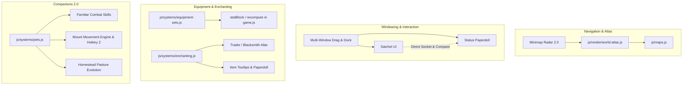

# Aetheria Grand Expansion: World Atlas, Multi-Window, Mythic Sets & Pets 2.0 Implementation Plan

> **For agentic workers:** REQUIRED SUB-SKILL: Use superpowers:subagent-driven-development to implement this plan task-by-task. Steps use checkbox (`- [ ]`) syntax for tracking.

**Goal:** Implement the 4 requested expansion pillars across Aetheria Online: an interactive full-screen graphical 10-zone World Atlas & Radar Minimap 2.0, an enhanced Multi-Window direct-interaction system, Regional Equipment Set Bonuses (Bands 2–5) with Mythic Enchanting, and Mounts with Familiar Combat AI and Homestead Evolution (Pets 2.0).

**Architecture:** Pure zero-build plain ES modules adhering to Aetheria Online's engine standards. New systems are modularized into `js/systems/equipment-sets.js`, `js/systems/enchanting.js`, `js/render/world-atlas.js`, with extensions to `js/systems/pets.js`, `js/render/pets-fx.js`, and `js/game.js`. Backwards compatibility with `awo_save_v1` and `window.__AWO` is strictly preserved, and bilingual localization (EN/TH) is maintained across all four pillars.

**Architecture Diagram:**

**Tech Stack:** Vanilla JavaScript (ES modules), HTML5 Canvas 2D, Web Audio API, Node.js test runner (`node:test`, `node:assert/strict`).

**Spec:** `docs/superpowers/plans/2026-10-16-aetheria-grand-expansion-atlas-windows-sets-pets.md`

## Global Constraints

- Native ES modules only (zero build steps, no bundlers).
- Preserve `awo_save_v1` and `window.__AWO` compatibility.
- STRICT ZERO SCREEN SHAKE on all player casting, mounting, and combat actions.
- 100% Bilingual parity (English and Thai in `js/locale.js`).
- Clean test runs (`npm test`) with zero regressions across all existing 105 test suites.

---

### Task 1: Graphical 10-Zone World Atlas & Minimap Radar 2.0

**Files:**
- Create: `js/render/world-atlas.js`
- Create: `js/world-atlas.test.js`
- Modify: `js/game.js`
- Modify: `js/maps.js`
- Modify: `js/locale.js`
- Test: `js/world-atlas.test.js`, `js/map-topology.test.js`

**Interfaces:**
- Consumes: `ZONE_ORDER`, `ZONE_PREREQUISITES`, `MAPS`, `G.guardiansSlain`, `G.mapId`.
- Produces: `renderWorldAtlasCanvas()`, `worldAtlasClick(x, y)`, `toggleWorldAtlas()`, `toggleMinimapExpand()`.

- [x] **Step 1: Write the failing test**
  - Create `js/world-atlas.test.js` asserting:
    - All 10 zones in `ZONE_ORDER` have defined graphical coordinates `(x, y)` in the 10-zone atlas node graph.
    - Zone connections follow `ZONE_PREREQUISITES`.
    - Waystone fast travel validation respects unlocked status (`prereqs` satisfied or guardian slain).
    - Minimap toggle functions (`toggleMinimapExpand`) switch between compact and tactical radar zoom.

- [x] **Step 2: Run test to verify it fails**
  - Run: `node script/run-tests.mjs js/world-atlas.test.js`
  - Expected: FAIL (`Cannot find module './render/world-atlas.js'`).

- [x] **Step 3: Implement World Atlas & Radar Overlay**
  - In `js/render/world-atlas.js`:
    - Define `ZONE_ATLAS_NODES` with normalized coordinates for all 10 zones and landmarks.
    - Implement `drawWorldAtlas(ctx, state, options)` rendering stylized parchment backgrounds, connecting highways, regional badges, boss skulls for active bosses, and pulsing player location marker.
    - Implement interactive waystone click detection for fast travel.
  - In `js/game.js`:
    - Wire `M` key / button to open the graphical World Atlas with tab toggle back to Chronicle.
    - Wire `Tab` key to toggle Minimap radar mode (expanded 240x240 view with monster/boss blips and player facing cone).
  - In `js/locale.js`:
    - Add English and Thai translations for World Atlas waystones, fast travel confirmations, and radar tooltips.

- [x] **Step 4: Run test to verify it passes**
  - Run: `node script/run-tests.mjs js/world-atlas.test.js js/map-topology.test.js`
  - Expected: PASS.

- [x] **Step 5: Full verification and commit**
  - Run: `npm test`
  - Commit: `feat(atlas): add interactive 10-zone world atlas and radar minimap 2.0`

---

### Task 2: Multi-Window Modernization & Direct Item Interaction

**Files:**
- Create: `js/multi-window.test.js`
- Modify: `js/game.js`
- Modify: `js/systems/player-features.js`
- Modify: `js/render/cards-ui.js`
- Modify: `js/equipment-features.js`
- Test: `js/multi-window.test.js`, `js/ui-windows.test.js`

**Interfaces:**
- Consumes: `openPanels()`, `setPanelPos()`, `panelEl()`, `G.player.equipment`, `G.player.inventory`.
- Produces: Direct socketing click interaction between Satchel and Status, equipment comparison tooltip on hover, persistent multi-window layout.

- [x] **Step 1: Write the failing test**
  - Create `js/multi-window.test.js`:
    - Test concurrent opening of `char` (Status) and `inv` (Satchel) without replacing each other.
    - Test direct card/gem socketing action: selecting a card in inventory and clicking an equipped gear item invokes `socketCandidate` without needing modal close/reopen.
    - Test equipment compare tooltip generation when hovering inventory gear while Status window is open.

- [x] **Step 2: Run test to verify it fails**
  - Run: `node script/run-tests.mjs js/multi-window.test.js`
  - Expected: FAIL.

- [x] **Step 3: Implement multi-window direct interaction**
  - In `js/game.js`:
    - Enhance `togglePanel` and `wirePanel`:
      - Allow clicking a card/gem in Satchel to enter "socketing pick" state, visually highlighting valid equipped slots in the open Status window.
      - Clicking the highlighted equipped gear slot in Status directly mounts the card/gem (or opens quick confirm).
      - Add gear comparison diff tooltip when hovering inventory items while Status panel is visible.
    - Refine window stacking and persistence in `winPos` so closed windows remember their coordinates.
  - In `js/render/cards-ui.js`:
    - Wire unsocket support if gem/card needs removal with extraction chisel.

- [x] **Step 4: Run test to verify it passes**
  - Run: `node script/run-tests.mjs js/multi-window.test.js js/ui-windows.test.js`
  - Expected: PASS.

- [x] **Step 5: Full verification and commit**
  - Run: `npm test`
  - Commit: `feat(ui): add multi-window concurrent interaction, direct card socketing, and gear comparison`

---

### Task 3: Regional Equipment Set Bonuses & Mythic Enchanting Altar

**Files:**
- Create: `js/systems/equipment-sets.js`
- Create: `js/systems/enchanting.js`
- Create: `js/equipment-sets.test.js`
- Create: `js/enchanting.test.js`
- Modify: `js/content.js`
- Modify: `js/game.js`
- Modify: `js/locale.js`
- Test: `js/equipment-sets.test.js`, `js/enchanting.test.js`, `js/equipment.test.js`, `js/balance.test.js`

**Interfaces:**
- Consumes: `G.player.equipment`, `CONTENT.items`, `statBlock(p)`, `recompute(p)`.
- Produces: `EQUIPMENT_SET_CATALOG`, `getActiveSetBonuses(equipment)`, `MYTHIC_ENCHANT_CATALOG`, `enchantItem(itemInstance, materialId)`.

- [x] **Step 1: Write the failing tests**
  - Create `js/equipment-sets.test.js`:
    - Assert set definitions for Band 2–5 regional armor sets (Duneslayer, Sunwalker, Sporeweaver, Mire Stalker, Thunderlord, Gale Dancer, Umbral Assassin, Darksteel Bulwark).
    - Assert 2-piece and 4-piece bonuses apply correct stat bonuses and passive procs.
  - Create `js/enchanting.test.js`:
    - Assert `enchantItem` rolls valid Mythic Affixes spending raid materials (`kernel_core`, `colossus_plating`, `voidstone_ore`).
    - Assert enchanted item stat modifiers apply correctly in `statBlock` and `recompute`.

- [x] **Step 2: Run tests to verify they fail**
  - Run: `node script/run-tests.mjs js/equipment-sets.test.js js/enchanting.test.js`
  - Expected: FAIL.

- [x] **Step 3: Implement Equipment Sets & Mythic Enchanting**
  - In `js/systems/equipment-sets.js`:
    - Define `EQUIPMENT_SET_CATALOG` with 2pc and 4pc bonuses.
    - Implement `computeActiveSetBonuses(playerEquipment)` returning cumulative stat mods and special set passives.
  - In `js/systems/enchanting.js`:
    - Define `MYTHIC_ENCHANT_CATALOG` (Architect's Insight, Colossal Force, Void Shroud, Singularity Warp).
    - Implement `enchantItem(itemInst, materialId)` with guaranteed and weighted affix ranges.
  - In `js/game.js`:
    - Wire `computeActiveSetBonuses` into `statBlock(p)` and `recompute(p)`.
    - Add Mythic Enchanting tab to Trader / Blacksmith modal (`Trader > Enhance > Mythic Infuse`).
    - Update item tooltips to show active set pieces `(2/4)` and enchanted affix glows.
  - In `js/locale.js`:
    - Add complete bilingual translations for all set names, set bonus descriptions, and mythic affixes.

- [x] **Step 4: Run tests to verify they pass**
  - Run: `node script/run-tests.mjs js/equipment-sets.test.js js/enchanting.test.js js/equipment.test.js js/balance.test.js`
  - Expected: PASS.

- [x] **Step 5: Full verification and commit**
  - Run: `npm test`
  - Commit: `feat(gear): add regional equipment set bonuses and mythic enchanting altar`

---

### Task 4: Mounts & Familiar Combat Evolution (Pets 2.0)

**Files:**
- Create: `js/pets-evolution.test.js`
- Create: `js/mounts.test.js`
- Modify: `js/systems/pets.js`
- Modify: `js/render/pets-fx.js`
- Modify: `js/render/pets-ui.js`
- Modify: `js/game.js`
- Modify: `js/locale.js`
- Test: `js/pets-evolution.test.js`, `js/mounts.test.js`, `js/pets.test.js`, `js/pets-integration.test.js`

**Interfaces:**
- Consumes: `PET_CATALOG`, `G.petState`, `G.player`, `TUNING.playerSpeed`.
- Produces: `toggleMount()`, `PET_COMBAT_SKILLS`, `evolvePet(petId, catalystId)`, `PET_EVOLUTION_CATALOG`.

- [x] **Step 1: Write the failing tests**
  - Create `js/mounts.test.js`:
    - Test mount activation with hotkey `Z` and pet UI button.
    - Test speed boost (+40%) when mounted, and automatic dismount upon taking heavy damage or entering subdungeons.
  - Create `js/pets-evolution.test.js`:
    - Test pet combat skill execution on interval during combat (`slime_puddle`, `pack_rend`, `fae_blessing`, `taunting_roar`, `pyro_breath`).
    - Test pet evolution in Homestead Pasture consuming rare catalysts, elevating companion to Tier II / III with enhanced auras.

- [x] **Step 2: Run tests to verify they fail**
  - Run: `node script/run-tests.mjs js/mounts.test.js js/pets-evolution.test.js`
  - Expected: FAIL.

- [x] **Step 3: Implement Mounts & Pets 2.0**
  - In `js/systems/pets.js`:
    - Add `canMount` flags, `PET_COMBAT_SKILLS`, and `PET_EVOLUTION_CATALOG`.
    - Implement `updatePetCombat(petState, targetMonster, dt)` and `evolvePet(petState, catalyst)`.
  - In `js/game.js`:
    - Wire `Z` key to `toggleMount()`, updating player speed multiplier and mounting state.
    - Integrate pet combat skills into the battle loop (pet casts skills toward target monster every 8–12s).
    - Wire evolution altar into Homestead Pasture interaction modal.
  - In `js/render/pets-fx.js` & `js/render/pets-ui.js`:
    - Add mount particle dust and aura rendering.
    - Add evolution tab with catalyst preview in Pet UI.
  - In `js/locale.js`:
    - Add English and Thai translations for mounts, pet skills, and evolution tiers.

- [x] **Step 4: Run tests to verify they pass**
  - Run: `node script/run-tests.mjs js/mounts.test.js js/pets-evolution.test.js js/pets.test.js js/pets-integration.test.js`
  - Expected: PASS.

- [x] **Step 5: Full verification, browser playtest, and commit**
  - Run: `npm test` across all suites (expecting ~110/110 passing).
  - Commit: `feat(pets): add mounts, familiar combat skills, and homestead evolution`

---

### Task 5: Final Acceptance, In-Browser Playtest & Regression Gate

**Files:**
- Create: `js/grand-expansion.test.js`
- Test: All suites (`npm test`)

- [x] **Step 1: Write end-to-end integration test**
  - Verify seamless interaction across all 4 pillars in `js/grand-expansion.test.js`:
    - World Atlas navigation -> Waystone travel -> Mounted movement -> Combat with pet skill procs -> Regional set bonus activation -> Mythic enchanting.

- [x] **Step 2: Run full test suite**
  - Run: `npm test`
  - Ensure 100% passing suites with zero regressions.

- [x] **Step 3: In-Browser Playtest & Visual Verification**
  - Launch headless browser or live dev server.
  - Verify World Atlas rendering, Multi-Window drag/socketing, Set bonus tooltip, and Mount toggle.

- [x] **Step 4: Final commit**
  - Commit: `test(e2e): add grand expansion integration suite and verify zero regression`
