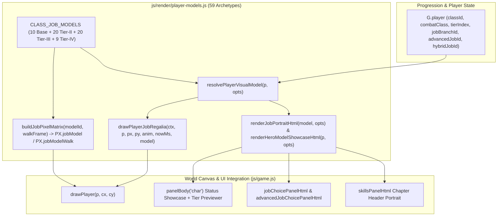

# Player Class & Job Visual Model Evolution Implementation Plan

> **For agentic workers:** REQUIRED SUB-SKILL: Use superpowers:subagent-driven-development to implement this plan task-by-task. Steps use checkbox (`- [ ]`) syntax for tracking.

**Goal:** Give all 10 base classes, 20 Tier-II job branches, 20 Tier-III advanced jobs, and 9 Tier-IV hybrid jobs (59 archetypes total) distinct, high-craft visual character models on both the world canvas and UI panels (Status window, Job Promotion choice overlays, and Skill Manual).

**Architecture:** We introduce a pure, deterministic visual-model registry and renderer in `js/render/player-models.js` that maps any player state (`classId`, `combatClass`, `tierIndex`, `jobBranchId`, `advancedJobId`, `hybridJobId`) or explicit `modelId` / `previewTier` to one of 59 archetype definitions (`CLASS_JOB_MODELS`). Each archetype owns a tailored color palette, regalia metadata (`headgear`, `mantle`, `mainhand`, `offhand`, `auraStyle`), an evolved `16×22` pixel-art sprite + walk frame registered into `PX.jobModel` / `PX.jobModelWalk`, and a directional 2D canvas regalia & aura renderer (`drawPlayerJobRegalia`) layered cleanly over the world-canvas character sprite while preserving existing `js/engine-surface.test.js` deterministic render hashes.

**Architecture Diagram:**



**Tech Stack:** Plain ES Modules (Browser + Node `--test`), HTML5 2D Canvas, SVG/DataURL pixel-art rasterization, CSS variables (`js/theme.js`), Bilingual `en`/`th` localization (`js/locale.js`).

**Spec:** [`docs/superpowers/specs/2026-10-16-player-class-job-models-design.md`](file:///Users/thanananasanthia/Desktop/personal/game-rpg/docs/superpowers/specs/2026-10-16-player-class-job-models-design.md)

## Global Constraints

- **Zero Build Step:** Native ES module imports only; no bundlers or external dependencies.
- **No Screen Shake:** All job promotion previews, idle/combat auras, and regalia animations must be strictly zero-shake and respect `prefersReducedMotion()`.
- **Deterministic Render Fingerprint Compatibility:** `js/engine-surface.test.js` records `ctx2d` calls (`fillRect`, `drawImage`, `fillText`) for an unpromoted Lv 1 `Reborn Blade` (`p.combatClass === 'blade'`, `p.tierIndex === 0`) in headless Node where `drawLpc` returns `false`. `drawPlayer` must only invoke `drawPlayerJobRegalia` on `ctx` when `drawLpc` succeeds OR `p.tierIndex > 0` OR `p.jobBranchId` OR `p.advancedJobId` OR `p.hybridJobId` OR `['assassin', 'necromancer', 'artificer'].includes(p.combatClass)`.
- **Bilingual Parity:** Every new UI label and regalia term must have English and Thai entries in `js/locale.js` and pass `js/locale-coverage.test.js` with zero negative `letter-spacing` in `js/theme.js`.

---

### Task 1: Create `js/render/player-models.js` & Unit Test Suite `js/player-models.test.js`

**Files:**
- Create: [`js/render/player-models.js`](file:///Users/thanananasanthia/Desktop/personal/game-rpg/js/render/player-models.js)
- Create: [`js/player-models.test.js`](file:///Users/thanananasanthia/Desktop/personal/game-rpg/js/player-models.test.js)

**Interfaces:**
- Consumes: `PAL`, `PX` from [`js/pixelart.js`](file:///Users/thanananasanthia/Desktop/personal/game-rpg/js/pixelart.js); `PROGRESSION` from [`js/progression.js`](file:///Users/thanananasanthia/Desktop/personal/game-rpg/js/progression.js)
- Produces:
  - `CLASS_JOB_MODELS`: Record mapping all 59 archetype IDs (`10` base classes + `20` Tier-II branches + `20` Tier-III advanced jobs + `9` Tier-IV hybrid jobs) to `{ id, tier, classId, combatClass, name, role, palette, regalia, crest, overlayPixels }`
  - `resolvePlayerVisualModel(p, opts = {})`: Resolves the active (or previewed via `opts.previewTier` / `opts.modelId`) model descriptor for player `p`, plus the full 4-tier lineage (`lineage: [tier0Model, tier1Model, tier2Model, tier3Model]`)
  - `getJobPixelMatrix(modelId, walk = false)`: Returns a `16×22` array of strings using valid `PAL` characters for `modelId` (and populates `PX.jobModel` and `PX.jobModelWalk`)
  - `drawPlayerJobRegalia(ctx, p, px, py, anim, nowMs, modelOverride)`: Renders directional regalia (`headgear`, `mantle`, `mainhand`, `offhand`) and tier aura (`auraStyle`) onto `ctx`
  - `renderJobPortraitHtml(modelOrId, opts = {})`: Renders a self-contained HTML portrait badge with pixel-art sprite data URI (or SVG crest fallback in headless mode), aura ring, and tier badge
  - `renderHeroModelShowcaseHtml(p, opts = {})`: Renders the Status window (`C`) interactive Hero Visual Model & Regalia Showcase with `Tier I–IV` preview tabs and regalia chips

- [ ] **Step 1: Write the failing unit test `js/player-models.test.js`**

```javascript
import assert from 'node:assert/strict';
import { DESIGN } from './design.js';
import { PROGRESSION } from './progression.js';
import { PAL, PX } from './pixelart.js';
import {
  CLASS_JOB_MODELS,
  resolvePlayerVisualModel,
  getJobPixelMatrix,
  drawPlayerJobRegalia,
  renderJobPortraitHtml,
  renderHeroModelShowcaseHtml,
} from './render/player-models.js';

// 1. Verify all 59 archetypes exist in CLASS_JOB_MODELS
const baseClassIds = DESIGN.classes.map(c => c.id);
assert.equal(baseClassIds.length, 10, '10 base classes exist');
for (const cid of baseClassIds) {
  assert.ok(CLASS_JOB_MODELS[cid], `Base class model missing for ${cid}`);
  assert.equal(CLASS_JOB_MODELS[cid].tier, 0);

  const branches = PROGRESSION.jobBranches[cid]?.choices || [];
  assert.equal(branches.length, 2, `2 Tier-II branches expected for ${cid}`);
  for (const br of branches) {
    assert.ok(CLASS_JOB_MODELS[br.id], `Tier-II branch model missing for ${br.id}`);
    assert.equal(CLASS_JOB_MODELS[br.id].tier, 1);
  }

  const advs = PROGRESSION.advancedJobs[cid]?.choices || [];
  assert.equal(advs.length, 2, `2 Tier-III advanced jobs expected for ${cid}`);
  for (const adv of advs) {
    assert.ok(CLASS_JOB_MODELS[adv.id], `Tier-III advanced job model missing for ${adv.id}`);
    assert.equal(CLASS_JOB_MODELS[adv.id].tier, 2);
  }
}

const hybridIds = Object.keys(PROGRESSION.hybridJobs);
assert.equal(hybridIds.length, 9, '9 Tier-IV hybrid jobs exist');
for (const hid of hybridIds) {
  assert.ok(CLASS_JOB_MODELS[hid], `Tier-IV hybrid job model missing for ${hid}`);
  assert.equal(CLASS_JOB_MODELS[hid].tier, 3);
}
assert.equal(Object.keys(CLASS_JOB_MODELS).length, 59, 'Exactly 59 total class/job visual models');

// 2. Verify every model has distinct 16x22 pixel matrices with valid PAL keys
for (const [id, model] of Object.entries(CLASS_JOB_MODELS)) {
  assert.ok(model.palette?.primary && model.palette?.secondary && model.palette?.aura, `Palette complete for ${id}`);
  assert.ok(model.regalia?.headgear && model.regalia?.mantle && model.regalia?.mainhand && model.regalia?.offhand && model.regalia?.auraStyle, `Regalia complete for ${id}`);

  const idleMat = getJobPixelMatrix(id, false);
  const walkMat = getJobPixelMatrix(id, true);
  assert.equal(idleMat.length, 22, `Idle matrix for ${id} is 22 rows`);
  assert.equal(walkMat.length, 22, `Walk matrix for ${id} is 22 rows`);
  for (const row of idleMat) {
    assert.equal(row.length, 16, `Row width is 16 for ${id}`);
    for (const ch of row) assert.ok(ch in PAL, `Valid PAL char '${ch}' in ${id}`);
  }
  assert.ok(PX.jobModel?.[id], `PX.jobModel registered for ${id}`);
  assert.ok(PX.jobModelWalk?.[id], `PX.jobModelWalk registered for ${id}`);
}

// 3. Verify resolvePlayerVisualModel across tiers & preview override
const mockPlayer = {
  classId: 'shadow_blade',
  combatClass: 'assassin',
  tierIndex: 0,
  jobBranchId: null,
  advancedJobId: null,
  hybridJobId: null,
};
const resolved0 = resolvePlayerVisualModel(mockPlayer);
assert.equal(resolved0.id, 'shadow_blade');
assert.equal(resolved0.lineage.length, 4);

mockPlayer.tierIndex = 1;
mockPlayer.jobBranchId = 'phantom_blade';
assert.equal(resolvePlayerVisualModel(mockPlayer).id, 'phantom_blade');

mockPlayer.tierIndex = 2;
mockPlayer.advancedJobId = 'void_stalker';
assert.equal(resolvePlayerVisualModel(mockPlayer).id, 'void_stalker');

mockPlayer.tierIndex = 3;
mockPlayer.hybridJobId = 'nightblade_phantom';
assert.equal(resolvePlayerVisualModel(mockPlayer).id, 'nightblade_phantom');

// Preview override in Status window
assert.equal(resolvePlayerVisualModel(mockPlayer, { previewTier: 0 }).id, 'shadow_blade');
assert.equal(resolvePlayerVisualModel(mockPlayer, { previewTier: 1 }).id, 'phantom_blade');
assert.equal(resolvePlayerVisualModel(mockPlayer, { previewTier: 2 }).id, 'void_stalker');
assert.equal(resolvePlayerVisualModel(mockPlayer, { previewTier: 3 }).id, 'nightblade_phantom');

// 4. Verify drawPlayerJobRegalia executes cleanly on mock 2D context for all directions & tiers
const drawnOps = [];
const mockCtx = {
  save: () => drawnOps.push('save'),
  restore: () => drawnOps.push('restore'),
  beginPath: () => drawnOps.push('beginPath'),
  closePath: () => {},
  arc: () => drawnOps.push('arc'),
  ellipse: () => drawnOps.push('ellipse'),
  fill: () => drawnOps.push('fill'),
  stroke: () => drawnOps.push('stroke'),
  fillRect: () => drawnOps.push('fillRect'),
  strokeRect: () => {},
  moveTo: () => {},
  lineTo: () => {},
  translate: () => {},
  scale: () => {},
  rotate: () => {},
};
for (const dir of ['down', 'left', 'right', 'up']) {
  drawnOps.length = 0;
  drawPlayerJobRegalia(mockCtx, mockPlayer, 100, 120, { state: 'idle', dir, frame: 0 }, 1000);
  assert.ok(drawnOps.includes('save') && drawnOps.includes('restore'), `Balanced save/restore for dir=${dir}`);
  assert.ok(drawnOps.length > 4, `Drew regalia primitives for dir=${dir}`);
}

// 5. Verify HTML helpers output expected classes and attributes
const portraitHtml = renderJobPortraitHtml('abyssal_lich', { size: 48 });
assert.ok(portraitHtml.includes('job-model-portrait'), 'Portrait wrapper class present');
assert.ok(portraitHtml.includes('data-model-id="abyssal_lich"'), 'Model ID attribute present');

const showcaseHtml = renderHeroModelShowcaseHtml(mockPlayer, { previewTier: 2 });
assert.ok(showcaseHtml.includes('st-model-showcase'), 'Showcase container present');
assert.ok(showcaseHtml.includes('data-preview-model-tier="0"'), 'Tier preview buttons present');
assert.ok(showcaseHtml.includes('data-preview-model-tier="3"'), 'Tier IV preview button present');

console.log('player-models.test.js passed');
```

- [ ] **Step 2: Run test to verify it fails**

Run: `node script/run-tests.mjs js/player-models.test.js`
Expected: FAIL with `ERR_MODULE_NOT_FOUND` for `js/render/player-models.js`.

- [ ] **Step 3: Implement `js/render/player-models.js`**

Create `js/render/player-models.js` with:
- Complete `CLASS_JOB_MODELS` dictionary for all 59 archetypes (10 base classes, 20 Tier-II job branches, 20 Tier-III advanced jobs, 9 Tier-IV hybrid jobs).
- Procedural `16×22` pixel-art composer (`buildJobPixelMatrix`) that starts from the class's base `PX.player[combatClass]` / `PX.playerWalk[combatClass]` matrix, remaps cloth/armor/trim palette keys to the job's distinct material ramp, and stamps tier-specific headgear crowns/hoods/halos, shoulder mantles/wings, and weapon/offhand silhouettes onto the `16×22` grid so every single job has a genuinely unique pixel sprite!
- Automatic registration into `PX.jobModel` and `PX.jobModelWalk`.
- `resolvePlayerVisualModel(p, opts)` that resolves the active or previewed model and returns `{ ...model, lineage, activeTier, previewTier }`.
- `drawPlayerJobRegalia(ctx, p, px, py, anim, nowMs, modelOverride)` that draws directional under-auras, back mantles/wings, headgear crests, and mainhand/offhand accents around `(px, py)` on the world canvas.
- `renderJobPortraitHtml(modelOrId, opts)` and `renderHeroModelShowcaseHtml(p, opts)` for the UI panels.

- [ ] **Step 4: Run test to verify it passes**

Run: `node script/run-tests.mjs js/player-models.test.js`
Expected: PASS (`player-models.test.js passed`).

---

### Task 2: Add Showcase & Job Portrait Styling in `js/theme.js` and Bilingual Strings in `js/locale.js`

**Files:**
- Modify: [`js/theme.js`](file:///Users/thanananasanthia/Desktop/personal/game-rpg/js/theme.js)
- Modify: [`js/locale.js`](file:///Users/thanananasanthia/Desktop/personal/game-rpg/js/locale.js)

**Interfaces:**
- Consumes: CSS class names produced by `renderJobPortraitHtml` and `renderHeroModelShowcaseHtml` (`.job-model-portrait`, `.st-model-showcase`, `.st-model-stage`, `.st-model-preview-tabs`, `.st-regalia-grid`, `.job-choice-portrait-wrap`)
- Produces: Styled UI components in `THEME.css` and complete English/Thai translations in `js/locale.js`

- [ ] **Step 1: Add CSS rules to `js/theme.js`**

Add rules for `.job-model-portrait`, `.st-model-showcase`, `.st-model-stage`, `.st-model-preview-tabs`, `.st-regalia-grid`, `.st-regalia-chip`, and `.job-choice-portrait-wrap` in `js/theme.js` (ensuring zero negative `letter-spacing` values).

- [ ] **Step 2: Add bilingual English & Thai strings to `js/locale.js`**

Add all new UI labels and regalia descriptors (`Visual Model`, `Model Evolution`, `Headgear`, `Mantle`, `Armament`, `Aura`, `Equipped Regalia`, `Preview Tier`, `Live Form`, `Previewing`, etc.) to `js/locale.js` under `ui`.

- [ ] **Step 3: Run locale & art tests**

Run: `node script/run-tests.mjs js/locale-coverage.test.js js/art.test.js`
Expected: PASS.

---

### Task 3: Integrate World-Canvas & UI Panel Models in `js/game.js` and `js/engine-surface.test.js`

**Files:**
- Modify: [`js/game.js`](file:///Users/thanananasanthia/Desktop/personal/game-rpg/js/game.js)
- Modify: [`js/engine-surface.test.js`](file:///Users/thanananasanthia/Desktop/personal/game-rpg/js/engine-surface.test.js)

**Interfaces:**
- Consumes: `CLASS_JOB_MODELS`, `resolvePlayerVisualModel`, `drawPlayerJobRegalia`, `renderJobPortraitHtml`, `renderHeroModelShowcaseHtml` from `js/render/player-models.js`
- Produces:
  - World-canvas player rendering in `drawPlayer(p, cx, cy)` with job-specific pixel matrices (`jobModel` / `jobModelWalk`) and directional regalia overlays (`drawPlayerJobRegalia`)
  - Job promotion choice cards (`jobChoicePanelHtml` and `advancedJobChoicePanelHtml`) with evolved job portraits and regalia tags
  - Status window (`panelBody('char')`) with interactive Hero Visual Model & Regalia Showcase (`[data-preview-model-tier]` wired in `wirePanel`)
  - Skill Manual (`skillsPanelHtml`) header displaying the active/inspected chapter's evolved job portrait
  - `window.__AWO` exports (`CLASS_JOB_MODELS`, `resolvePlayerVisualModel`, `drawPlayerJobRegalia`) registered in `js/engine-surface.test.js`

- [ ] **Step 1: Wire `player-models.js` into `js/game.js` and `js/engine-surface.test.js`**

1. Import `CLASS_JOB_MODELS`, `resolvePlayerVisualModel`, `drawPlayerJobRegalia`, `renderJobPortraitHtml`, `renderHeroModelShowcaseHtml` in `js/game.js`.
2. In `jobChoicePanelHtml(p)` (`js/game.js:1366`) and `advancedJobChoicePanelHtml(p)` (`js/game.js:1436`), embed `renderJobPortraitHtml(branch.id, { size: 52,pxDataURL })` / `renderJobPortraitHtml(job.id, { size: 52, pxDataURL })` and regalia summary badges inside each `.job-choice-card`.
3. In `drawPlayer(p, cx, cy)` (`js/game.js:4905`):
   - Resolve `const model = resolvePlayerVisualModel(p);`
   - When `drawLpc(LPC.player[p.combatClass], px, py + 8, a.state, a.dir, a.frame, 64)` returns `true`, call `drawPlayerJobRegalia(ctx, p, px, py + 8, a, now(), model)`.
   - In the `else` (`drawPx`) branch:
     - For `p.tierIndex > 0 || p.jobBranchId || p.advancedJobId || p.hybridJobId`, use `group = movingFrame ? 'jobModelWalk' : 'jobModel'` and `spriteKey = model.id`, then call `drawPlayerJobRegalia(ctx, p, px, py + bob, a, now(), model)`.
     - For `p.tierIndex === 0` base classes, use `drawPx(group, p.combatClass, px, py + bob, 36, p.facing.x < 0)`, and if `['assassin', 'necromancer', 'artificer'].includes(p.combatClass)`, also call `drawPlayerJobRegalia(ctx, p, px, py + bob, a, now(), model)` so the 3 expansion classes have unmistakable world-canvas regalia even in fallback mode while keeping `reborn_blade` (`blade`) 100% fingerprint-identical for `js/engine-surface.test.js`.
4. In `skillsPanelHtml(p)` (`js/game.js:7456`), render the inspected tier's evolved job portrait inside `.ro-book-head`.
5. In `panelBody('char')` (`js/game.js:8164`), render `renderHeroModelShowcaseHtml(p, { previewTier: G._previewModelTier, pxDataURL, T })` inside `.st-window` and wire `[data-preview-model-tier]` clicks in `wirePanel('char')` (`js/game.js:9338`).
6. Export `CLASS_JOB_MODELS`, `resolvePlayerVisualModel`, and `drawPlayerJobRegalia` on `window.__AWO` and add them to `AWO_KEYS` in `js/engine-surface.test.js`.

- [ ] **Step 2: Run full test suite**

Run: `npm test`
Expected: All 117 test suites pass with 0 failures, including `js/engine-surface.test.js`, `js/player-models.test.js`, `js/art.test.js`, and `js/locale-coverage.test.js`.

---

### Task 4: Visual Browser Verification & Git Commit

**Files:**
- Verify: `http://127.0.0.1:8123/autotest.html` in headless Brave

- [ ] **Step 1: Capture headless Brave screenshot of `autotest.html` with Status Showcase & Evolved Player Model**

Run headless Brave against `http://127.0.0.1:8123/autotest.html?panel=char` and inspect the screenshot to verify the evolved player model, Status Window Hero Model Showcase, and zero runtime errors.

- [ ] **Step 2: Commit and push to `origin/main`**

Stage all modified/created files, verify `git status`, commit with a clear message, and push to `origin/main`.
