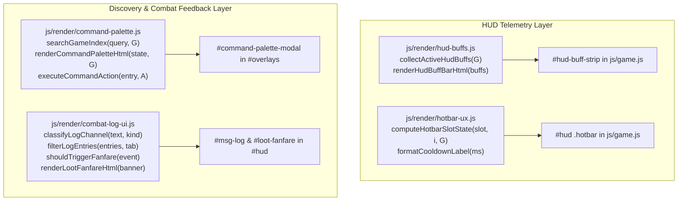

# Aetheria Online UX/UI Modernization Suite Implementation Plan

> **For agentic workers:** REQUIRED SUB-SKILL: Use superpowers:subagent-driven-development to implement this plan task-by-task. Steps use checkbox (`- [ ]`) syntax for tracking.

**Goal:** Implement the 4-Pillar UX/UI Modernization Suite across Aetheria Online: HUD Buff/Debuff & Status Aura Bar, Action Hotbar 2.0 (Radial Cooldown Sweep, Resource/Range Badges & Combo Glow), Universal Command & Codex Search Palette (`Ctrl+K` / `/`), and Combat Log Tabs + Rare Loot/Boss Fanfare 2.0.

**Architecture:** Modular zero-build plain ES modules in `js/render/` (`hud-buffs.js`, `hotbar-ux.js`, `command-palette.js`, `combat-log-ui.js`) integrated into `js/game.js` and styled via Aetheria × RO design tokens in `js/theme.js`. Preserves `awo_save_v1`, `window.__AWO`, 100% EN/TH bilingual parity in `js/locale.js`, and strict zero camera shake.

**Architecture Diagram:**



**Tech Stack:** Vanilla JavaScript (ES modules), HTML5 Canvas 2D, CSS Custom Properties & Masking, Node.js test runner (`node:test`, `node:assert/strict`).

**Spec:** [`docs/superpowers/specs/2026-10-16-ux-ui-modernization-suite-design.md`](file:///Users/thanananasanthia/Desktop/personal/game-rpg/docs/superpowers/specs/2026-10-16-ux-ui-modernization-suite-design.md)

## Global Constraints

- Zero build step: Pure browser-native ES modules only.
- Preserve `awo_save_v1` and `window.__AWO` compatibility (sorted keys in `js/engine-surface.test.js`).
- Strict ZERO screen shake on all actions, fanfare banners, and HUD updates.
- 100% Bilingual parity (English and Thai in `js/locale.js`, verified by `js/locale-coverage.test.js`).
- Zero regressions across all existing 112 test suites (`npm test`).

---

### Task 1: HUD Buff, Debuff & Status Aura Bar (`js/render/hud-buffs.js`)

**Files:**
- Create: `js/render/hud-buffs.js`
- Create: `js/hud-buffs.test.js`
- Modify: `js/theme.js`
- Modify: `js/locale.js`
- Modify: `js/game.js`
- Modify: `js/engine-surface.test.js`
- Test: `js/hud-buffs.test.js`

**Interfaces:**
- Consumes: `G.mounted`, `G.homestead?.activeBuff`, `G.player.imbue`, `G.player.petAtkBuffUntil`, `G.player.shield`, `G.player.statuses`, `getActiveSetBonuses(G.player.equip)`.
- Produces: `collectActiveHudBuffs(G, nowMs)`, `formatBuffDuration(ms)`, `renderHudBuffBarHtml(buffs, translateFn)`.

- [ ] **Step 1: Write the failing test**

Create `js/hud-buffs.test.js` testing `collectActiveHudBuffs`, `formatBuffDuration`, and `renderHudBuffBarHtml` across mount state, homestead food buff, weapon elemental imbue, pet buffs, status effects/debuffs, and active equipment set bonuses.

- [ ] **Step 2: Run test to verify it fails**

Run: `node script/run-tests.mjs js/hud-buffs.test.js`
Expected: FAIL (`Cannot find module './render/hud-buffs.js'`).

- [ ] **Step 3: Implement `js/render/hud-buffs.js` and wire into `js/game.js`, `js/theme.js`, and `js/locale.js`**

Implement `collectActiveHudBuffs`, `formatBuffDuration`, and `renderHudBuffBarHtml` in `js/render/hud-buffs.js`; add `#hud-buff-strip` to `buildHud()` and update it in `updateHud()` in `js/game.js`; style `.hud-buff-strip` and `.hud-buff-chip` in `js/theme.js`; add EN/TH translations in `js/locale.js`.

- [ ] **Step 4: Run test to verify it passes**

Run: `node script/run-tests.mjs js/hud-buffs.test.js js/locale-coverage.test.js`
Expected: PASS.

- [ ] **Step 5: Commit**

```bash
git add js/render/hud-buffs.js js/hud-buffs.test.js js/theme.js js/locale.js js/game.js js/engine-surface.test.js
git commit -m "feat(hud): add active buff, debuff, mount, and set aura bar"
```

---

### Task 2: Action Hotbar 2.0 — Radial Cooldown Sweep, Resource/Range States & Combo Glow (`js/render/hotbar-ux.js`)

**Files:**
- Create: `js/render/hotbar-ux.js`
- Create: `js/hotbar-ux.test.js`
- Modify: `js/theme.js`
- Modify: `js/game.js`
- Modify: `js/engine-surface.test.js`
- Test: `js/hotbar-ux.test.js`

**Interfaces:**
- Consumes: `G.player`, `G.target`, `COMBAT.skills`, `TUNING.momentum`.
- Produces: `formatCooldownLabel(ms)`, `computeHotbarSlotState(slot, index, G, nowMs)`.

- [ ] **Step 1: Write the failing test**

Create `js/hotbar-ux.test.js` asserting sub-second cooldown labels under 3s (`0.8s`), integer labels above 3s (`5s`), radial percentage computation (`0..100`), `insufficientMp`, `outOfRange`, and `comboPrimed` states for Detonators and Finishers.

- [ ] **Step 2: Run test to verify it fails**

Run: `node script/run-tests.mjs js/hotbar-ux.test.js`
Expected: FAIL (`Cannot find module './render/hotbar-ux.js'`).

- [ ] **Step 3: Implement `js/render/hotbar-ux.js` and wire into `js/game.js` and `js/theme.js`**

Implement `formatCooldownLabel` and `computeHotbarSlotState` in `js/render/hotbar-ux.js`; update `updateHud()` in `js/game.js` to apply `--cd-angle`, `.is-no-mp`, `.is-out-range`, and `.is-combo-primed` classes and sub-second cooldown labels; style radial `conic-gradient` cooldown sweeps and combo pulse in `js/theme.js`.

- [ ] **Step 4: Run test to verify it passes**

Run: `node script/run-tests.mjs js/hotbar-ux.test.js`
Expected: PASS.

- [ ] **Step 5: Commit**

```bash
git add js/render/hotbar-ux.js js/hotbar-ux.test.js js/theme.js js/game.js js/engine-surface.test.js
git commit -m "feat(hotbar): add radial conic cooldown sweep, range/mp states, and combo glow"
```

---

### Task 3: Universal Command & Codex Search Palette (`js/render/command-palette.js`)

**Files:**
- Create: `js/render/command-palette.js`
- Create: `js/command-palette.test.js`
- Modify: `js/theme.js`
- Modify: `js/locale.js`
- Modify: `js/game.js`
- Modify: `js/engine-surface.test.js`
- Test: `js/command-palette.test.js`

**Interfaces:**
- Consumes: `MAPS`, `ZONE_ATLAS_NODES`, `CONTENT.monsters`, `CONTENT.items`, `CARD_CATALOG`, `G`.
- Produces: `searchGameIndex(query, G, opts)`, `renderCommandPaletteHtml(state, G, translateFn)`, `executeCommandAction(entry, A)`, `toggleCommandPalette()`.

- [ ] **Step 1: Write the failing test**

Create `js/command-palette.test.js` testing `searchGameIndex` across zones, monsters, items, and panels, `renderCommandPaletteHtml`, and `executeCommandAction` (fast travel / route for zones, hunt for monsters, satchel/book for items, panel jump for menus).

- [ ] **Step 2: Run test to verify it fails**

Run: `node script/run-tests.mjs js/command-palette.test.js`
Expected: FAIL (`Cannot find module './render/command-palette.js'`).

- [ ] **Step 3: Implement `js/render/command-palette.js` and wire into `js/game.js`, `js/theme.js`, and `js/locale.js`**

Implement `searchGameIndex`, `renderCommandPaletteHtml`, and `executeCommandAction` in `js/render/command-palette.js`; wire `Ctrl+K`, `Cmd+K`, `/`, and a `🔍` HUD button in `js/game.js`, plus `closeTopmost()` support; add bilingual strings in `js/locale.js`.

- [ ] **Step 4: Run test to verify it passes**

Run: `node script/run-tests.mjs js/command-palette.test.js js/locale-coverage.test.js`
Expected: PASS.

- [ ] **Step 5: Commit**

```bash
git add js/render/command-palette.js js/command-palette.test.js js/theme.js js/locale.js js/game.js js/engine-surface.test.js
git commit -m "feat(ux): add universal Ctrl+K command and codex search palette"
```

---

### Task 4: Combat Log Tabs & Rare Loot / Boss Fanfare 2.0 (`js/render/combat-log-ui.js`)

**Files:**
- Create: `js/render/combat-log-ui.js`
- Create: `js/combat-log-ui.test.js`
- Modify: `js/theme.js`
- Modify: `js/locale.js`
- Modify: `js/game.js`
- Modify: `js/engine-surface.test.js`
- Test: `js/combat-log-ui.test.js`

**Interfaces:**
- Consumes: `logMsg(text, kind)` events, `addItem` / `rollItem` loot events, guardian/raid boss kill events.
- Produces: `classifyLogChannel(text, kind)`, `filterLogEntries(entries, tab)`, `renderLogFilterTabsHtml(activeTab, translateFn)`, `shouldTriggerFanfare(event)`, `renderLootFanfareHtml(banner, translateFn)`.

- [ ] **Step 1: Write the failing test**

Create `js/combat-log-ui.test.js` testing `classifyLogChannel` (`combat`, `loot`, `sys`), `filterLogEntries` across `all`, `combat`, `loot`, and `sys` tabs, `shouldTriggerFanfare` for Epic/Legendary items, Monster Cards, Boss Catalysts, and Guardian kills, and `renderLootFanfareHtml`.

- [ ] **Step 2: Run test to verify it fails**

Run: `node script/run-tests.mjs js/combat-log-ui.test.js`
Expected: FAIL (`Cannot find module './render/combat-log-ui.js'`).

- [ ] **Step 3: Implement `js/render/combat-log-ui.js` and wire into `js/game.js`, `js/theme.js`, and `js/locale.js`**

Implement `classifyLogChannel`, `filterLogEntries`, `renderLogFilterTabsHtml`, `shouldTriggerFanfare`, and `renderLootFanfareHtml` in `js/render/combat-log-ui.js`; wire buffered log tabs and soft-edge CSS `mask-image` into `#msg-log`, and wire `#loot-fanfare` banners on rare drops and guardian/raid kills in `js/game.js`.

- [ ] **Step 4: Run test to verify it passes**

Run: `node script/run-tests.mjs js/combat-log-ui.test.js js/locale-coverage.test.js`
Expected: PASS.

- [ ] **Step 5: Commit**

```bash
git add js/render/combat-log-ui.js js/combat-log-ui.test.js js/theme.js js/locale.js js/game.js js/engine-surface.test.js
git commit -m "feat(ux): add categorized combat log tabs with soft-edge fade and rare loot fanfare"
```

---

### Task 5: End-to-End UX/UI Acceptance, Browser Visual Playtest & Full Regression Gate

**Files:**
- Modify: `js/engine-surface.test.js`
- Test: All suites (`npm test`)

- [ ] **Step 1: Run `js/engine-surface.test.js` and `js/locale-coverage.test.js`**
- [ ] **Step 2: Run full regression suite (`npm test`) across all 116 test suites**
- [ ] **Step 3: Capture headless Brave visual verification screenshots (`autotest.html`) and verify zero `#err` banner**
- [ ] **Step 4: Final commit and push**
