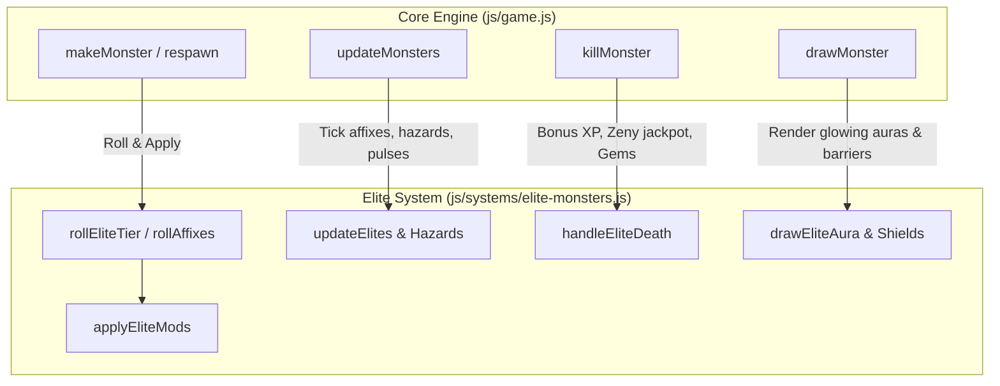

# Elite & Champion Monster Affix System Design Specification

## 1. Overview & Goals

The **Elite & Champion Monster Affix System** introduces procedural modifier packs to *Aetheria Online*, elevating moment-to-moment combat in open field zones and dungeons. 

### Core Goals
- **Combat Variety:** Break up routine grinding with high-threat monster variants requiring tactical adaptation (avoiding ground fire, timing bursts during shield downtime, dodging frost novas).
- **Compelling Rewards:** Grant substantial XP multipliers, zeny jackpots, guaranteed gem drops, and improved equipment rarity rolls when defeating Champion and Elite packs.
- **Visual Clarity:** Instantly distinguishable glowing ground auras, colored badges, and active state indicators (e.g. shielding bubbles, telegraph rings) without visual clutter.
- **Zero Camera Shake:** 100% steady camera, respecting player preferences while maintaining crisp visual feedback.
- **Clean Modularity:** Encapsulated in `js/systems/elite-monsters.js` with 100% unit-testable mechanics in Node.js.

---

## 2. Rarity Tiers & Spawning Rules

| Tier | Spawn Chance | Multipliers | Affix Count | Aura Visual | Loot & Reward Multipliers |
|---|---|---|---|---|---|
| **Normal** | ~88% | 1.0× HP, 1.0× ATK | 0 | None | Base XP, base zeny, standard drops |
| **Champion** | ~9% | 1.8× HP, 1.25× ATK | 1 | Rotating Cyan Ring (`#5bc0de`) | 2.5× XP, 3.0× Zeny, +2 Drop Bias, 25% Gem Shard |
| **Elite** | ~3% | 3.0× HP, 1.40× ATK | 2 | Radiant Golden Halo (`#ffcc00`) | 4.0× XP, 6.0× Zeny, +4 Drop Bias, 100% Gem Shard |

### Exclusion Rules
- **Bosses & Guardians (`def.sizeTiles >= 2`):** Excluded from the procedural elite roll to preserve authored boss mechanics and phase transitions.
- **Roaming World Bosses (`def.rare`):** Excluded from elite rolls (already possess specialized world-boss timers and mechanics).
- **Raid Adds & Minions:** Excluded from elite rolls.

---

## 3. Affix Catalog & Mechanics

Monsters rolling Champion (1 affix) or Elite (2 distinct affixes) select from the following pool:

### 1. `molten` (Fiery Footprints & Death Burst)
- **Trail:** Leaves fiery ember puddles on the ground every 1.2s as it walks. Puddles persist for 3.5s and inflict 5% max HP/sec fire damage to players standing inside.
- **On Death:** Releases 3 small exploding magma sparks in 120° offsets, detonating after 0.8s.

### 2. `frost_nova` (Pulsing Chill Nova)
- **Active Telegraph:** Every 6.0s in combat, casts a 360° circular frost telegraph (radius: 2.8 tiles, duration: 1.1s).
- **Impact:** Deals moderate frost damage and applies `slow` status for 3.5s (50% movement and attack speed reduction). Can be dodged by stepping outside the ring.

### 3. `vortex` (Gravitational Pull)
- **Active Pulse:** Every 7.5s in combat, creates a swirling gravitational pulse that pulls the player 1.6 tiles toward the monster, preventing easy kiting.

### 4. `shielding` (Periodic Kinetic Barrier)
- **Active Barrier:** Every 8.5s in combat, generates a kinetic hex-shield lasting 3.0s.
- **Effect:** Absorbs 70% of all incoming damage while active. Visualized by a glowing hexagonal barrier around the monster sprite. Players are incentivized to hold high-damage cooldowns until the shield drops.

### 5. `avenger` (Pack Retaliation)
- **Reactive Trigger:** When any other monster within 4.5 tiles dies, the Avenger gains a stack of Enrage (+15% ATK, max 3 stacks) and instantly heals 12% of its maximum HP.

---

## 4. Visual Presentation & UI

### In-World Auras (`drawMonster`)
- **Champion Aura:** A spinning dashed cyan circle beneath the monster with a gentle pulsation (`#5bc0de`).
- **Elite Aura:** A double-layered golden halo with radiant outward rays (`#ffcc00`).
- **Shielding Effect:** A pulsing translucent hex-barrier outline drawn over the sprite when the barrier is active.

### Nameplate & Floating Badges
- **Champion Nameplate:** `[★ CHAMPION] Lv{lvl} {Monster Name}` styled in `#5bc0de`.
- **Elite Nameplate:** `[★ ELITE] Lv{lvl} {Monster Name}` styled in `#ffcc00`.
- **Affix Subtitle:** Displays active affixes beneath the nameplate, e.g., `Molten · Shielding` in light gray/gold.

---

## 5. System Architecture & Module Boundaries

### Module Interface: `js/systems/elite-monsters.js`
- `createEliteSystem(deps)`:
  - `rollTier(monsterDef, mapTier)` -> `'champion' | 'elite' | null`
  - `rollAffixes(tier)` -> `string[]`
  - `applyEliteMods(monster, tier, affixes)`
  - `updateElites(monsters, player, dt, context)`
  - `handleEliteDeath(monster, player, context)` -> `{ bonusXp, bonusZeny, bonusItems }`
  - `drawEliteAura(ctx, monster, screenX, screenY, size, now)`
  - `drawEliteShield(ctx, monster, screenX, screenY, size, now)`
  - `clearHazards()`

---

## 6. Testing Strategy

1. **Unit Tests (`js/elite-monsters.test.js`):**
   - Tier roll probability distribution and exclusion of size-2 bosses.
   - Correct stat scaling (HP and ATK multipliers).
   - Molten hazard puddle creation and player damage ticks.
   - Frost Nova telegraph scheduling, timing, and slow status infliction.
   - Vortex displacement vectors.
   - Shielding damage mitigation calculation (70% damage reduction).
   - Avenger stack accumulation on nearby monster death.
   - Bonus XP, Zeny, and guaranteed gem shard drop on elite death.
2. **Deterministic Engine Characterization (`js/engine-surface.test.js`):**
   - Verification that all 255 keys on `window.__AWO` are unchanged.
   - Verification that render fingerprint hashes for empty maps remain identical.
3. **Full Regression Suite:**
   - Execute `npm test` to ensure all 36 test suites pass with zero regressions.
4. **Visual Smoke Test:**
   - Headless Brave capture of `autotest.html` confirming clean aura rendering and absence of `#err` banners.
