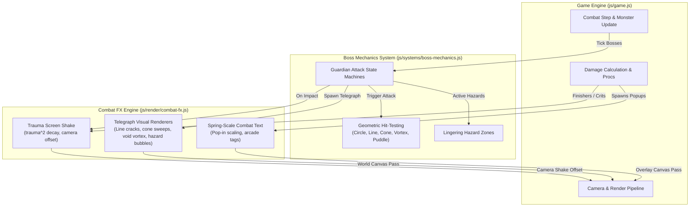

# Tactical Boss Mechanics & Combat Juice Design Specification

**Status:** Approved for Implementation  
**Date:** 2026-10-06  
**Target:** Aetheria Online (`index.html` + `js/*.js`)  
**Scope:** Boss encounter mechanics, telegraph geometric rendering, trauma screen shake, and expressive floating combat text.

---

## 1. Executive Summary & Goals

Aetheria Online features an expansive Base Lv 1→80 journey across six biomes with 7 classes and 28 monsters. However, boss encounters currently share a single generic circular slam telegraph and an enrage threshold, and combat impacts lack visceral tactile feedback (screen shake and expressive combat floaties).

This specification introduces:
1. **Unique Boss Encounter Mechanics & Telegraph Patterns**: Each of the 5 zone guardians, the endgame finale boss, and the roaming rare boss receives custom telegraph geometry (fissures, cones, vortexes, lingering hazard puddles).
2. **Visceral Trauma Screen Shake Engine**: Decay-based camera shake (`trauma^2`) triggered by boss impacts, Tier-3 ultimate finishers, and status detonations, fully respecting accessibility and `prefersReducedMotion()`.
3. **Expressive Arcade Floating Combat Text**: Spring-scaled damage numbers and bold combat tags (`CRIT!`, `WEAKNESS!`, `RESIST`, `DETONATE!`, `STUN!`, `FROZEN!`, `DODGE!`).
4. **Clean Decoupled Architecture**: Modularizing these systems into [`js/render/combat-fx.js`](file:///Users/thanananasanthia/Desktop/personal/game-rpg/js/render/combat-fx.js) and [`js/systems/boss-mechanics.js`](file:///Users/thanananasanthia/Desktop/personal/game-rpg/js/systems/boss-mechanics.js), keeping [`js/game.js`](file:///Users/thanananasanthia/Desktop/personal/game-rpg/js/game.js) focused and unbloated.

---

## 2. Architectural Overview



---

## 3. Module Specifications

### 3.1. `js/systems/boss-mechanics.js`
Encapsulates boss attack patterns, telegraph timers, and geometric collision testing.

#### Boss Roster & Attack Patterns:
1. **Elderwood Treant** (`elderwood_treant`, Woods Guardian, Lv14 Nature):
   - **Root Slam**: Circular expanding root ring under player (radius `TS * 1.8`, 1100ms). If hit: deals `1.5x` ATK damage and applies a **Root / Slow** effect (-50% move speed for 2.5s).
   - **Bramble Burst**: Small secondary bramble spikes around the Treant's feet.
2. **Ruin Golem** (`ruin_golem`, Ruins Guardian, Lv28 Earth):
   - **Seismic Fissure**: Directional rectangular line telegraph pointing from Golem towards player (width `TS * 1.5`, length `TS * 6`, 1200ms).
   - If hit: deals heavy blunt damage (`1.7x` ATK) and **Stun** (1.0s).
3. **Frost Revenant** (`frost_revenant`, Tundra Guardian, Lv44 Ice):
   - **Glacial Breath**: 60° forward cone telegraph extending from Revenant towards target (radius `TS * 5`, 1200ms).
   - If hit: deals cold damage (`1.6x` ATK) and applies **Chilled / Slow** (-40% move/attack speed for 3s).
4. **Flame Dragon** (`flame_dragon`, Caldera Guardian, Lv60 Fire):
   - **Magma Breath & Cascade**: 75° sweeping flame cone telegraph (radius `TS * 5.5`, 1300ms) + leaves **2–3 Lingering Magma Pools** at random positions within the breath zone.
   - Magma Pools linger for 4.0s; stepping into a pool ticks for 7% player max HP/sec.
5. **Nullking** (`nullking`, Astral Rift Guardian / Finale Boss, Lv80 Void):
   - **Gravitational Collapse**: Inward-swirling void singularity centered at target location (radius `TS * 3.2`, 1400ms).
   - During the 1400ms telegraph, the player experiences a gentle gravitational pull towards the vortex center (~35 px/s).
   - At impact, explodes into a catastrophic void supernova (`2.0x` ATK).
6. **Gilded Ravager** (`gilded_ravager`, Roaming Rare Boss, Lv45):
   - **Vault Cataclysm**: Staggered triple gold impact circles (each radius `TS * 1.6`, timed 250ms apart).
7. **Raid Encounter & Generic Bosses**:
   - Preserves existing raid phase triggers (adds at 66% HP, expanding hazard at 33% HP) and fallback circular slams for custom/subdungeon bosses.

#### Geometric Hit-Testing Functions:
- `pointInCircle(px, py, cx, cy, radius)`: Euclidean distance check `Math.hypot(px - cx, py - cy) <= radius`.
- `pointInOrientedBox(px, py, ox, oy, targetX, targetY, length, width)`: Rotates point into local coordinate frame aligned with line from origin `(ox, oy)` to `(targetX, targetY)` and performs AABB check `[0, length]` and `[-width/2, width/2]`.
- `pointInCone(px, py, ox, oy, targetX, targetY, radius, fovRadians)`: Distance check plus angle delta check `Math.abs(angleDiff(heading, targetAngle)) <= fovRadians / 2`.
- `checkHazardOverlap(px, py, hazards)`: Iterates active lingering ground hazards.

---

### 3.2. `js/render/combat-fx.js`
Handles the visual presentation of telegraphs, trauma screen shake, and floating text.

#### 1. Trauma Screen Shake Engine
- **Trauma-based model**: `shake = trauma^2` (provides non-linear visceral feel — small hits feel tight, big hits feel colossal).
- `trauma` ranges `0.0` to `1.0`, decaying linearly at `1.8 / second`.
- Maximum displacement: `maxOffsetX = 12px`, `maxOffsetY = 12px`, `maxAngle = 0.03 rad`.
- Computed using sinusoidal noise based on current timestamp:
  ```js
  const shake = trauma * trauma;
  const offsetX = maxOffsetX * shake * Math.sin(now * 0.045);
  const offsetY = maxOffsetY * shake * Math.cos(now * 0.052);
  ```
- Trigger Events:
  - Boss telegraph impacts: `+0.55 .. +0.80` trauma
  - Tier-3 Ultimate Finishers (`world_cleaver`, `meteor`, `apocalypse`, `dawnbreaker`, `hundred_fists`, `star_fall`): `+0.45 .. +0.65` trauma
  - Detonation procs & Big Critical hits: `+0.25 .. +0.35` trauma
  - Player lethal / heavy hits: `+0.40 .. +0.60` trauma
- **Accessibility**: When `prefersReducedMotion()` is true or when disabled in settings, `trauma` remains 0 (no camera displacement).

#### 2. Canvas Telegraph Renderers
All telegraphs render beneath entities and above background tiles with smooth alpha blending and warning pulses:
- **Circle**: Expanding translucent inner fill with a pulsing high-contrast outer warning ring and center crack lines.
- **Directional Fissure (Line)**: Ground fissure rectangle with glowing jagged fault line down the center.
- **Cone (Breath)**: Pie slice / sector arc with radiating flame/frost particle streaks.
- **Vortex (Singularity)**: Orbiting spiral arms rotating inward towards the black-hole core.
- **Magma Puddles**: Viscous bubbling circular hazard pools with burning ember sparks and heat shimmer.

#### 3. Spring-Scale Floating Combat Text
- Floaties animate with a spring-scale curve: pops up to `1.3x` scale in first 120ms, settles to `1.0x`, rises upward by 28px, then fades smoothly.
- Distinct color & typography styling:
  - **CRIT!**: High-visibility gold/amber, larger font (`24px`), `CRIT! <damage>`.
  - **WEAKNESS!**: Elemental gold/cyan glow, `WEAK! <damage>`.
  - **RESIST**: Muted steel-grey, `RESIST <damage>`.
  - **DETONATE!**: Vibrant orange-red explosion burst, `DETONATE! <damage>`.
  - **STATUS PROCS**: `STUN!`, `FROZEN!`, `BURN!`, `BLEED!`, `SLOW!`.
  - **EVASION**: Green `DODGE!` or grey `MISS`.

---

## 4. Integration with `js/game.js`

1. **Camera Shake Integration**:
   - In `js/game.js` `render()`:
     ```js
     const shake = combatFx.getScreenShakeOffset();
     G.cam.x = clamp(p.x - CANVAS_W / 2, ...) + shake.x;
     G.cam.y = clamp(p.y - CANVAS_H / 2, ...) + shake.y;
     ```
   - On canvas click input, subtract `shake.x, shake.y` so clicks remain pixel-accurate even during violent screen shakes.
2. **Boss Loop Delegation**:
   - In `updateMonsters()`, replace lines 2248–2305 with:
     ```js
     bossMechanics.updateBoss(m, p, dt, {
       now,
       TUNING,
       COMBAT,
       TS,
       dist,
       playerAvoidsHit,
       calcDamage,
       buffMult,
       playerDeath,
       floatText,
       playSfx: AUDIO.playSfx,
       addScreenShake: combatFx.addScreenShake,
       addTelegraph: combatFx.addTelegraph,
     });
     ```
3. **Floating Text Hooks**:
   - Enhance `floatText(x, y, text, kind, tag)` in `js/game.js` to route through `combatFx.addFloatText(...)`.
   - Update `damageMonster` and skill detonation calls to pass appropriate tags (`crit`, `weakness`, `resist`, `detonate`).

---

## 5. Verification & Testing Plan

1. **Deterministic Test Suites**:
   - Run `npm test` across all 34 existing suites. Ensure 34/34 suites pass with 0 regressions.
   - Add new test suite `js/boss-mechanics.test.js` validating:
     - Geometric hit detection formulas (point-in-box, point-in-cone, point-in-circle, hazard overlap).
     - Boss telegraph timers, telegraph cleanup on boss defeat or leash.
     - Root/slow/stun status application on hit.
     - Screen shake trauma accumulation and decay calculations.
2. **Surface Characterization**:
   - Run `node js/engine-surface.test.js`:
     - Verify all 255 keys of `window.__AWO` remain intact.
     - Verify deterministic tile render fingerprints remain exact.
3. **Headless Browser Visual Inspection**:
   - Serve repo locally and capture `autotest.html` using headless Brave.
   - Test boss slam execution via query parameter (e.g. `autotest.html?boss=1&slam=1`).
   - Confirm zero runtime errors in `#err` banner, inspect screenshot for crisp telegraph geometry and floating combat text rendering.

---

## 6. Compatibility & Constraints

- **Compatibility**: All 255 `window.__AWO` identifiers, `awo_save_v1` save format, and data in `js/design.js` / `js/content.js` remain completely unchanged.
- **Zero-Build Plain ES Modules**: No bundlers, external libraries, or build steps.
- **Accessibility**: Full compliance with `prefers-reduced-motion: reduce`. Screen shake and aggressive scale springs gracefully disable without affecting combat logic or hit detection.
