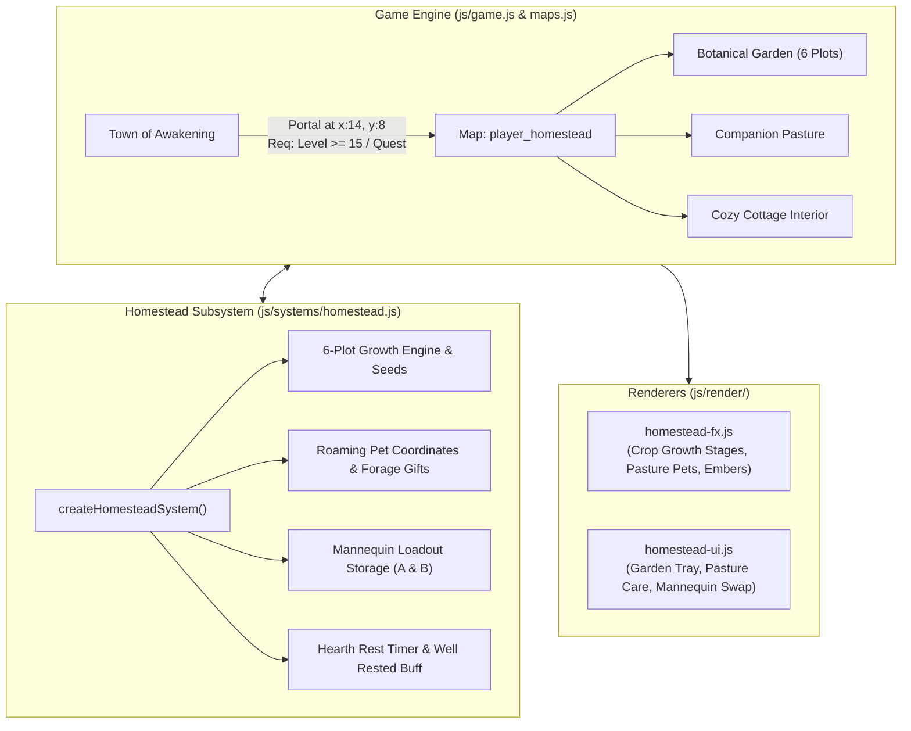
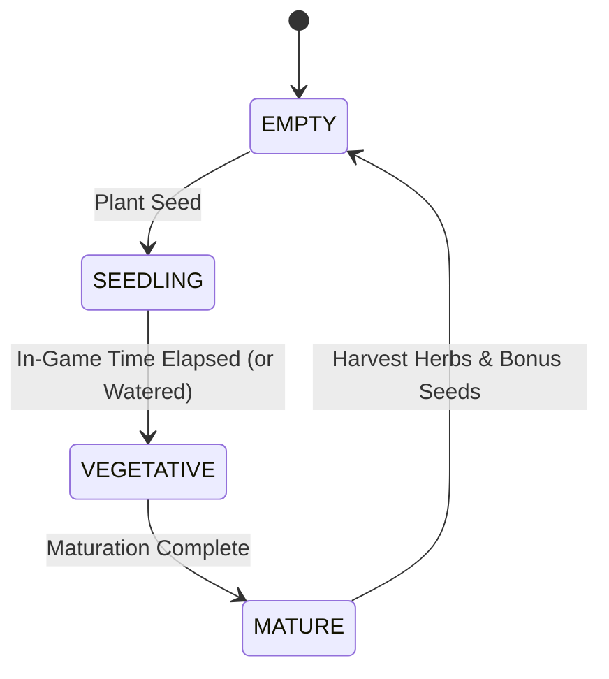
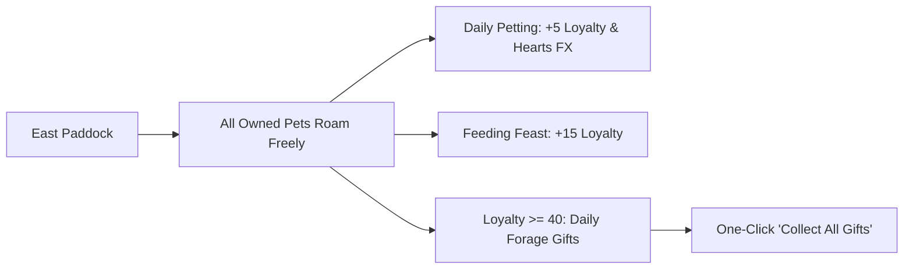
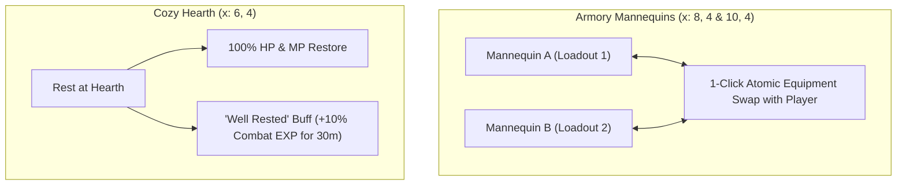

# The Sovereign Realm — Module 3: Adventurer's Homestead & Botanical Sanctum Design Specification

**Document:** `docs/superpowers/specs/2026-10-08-adventurers-homestead-and-sanctum-design.md`  
**Status:** Approved by User  
**Target:** Aetheria Online (`index.html` + `js/*.js` ES-module runtime)  

---

## 1. Overview & Design Goals

Module 3 of "The Sovereign Realm" expansion introduces **The Adventurer's Homestead & Botanical Sanctum**, providing players with an explorable, cozy personal sanctuary featuring real-time herb and crop cultivation, a roaming companion pasture with daily bonding and forage gifts, dual armory mannequins for 1-click gear loadout swapping, and a cozy hearth rest point granting combat buffs.

### Core Objectives
1. **Physical Homestead Map (`player_homestead`):** An instanced 28×20 sanctuary featuring a cozy cottage, a 6-plot botanical garden, a fenced companion pasture, and an exit portal to Town of Awakening.
2. **Botanical Sanctum Cultivation:** 6 tilled soil plots with multi-stage real-time growth (Empty $\to$ Seedling $\to$ Vegetative $\to$ Mature), watering hydration acceleration, and seed extraction recipes for rare herbs and cooking grain.
3. **Companion Pasture & Daily Foraging:** All owned companions wander freely in an open meadow paddock; daily petting grants loyalty, and companions with loyalty $\ge 40$ yield daily forage gift bundles (materials, essences, seeds).
4. **Armory Mannequins & 1-Click Loadout Swapping:** 2 wooden display mannequins storing complete equipment loadouts with instant 1-click swapping with worn gear.
5. **Cozy Hearth & Bestiary Card Gallery:** Hearth fireplace resting restores full HP/MP and grants a 30-minute "Well Rested" buff (+10% combat EXP), alongside framed monster card milestone achievements.
6. **Zero Camera Shake & Strict Responsive Boxing:** Canvas 2D crop growth and hearth embers with immutable `G.cam` invariance, coupled with `box-sizing: border-box` responsive UI framing.
7. **Dual Bilingual Localization:** 100% parity across English and Thai in `js/locale.js`.
8. **Engine Surface Baseline:** Preservation of the exact 255 keys on `window.__AWO`.

---

## 2. Architecture & Subsystem Division

- **`js/systems/homestead.js`**: Pure logic state machine managing the 6 garden plots, seed planting, growth progression timers, watering boosts, companion pasture gifts, mannequin loadout swaps, and the hearth rest buff.
- **`js/render/homestead-fx.js`**: Canvas 2D renderers for furrowed soil, sprouts, foliage, blooming flora with floating pollen motes, roaming pasture familiars, hearth embers/warmth, and strict zero camera shake.
- **`js/render/homestead-ui.js`**: Responsive modals for planting seeds, tending pasture pets, previewing mannequin gear loadouts, and reviewing the bestiary card showcase.
- **`js/maps.js`**: Definition of the `player_homestead` map.
- **`js/game.js`**: Engine wiring for Town hearth portal gate checks, 1-click mannequin swaps, `recompute(p)` "Well Rested" buff multipliers, and save state persistence under `world.homestead`.

---

## 3. Physical Map Specification (`player_homestead`)

### Map Parameters
- **ID:** `player_homestead`
- **Dimensions:** 28 tiles wide × 20 tiles high ($896 \times 640$ px at 32px per tile).
- **Theme/Music:** `'sanctuary'` or `'homestead'`.
- **Legend:**
  - Walls (`O`), walkable grass/wood floor (`.`), decorative stone arches (`A`), decorative columns (`C`), crop furrow tiles (`X`), hearth fireplace (`H`).

### Key Coordinates
1. **Entrance / Exit Hearth Portal:** Located at `(14, 18)` $\to$ returns to `town_awakening` at `(14, 8)`.
2. **Cozy Cottage Interior (North-West, x: 4..12, y: 3..9):**
   - Cozy Hearth: `(6, 4)`
   - Armory Mannequin A: `(8, 4)`
   - Armory Mannequin B: `(10, 4)`
   - Bestiary Card Showcase: `(12, 4)`
3. **Botanical Garden (South-West, x: 4..12, y: 12..16):**
   - Plot 0: `(5, 13)`, Plot 1: `(7, 13)`, Plot 2: `(9, 13)`
   - Plot 3: `(5, 15)`, Plot 4: `(7, 15)`, Plot 5: `(9, 15)`
   - Water Well: `(4, 14)`
4. **Companion Pasture (East Meadow, x: 16..25, y: 4..16):**
   - Split-rail wooden fenced paddock where all owned pets roam.
   - Gift Basket / Feed Trough: `(17, 10)`

### Access Gate
- **Entry Tile in Town:** `(14, 8)` in `town_awakening`.
- **Unlock Condition:** Adventurer Level $\ge 15$ and quest `"A Place to Call Home"` (`q_homestead_intro`).
- **Failure Toast:**
  - *EN:* *"The Hearth Portal is dormant. Reach Level 15 and speak with the Oracle to claim your homestead."*
  - *TH:* *"พอร์ทัลบ้านพักยังไม่ทำงาน จงบรรลุเลเวล 15 และคุยกับผู้หยั่งรู้เพื่อรับสิทธิ์เข้าสู่บ้านพักของคุณ"*

---

## 4. Botanical Sanctum: Crops, Growth Lifecycle & Recipes

The garden features **6 independent tilled soil plots** (`plot_0` to `plot_5`):

### 1. Plot State Schema
Each plot stores:
- `id`: `0..5`
- `cropId`: `null` or active seed ID (`seed_silverleaf`, `seed_golden_wheat`, `seed_moonflower`, `seed_ember_blossom`).
- `stage`: `EMPTY` (0), `SEEDLING` (1), `VEGETATIVE` (2), `MATURE` (3).
- `plantedAt`: Timestamp when sown.
- `watered`: Boolean. If true, remaining growth time decays **2× faster**!
- `durationMs`: Total growth duration.

### 2. Crop Varieties & Yields
| Seed Item | Base Growth Time | Watered Growth Time | Harvest Yield | Seed Return Chance |
| :--- | :--- | :--- | :--- | :--- |
| **`seed_silverleaf`** | 5 minutes (300s) | 2.5 minutes (150s) | 2–3× `silverleaf` | 50% chance for 1× `seed_silverleaf` |
| **`seed_golden_wheat`** | 8 minutes (480s) | 4 minutes (240s) | 3–4× `golden_grain` | 60% chance for 1× `seed_golden_wheat` |
| **`seed_moonflower`** | 12 minutes (720s) | 6 minutes (360s) | 2–3× `moonlight_lotus` | 40% chance for 1× `seed_moonflower` |
| **`seed_ember_blossom`** | 15 minutes (900s) | 7.5 minutes (450s) | 2–3× `ember_blossom` | 35% chance for 1× `seed_ember_blossom` |

### 3. New Items & Recipes
- **`golden_grain`:** Material/Produce (`price: 40`, `rarity: 'common'`).
- **`artisan_bread`:** Consumable Feast (`price: 250`, `rarity: 'uncommon'`). Restores 500 HP and grants the **Nourished** buff (+150 Max HP and +10 HP/5s regen for 15 min).
  - Craft recipe: 3× `golden_grain` + 1× `iron_ore`.
- **Seed Extraction Recipes:**
  - 2× `silverleaf` $\to$ 1× `seed_silverleaf`
  - 2× `moonlight_lotus` $\to$ 1× `seed_moonflower`
  - 2× `ember_blossom` $\to$ 1× `seed_ember_blossom`

---

## 5. Companion Pasture & Daily Foraging

All companions owned in `G.pets.owned` roam the fenced eastern pasture `(x: 16..25, y: 4..16)`:

### 1. Roaming Pasture Simulation
- Owned pets have independent autonomous wander positions inside `(16 <= x <= 25, 4 <= y <= 16)`.
- When inside `player_homestead`, all pets render in the pasture even if not summoned as the active adventure follower.

### 2. Daily Petting & Bonding
- Interacting with a pet allows **`[Pet Companion]`** once every in-game day (or 24h cycle).
- Grants **+5 loyalty** and displays heart particles (`♥`).
- Quick-feeding feasts grants **+15 loyalty**.

### 3. Forage Gift Catalog (Loyalty $\ge 40$)
- **Slime Pets:** 3–5× `slime_gel`, 50% chance for 1× `seed_silverleaf`.
- **Canine/Beast Pets:** 1–2× `wolf_pelt`, 1–2× `beast_fang`.
- **Fairy/Celestial Pets:** 1× `essence_nature`, 50% chance for 1× `seed_moonflower`.
- **Drake/Fire Pets:** 1× `essence_fire`, 50% chance for 1× `seed_ember_blossom`.
- **General Pets:** 2–3× `golden_grain`, 50% chance for 1× `seed_golden_wheat`.
- **Single-Click Collection:** Interacting with the gift basket collects all pending gifts into inventory.

---

## 6. Armory Mannequins & Cozy Hearth

Located inside the cottage interior `(x: 4..12, y: 3..9)`:

### 1. Armory Mannequins A & B
- Each mannequin stores a full equipment dictionary:
  `{ weapon, shield, head, body, accessory1, accessory2, relic }`.
- **`[Save Current Loadout]`:** Stores the player's worn gear configuration onto the mannequin.
- **`[Equip This Loadout]` (1-Click Swap):** Atomically exchanges all worn equipment with the items on the mannequin. Items are preserved with full durability, affixes, and enhancement tiers.
- **`[Retrieve Equipment]`:** Moves all items from the mannequin back into inventory.

### 2. Cozy Hearth
- Stone fireplace with crackling embers at `(6, 4)`.
- **`[Rest by the Hearth]`:**
  - Restores 100% Player HP and MP.
  - Grants the **Well Rested** buff for 30 minutes (`1,800,000 ms`).
  - Multiplies combat EXP by **1.10×** (`p.expMult = (p.expMult || 1) * 1.10` in `recompute(p)`).

### 3. Bestiary Card Showcase
- Plaque display at `(12, 4)`.
- Renders collection completion metrics from `G.bestiary` and active zone milestone bonuses.

---

## 7. Canvas 2D Visual Effects & Strict ZERO Screen Shake

All visuals reside in `js/render/homestead-fx.js`.

### 1. Crop Growth Stages
- Renders 4 growth stages for each of the 6 plots:
  - *Empty (0):* Furrowed tilled soil.
  - *Seedling (1):* Small bright sprout shoot.
  - *Vegetative (2):* Budding foliage.
  - *Mature (3):* Colorful bloom with floating pollen/sparkle particles.
- Watered plots display a dark hydrated soil sheen with subtle water droplets.

### 2. Pasture Roaming Companions
- Renders all owned pets bobbing and grazing inside paddock bounds.
- Floating heart particles (`♥`) upon petting.

### 3. Cozy Hearth Fireplace
- Radial ambient warmth glow (`rgba(255, 179, 0, 0.25)`).
- Crackling rising ember motes and chimney smoke particles.

### 4. Strict ZERO Screen Shake Rule
- `G.cam.x` and `G.cam.y` are immutable engine-wide; verified with `Object.freeze(G.cam)`.

---

## 8. UX/UI Specifications & Boxing Containment

All UI components reside in `js/render/homestead-ui.js`.

### 1. Garden Plot Modal (`renderPlotModalHtml`)
- Growth progress meter bar (`75% · 1m 30s remaining`).
- Actions: `[Plant Seed]`, `[Water Plot]`, `[Harvest Crop]`.

### 2. Pasture Care Dialog (`renderPastureDialogHtml`)
- Companion roster with loyalty bars and quick-feed trays.
- `[Pet Companion]` and `[Collect All Gifts]` action buttons.

### 3. Mannequin Loadout Modal (`renderMannequinModalHtml`)
- Side-by-side equipment comparison (Worn vs. Mannequin).
- Stat delta previews (ATK, DEF, HP).
- `[Equip This Loadout]` and `[Store Current Gear]` buttons.

### 4. Strict Boxing Containment Invariants
- `box-sizing: border-box; width: 100%; max-width: 100%; min-width: 0; overflow-x: hidden;` across all containers.
- Flex and grid children include `min-width: 0; box-sizing: border-box;`.

---

## 9. Content Registration & Pixel Art

### Items (`js/content.js`)
- `seed_silverleaf`: Material/Seed (`price: 50`, `rarity: 'common'`).
- `seed_golden_wheat`: Material/Seed (`price: 60`, `rarity: 'common'`).
- `seed_moonflower`: Material/Seed (`price: 100`, `rarity: 'uncommon'`).
- `seed_ember_blossom`: Material/Seed (`price: 120`, `rarity: 'uncommon'`).
- `golden_grain`: Material/Produce (`price: 40`, `rarity: 'common'`).
- `artisan_bread`: Consumable Feast (`price: 250`, `rarity: 'uncommon'`).

### Quests (`js/content.js`)
- `q_homestead_intro`: "A Place to Call Home" (Level 15+, rewards Homestead Hearth Portal).

### Pixel Art Mappings (`js/pixelart.js`)
- Item icons in `ITEM_ICON`:
  - `seed_silverleaf: 'scroll'` (or seed pouch)
  - `seed_golden_wheat: 'scroll'`
  - `seed_moonflower: 'scroll'`
  - `seed_ember_blossom: 'scroll'`
  - `golden_grain: 'ore'` (or wheat sheaf)
  - `artisan_bread: 'potion'` (or feast icon)

---

## 10. Dual Bilingual Localization (`js/locale.js`)

Full English and Thai translations for:
- Map name & description (`Adventurer's Homestead` / `บ้านพักนักผจญภัย`).
- Crop seeds & produce:
  - `Silverleaf Seeds` / `เมล็ดซิลเวอร์ลีฟ`
  - `Golden Wheat Seeds` / `เมล็ดข้าวสาลีทองคำ`
  - `Moonflower Seeds` / `เมล็ดมูนฟลาวเวอร์`
  - `Ember Blossom Seeds` / `เมล็ดเอมเบอร์บลอสซัม`
  - `Golden Grain` / `รวงข้าวสาลีทองคำ`
  - `Artisan Bread` / `ขนมปังฝีมือช่าง`
- UI strings:
  - `Botanical Sanctum` / `สวนพฤกษศาสตร์ศักดิ์สิทธิ์`
  - `Companion Pasture` / `ทุ่งหญ้าสัตว์เลี้ยง`
  - `Armory Mannequin` / `หุ่นลองชุดเกราะ`
  - `Cozy Hearth` / `เตาผิงอันอบอุ่น`
  - `Well Rested` / `พักผ่อนเต็มอิ่ม`
  - `Plant Seed` / `หว่านเมล็ดพืช`
  - `Water Plot` / `รดน้ำแปลงเพาะปลูก`
  - `Harvest Crop` / `เก็บเกี่ยวผลผลิต`
  - `Pet Companion` / `ลูบหัวสัตว์เลี้ยง`
  - `Collect Pasture Gifts` / `เก็บของขวัญสัตว์เลี้ยงทั้งหมด`
  - `Equip This Loadout` / `สวมใส่ชุดอุปกรณ์นี้`
  - `Save Current Loadout` / `บันทึกชุดอุปกรณ์ปัจจุบัน`

---

## 11. Verification & Testing Strategy

1. **`js/homestead.test.js`**: Unit tests for plot growth progression, watering time reduction, crop harvesting, seed extraction, pasture gift generation, mannequin loadout swapping, and hearth rest buff.
2. **`js/homestead-fx.test.js`**: Mock Canvas 2D tests verifying zero camera shake (`Object.freeze(G.cam)`), offscreen culling, crop stage visuals, and hearth ember rendering.
3. **`js/homestead-ui.test.js`**: Unit tests verifying plot modal, pasture care dialog, mannequin loadout view, and strict boxing containment.
4. **`js/homestead-integration.test.js`**: End-to-end integration test with headless browser environment verifying Town portal gate check (Level 15), seed planting, watering, harvesting, companion gift collection, 1-click mannequin loadout swap, and hearth rest buff in `recompute(player)`.
5. **`js/engine-surface.test.js`**: Enforces strict golden baseline of **exactly 255 keys on `window.__AWO`**.
6. **`npm test`**: All 70+ test suites must pass 100% green.
