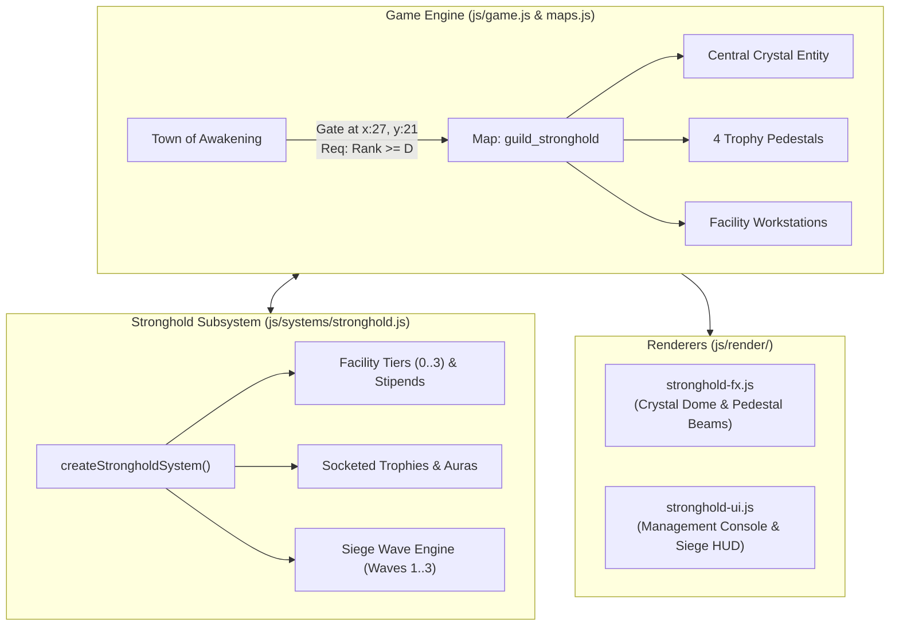
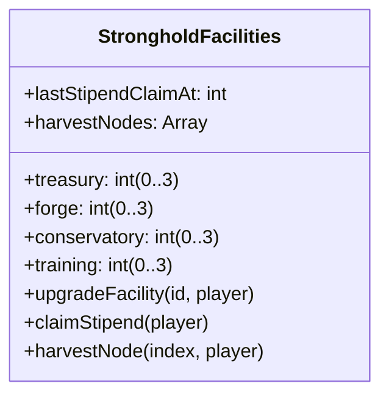
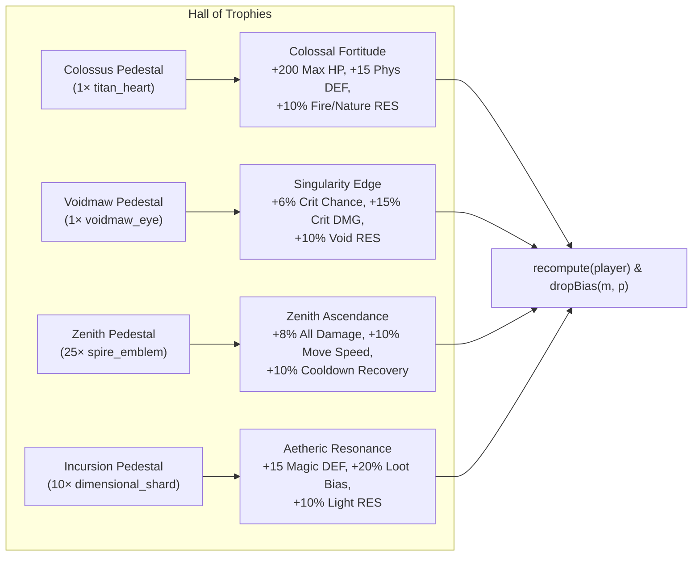
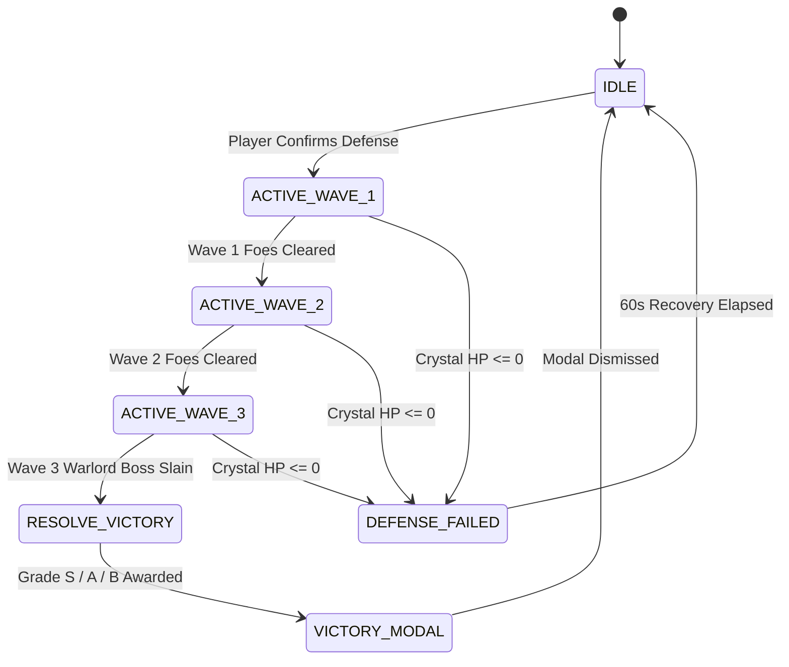

# The Sovereign Realm — Module 2: Guild Stronghold & Hall of Trophies Design Specification

**Document:** `docs/superpowers/specs/2026-10-08-guild-stronghold-and-trophies-design.md`  
**Status:** Approved by User  
**Target:** Aetheria Online (`index.html` + `js/*.js` ES-module runtime)  

---

## 1. Overview & Design Goals

Module 2 of "The Sovereign Realm" expansion introduces **The Guild Stronghold & Hall of Trophies**, transitioning the Adventurer's Guild from a simple town quest board into a physical, explorable sanctuary and account-wide progression citadel.

### Core Objectives
1. **Physical Sanctuary Map (`guild_stronghold`):** An instanced 32×24 citadel featuring an open courtyard, facility wings, and a north trophy sanctuary, accessible to adventurers of Guild Rank D or higher.
2. **Account-Wide Facility Progression:** 4 structural facilities (Treasury Vault, Guild Forge, Botanical Conservatory, Tactical Training Grounds), upgradable from Tier 0 to 3 using Guild Points, Zeny, and crafting materials.
3. **Hall of Trophies (Apex Pedestals):** 4 elemental pedestals socketing epic boss trophies (`titan_heart`, `voidmaw_eye`, `spire_emblem`, `dimensional_shard`) to project passive account-wide aura buffs into `recompute(player)`.
4. **Crystal Defense Wave Siege:** An on-demand 3-wave siege encounter defending the central Stronghold Crystal against marching invaders, rewarding Guild Points and `guild_commendation` tokens based on preserved crystal health.
5. **Zero Camera Shake & Strict Responsive Boxing:** Canvas 2D particle beacons with frozen `G.cam` invariance, coupled with `box-sizing: border-box` responsive UI framing.
6. **Dual Bilingual Localization:** 100% parity across English and Thai in `js/locale.js`.
7. **Engine Surface Baseline:** Preservation of the exact 255 keys on `window.__AWO`.

---

## 2. Architecture & Subsystem Division

- **`js/systems/stronghold.js`**: Pure logic state machine managing facility levels, trophy sockets, daily stipend timers, and the 3-wave siege defense lifecycle.
- **`js/render/stronghold-fx.js`**: Canvas 2D ambient particles, crystal shield dome, elemental pedestal beams, and siege attack lines with strict zero camera shake.
- **`js/render/stronghold-ui.js`**: Responsive console for upgrading facilities, socketing trophies, tracking siege waves, and reviewing victory grades.
- **`js/maps.js`**: Definition of the `guild_stronghold` arena/sanctuary map.
- **`js/game.js`**: Integration into engine loops, combat damage redirection, `recompute(p)` stat wiring, and save persistence.

---

## 3. Physical Map Specification (`guild_stronghold`)

### Map Parameters
- **ID:** `guild_stronghold`
- **Dimensions:** 32 tiles wide × 24 tiles high ($1024 \times 768$ px at 32px per tile).
- **Theme/Music:** `'sanctuary'` or `'stronghold'`.
- **Legend:**
  - Walls (`O`), walkable floor (`.`), decorative stone arches (`A`), decorative columns (`C`), crystal plinth (`X`).

### Key Locations & Coordinates
1. **Entrance / Exit Portal:** `(16, 23)` $\to$ returns to `town_awakening` at `(26, 21)` (in front of Elder Maro).
2. **Central Courtyard & Crystal:** `(16, 12)` — Houses the 2×2 tile Stronghold Crystal (`G.strongholdCrystal`).
3. **North Grand Chamber (Hall of Trophies):** `(16, 4)`
   - Colossus Pedestal: `(12, 4)`
   - Voidmaw Pedestal: `(14, 4)`
   - Zenith Pedestal: `(18, 4)`
   - Incursion Pedestal: `(20, 4)`
4. **West Wing (Forge & Treasury):** `(5, 12)`
   - Guild Anvil / Forge Master: `(5, 10)`
   - Treasury Vault / Strongbox: `(5, 14)`
5. **East Wing (Conservatory & Training Grounds):** `(27, 12)`
   - Conservatory Garden Plot: `(27, 10)`
   - Training Dummies & Master Tactician: `(27, 14)`

### Access Gate
- **Entry Tile in Town:** `(27, 21)` in `town_awakening`.
- **Gate Check:** `(G.guildRankIdx || 0) >= GUILD_RANKS.indexOf('D')` (Rank D or higher).
- **Failure Message:**
  - *EN:* *"The Stronghold gate is barred. Prove your valor by reaching Guild Rank D with Elder Maro."*
  - *TH:* *"ประตูป้อมปราการกิลด์ถูกปิดล็อก จงพิสูจน์ความกล้าหาญโดยการเลื่อนระดับเป็นกิลด์แรงก์ D กับผู้อาวุโสมาโรก่อน"*

---

## 4. Facility Upgrade Progression System

Each facility progresses from **Tier 0 (Unbuilt)** to **Tier 3 (Mastery)**:

### 1. Treasury Vault (`treasury`)
- **Tier 0:** Unbuilt.
- **Tier 1:** 30 GP, 5,000z, 10× Iron Ore $\to$ +500z daily stipend, +50,000 max bank capacity.
- **Tier 2:** 75 GP, 15,000z, 10× Star Iron $\to$ +1,500z daily stipend, +5% Zeny drops from all monsters.
- **Tier 3:** 150 GP, 40,000z, 5× Blessed Ore $\to$ +3,500z daily stipend, +10% Zeny drops from all monsters.

### 2. Guild Forge (`forge`)
- **Tier 0:** Baseline anvil.
- **Tier 1:** 30 GP, 6,000z, 10× Iron Ore $\to$ +5% gear refine success chance, -10% crafting cost.
- **Tier 2:** 75 GP, 18,000z, 10× Star Iron, 5× Caldera Crystal $\to$ +10% gear refine success chance, -15% crafting cost.
- **Tier 3:** 150 GP, 45,000z, 8× Blessed Ore, 2× Titan Heart $\to$ +15% gear refine success chance, 10% chance to duplicate crafted gear.

### 3. Botanical Conservatory (`conservatory`)
- **Tier 0:** Barren courtyard.
- **Tier 1:** 25 GP, 4,000z, 10× Wood $\to$ Spawns 2 daily courtyard gathering nodes (Silverleaf, Moonflower).
- **Tier 2:** 60 GP, 12,000z, 15× Silverleaf, 5× Nature Essence $\to$ Spawns 3 daily nodes + 15% gathering yield bonus.
- **Tier 3:** 120 GP, 30,000z, 10× Nature Essence, 2× Titan Heart $\to$ Spawns 4 daily nodes (including rare Star Lotus) + 30% yield bonus.

### 4. Tactical Training Grounds (`training`)
- **Tier 0:** Empty yard.
- **Tier 1:** 35 GP, 7,000z, 10× Hardwood $\to$ +5% combat EXP account-wide.
- **Tier 2:** 80 GP, 20,000z, 10× Star Iron $\to$ +10% combat EXP, +10% Skill EXP account-wide.
- **Tier 3:** 160 GP, 50,000z, 10× Blessed Ore, 2× Titan Heart $\to$ +20% combat EXP, +20% Skill EXP, +5% All Damage.

---

## 5. Hall of Trophies & Account-Wide Passive Aura Hooks

The North Grand Chamber features 4 marble pedestals. When socketed, each projects an elemental beam and applies an account-wide aura:

### Pedestal Matrix
| Pedestal ID | Trophy Item Req | Active Aura Name | Passive Bonuses |
| :--- | :--- | :--- | :--- |
| `pedestal_colossus` | 1× `titan_heart` | **Colossal Fortitude** | `maxHp: +200`, `physDef: +15`, `res_fire: +10`, `res_nature: +10` |
| `pedestal_voidmaw` | 1× `voidmaw_eye` | **Singularity Edge** | `critChance: +6`, `critDmg: +15`, `res_void: +10` |
| `pedestal_zenith` | 25× `spire_emblem` | **Zenith Ascendance** | `dmgMult: +8%`, `moveMult: +10%`, `cooldownRecovery: +10%` |
| `pedestal_incursion` | 10× `dimensional_shard` | **Aetheric Resonance** | `magicDef: +15`, `lootBias: +0.20`, `res_light: +10` |

### Interaction Mechanics
- Interacting with an empty pedestal allows the player to deposit the trophy.
- Interacting with a socketed pedestal allows the player to unmount and retrieve the trophy to inventory.
- Trophies cannot be accidentally duplicated or destroyed.

---

## 6. Central Crystal Siege Encounter State Machine

The central Stronghold Crystal has an active state machine:

### Crystal Entity Parameters
- **Location:** `(16 * TS, 12 * TS)`.
- **Max HP:** `15,000`. Current HP in `G.strongholdCrystal.hp`.
- **Idle Regeneration:** Restores 100 HP/sec when idle until full.
- **Sanctuary Aura:** Restores 25 HP/5s to player while near the crystal outside combat.

### Wave Spawns & Monster Archetypes
1. **Wave 1: Vanguard Breachers (6 Mobs)**
   - 4× `siege_grunt`, 2× `siege_hound` (Fast charging infantry).
2. **Wave 2: Sappers & Bombardiers (8 Mobs)**
   - 4× `siege_grunt`, 2× `siege_sapper` (Demolitionists), 2× `siege_archer` (Ranged volleys).
3. **Wave 3: The Siege Warlord (10 Mobs + 1 Boss)**
   - 6× `siege_grunt`, 2× `siege_sapper`, 2× `siege_archer`, 1× `siege_warlord_boss` (Lv 75 Boss, cleaves and warcry buffs).

### Invader AI Behavior
- Invaders spawn at the South Gate `(16, 22)` and West Breach `(2, 12)`.
- Invaders target the crystal first. If the crystal is within 1 tile, they attack it directly for 15–35 damage per swing.
- If the player attacks an invader or stands within 3 tiles, the invader targets the player instead, allowing defensive tanking.

### Victory Grades & Spoils
| Grade | Crystal Health Condition | Rewards |
| :--- | :--- | :--- |
| **Rank S (Flawless)** | $\ge 80\%$ Crystal HP | 100 GP, 6,000z, 3× `guild_commendation`, 2× `blessed_ore`, 1× rare gem |
| **Rank A (Resolute)** | $50\% - 79\%$ Crystal HP | 60 GP, 3,500z, 2× `guild_commendation`, 1× `blessed_ore` |
| **Rank B (Battered)** | $1\% - 49\%$ Crystal HP | 35 GP, 1,800z, 1× `guild_commendation` |
| **Failed** | $0\%$ Crystal HP | 0 GP, crystal shatters, 60s repair cooldown |

---

## 7. Canvas 2D Visual Effects & Strict ZERO Screen Shake

All stronghold visuals reside in `js/render/stronghold-fx.js`.

### 1. Central Crystal Visuals
- Concentric pulsing rings (`#00e676` emerald when healthy, shifting toward `#ff5252` when critically low).
- Shimmering energy lattice dome around the crystal during active siege.
- Motes of light drifting upward.

### 2. Pedestal Elemental Beams
- Distinct vertical light columns for each socketed pedestal:
  - *Colossus*: Rising fiery cinders (`#ff5722`).
  - *Voidmaw*: Pulsing violet singularity rings (`#9c27b0`).
  - *Zenith*: Golden celestial flares (`#ffd700`).
  - *Incursion*: Astral cyan geometric runes (`#00e5ff`).

### 3. Strict ZERO Screen Shake Rule
- `G.cam.x` and `G.cam.y` are immutable.
- Frozen in tests via `Object.freeze(G.cam)` — no crystal fractures, warlord slams, or victory fanfare displace the viewport.

---

## 8. UX/UI Specifications & Boxing Containment

All UI components reside in `js/render/stronghold-ui.js`.

### 1. Stronghold Management Console
- Tabbed facility cards displaying current Tier (0..3), active perks, and an `[Upgrade]` button with exact material/GP counts.
- `[Claim Daily Stipend]` button enabled once every 24 hours.
- Hall of Trophies socketing overview showing status and perks of all 4 pedestals.

### 2. Crystal Siege Encounter HUD
- Top encounter pill showing:
  - Wave progress: `⚔ WAVE 2 / 3`
  - Crystal Health Bar: `💎 12,450 / 15,000 HP (83%)`
  - Invaders remaining: `👾 4 Foes Remaining`

### 3. Victory Summary Modal
- Overlay displaying:
  - Rank badge (`RANK S`, `RANK A`, `RANK B`)
  - Crystal HP preserved metric
  - Spoils showcase (`guild_commendation`, GP, Zeny, materials)
  - `[Claim Commendations]` button

### 4. Strict Boxing Containment Invariants
- `box-sizing: border-box; width: 100%; max-width: 100%; min-width: 0; overflow-x: hidden;` enforced across all containers.
- Flex and grid children include `min-width: 0; box-sizing: border-box;` to prevent layout blowout.

---

## 9. Content Registration & Pixel Art

### Monsters (`js/content.js`)
- `siege_grunt`: Lv 60, Physical, Melee.
- `siege_hound`: Lv 60, Physical, Fast Melee.
- `siege_sapper`: Lv 65, Fire/Physical, Demolitionist.
- `siege_archer`: Lv 65, Physical, Ranged.
- `siege_warlord_boss`: Lv 75, Physical/Earth, Boss (sizeTiles: 2).

### Items (`js/content.js`)
- `guild_commendation`: Epic material/currency awarded for crystal defense.
- `stronghold_banner`: Rare decorative accessory/trophy.

### Pixel Art Mappings (`js/pixelart.js`)
- Monster sprite aliases:
  - `siege_grunt` $\to$ `orc_warrior`
  - `siege_hound` $\to$ `wolf`
  - `siege_sapper` $\to$ `goblin`
  - `siege_archer` $\to$ `bandit_archer`
  - `siege_warlord_boss` $\to$ `orc_warlord`
- Item icon mappings:
  - `guild_commendation` $\to$ `'coin'` or `'gem'`
  - `stronghold_banner` $\to$ `'scroll'`

---

## 10. Dual Bilingual Localization (`js/locale.js`)

Full English and Thai translations for:
- Map name & description (`Guild Stronghold` / `ป้อมปราการกิลด์`).
- Facilities:
  - `Treasury Vault` / `ห้องคลังสมบัติกิลด์`
  - `Guild Forge` / `โรงตีเหล็กกิลด์`
  - `Botanical Conservatory` / `เรือนกระจกพฤกษศาสตร์`
  - `Tactical Training Grounds` / `ลานฝึกยุทธวิธี`
- Pedestals & Auras:
  - `Colossal Fortitude` / `ความทรหดยักษ์ศิลา`
  - `Singularity Edge` / `คมดาบซิงกูลาริตี`
  - `Zenith Ascendance` / `การก้าวข้ามสู่จุดสูงสุด`
  - `Aetheric Resonance` / `คลื่นสะท้อนเอเธอริก`
- Siege HUD & Modals:
  - `Crystal Siege Defense` / `การป้องกันคริสตัลกิลด์`
  - `Commence Siege Defense` / `เริ่มการป้องกันการปิดล้อม`
  - `Crystal Health` / `พลังชีวิตของคริสตัล`
  - `Siege Victory!` / `ชัยชนะการป้องกันป้อมปราการ!`
  - `Defense Failed!` / `การป้องกันล้มเหลว!`
  - `Guild Commendation` / `เหรียญเกียรติยศกิลด์`

---

## 11. Verification & Testing Strategy

1. **`js/stronghold.test.js`**: Unit tests for facility upgrade prerequisites, stipend timers, trophy socketing/unmounting, and 3-wave siege state machine transitions.
2. **`js/stronghold-fx.test.js`**: Mock Canvas 2D tests verifying zero camera shake (`Object.freeze(G.cam)`), offscreen culling, and beam renderers.
3. **`js/stronghold-ui.test.js`**: Unit tests verifying management console markup, siege HUD, victory modal, and strict boxing containment.
4. **`js/stronghold-integration.test.js`**: End-to-end integration test with headless browser environment verifying entry gate (Rank D), trophy aura stat bonuses in `recompute(p)`, siege wave progression, crystal damage interception, and victory spoils.
5. **`js/engine-surface.test.js`**: Enforces strict golden baseline of **exactly 255 keys on `window.__AWO`**.
6. **`npm test`**: All 66+ test suites must pass 100% green.
