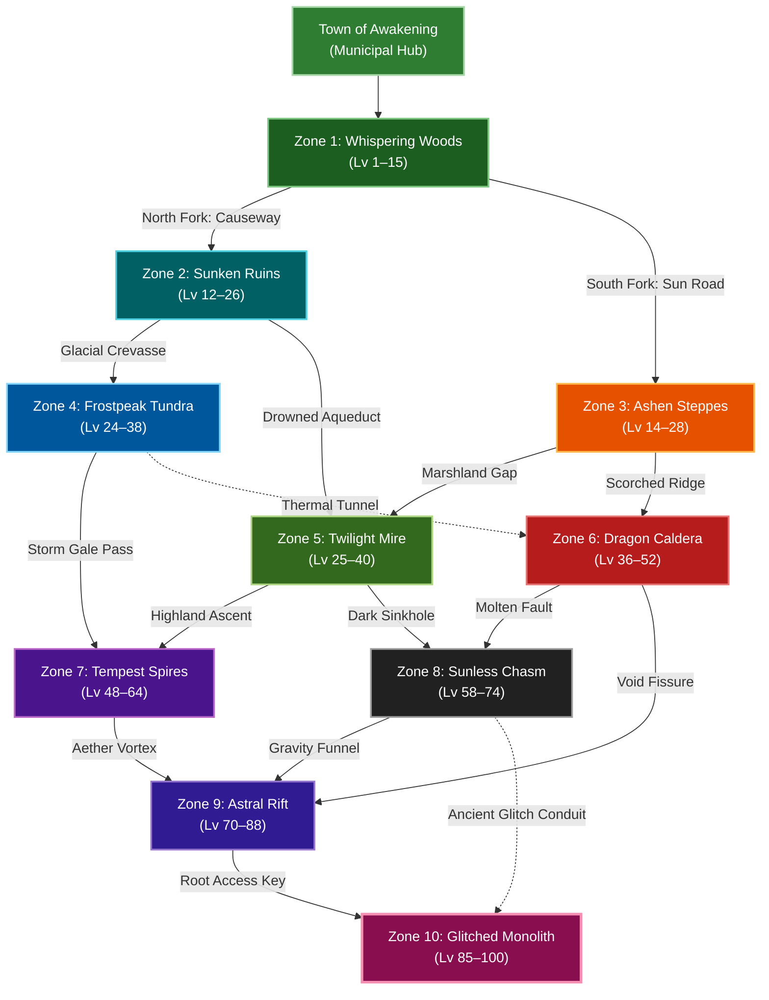

# Design Document: 10-Zone Non-Linear World & Dungeon Overhaul

**Date:** 2026-10-13  
**Status:** Approved for Implementation Planning  
**Target Systems:** `js/maps.js`, `js/systems/gathering.js`, `js/content.js`, `js/data/progression.js`, `js/game.js`

---

## 1. Executive Summary & Goals

*Aetheria Online* transitions from a 6-zone linear route into an expansive **10-Zone Non-Linear World Network**. The overhaul achieves five major goals:
1. **Non-Linear Branching Topology**: Replace the single linear pipeline with a multi-branch route graph (Aquatic/Glacial, Scorched/Volcanic, Subterranean/Chasm) with cross-zone mountain passes and secret shortcuts.
2. **Smooth Intersecting Level Bands**: Every connected map shares a 2–4 level overlap buffer (from Lv 1 up to Lv 100), eliminating harsh difficulty cliffs and respecting the game's level-gap combat formula.
3. **Standardized 4-Quadrant Overworld Maps (50×38)**:
   - Continuous 2-tile-wide paved King's Road (`R`).
   - Central open 10×10 Incursion Ritual Clearing.
   - Dedicated Botanical Haven (Herbs) & Aquatic Eddy (Fishing).
   - Dedicated Mineral Quarry (Ores & Subdungeon Entrance).
   - Dedicated 14×14 Telegraph-Safe Guardian Colosseum.
4. **Winged MMORPG Subdungeons (32×22)**:
   - Entry Foyer with return portal.
   - Resource / Treasure Wing (rich ore clusters + fishing pool guarded by elites).
   - Boss Sanctum with generous arena clearance.
5. **Full Content Integration**:
   - 10 Regional Overworld Zones + 10 Regional Subdungeons.
   - Full Bestiary expansion (40+ monsters and 10 regional guardians).
   - Complete Monster Card Album additions with unique build passives.
   - New regional equipment sets and gathering drops.

---

## 2. World Topology & Non-Linear Routing Graph



### Route Descriptions
1. **The Glacial Elemental Path**: `Z1 ➔ Z2 ➔ Z4 ➔ Z7 ➔ Z9 ➔ Z10` (Forest ➔ Water ➔ Ice ➔ Lightning ➔ Cosmic ➔ Apex).
2. **The Scorched Earth Path**: `Z1 ➔ Z3 ➔ Z6 ➔ Z9 ➔ Z10` (Forest ➔ Arid Steppes ➔ Volcanic Caldera ➔ Cosmic ➔ Apex).
3. **The Subterranean Shadow Path**: `Z1 ➔ Z3 ➔ Z5 ➔ Z8 ➔ Z10` (Forest ➔ Steppes ➔ Toxic Mire ➔ Deep Underworld ➔ Glitched Shortcut).

---

## 3. Map Geometry & Surface Standards

### 3.1 Standard Dimensions
- **Tier 1 (Overworld Zones)**: `50 × 38` tiles (`1600 × 1216` px).
- **Tier 2 (Regional Subdungeons)**: `32 × 22` tiles (`1024 × 704` px).
- **Tier 3 (Municipal Hubs)**: `36 × 26` tiles (`1152 × 832` px).
- **Tier 4 (Challenge Spire & Trials)**: `24 × 18` tiles (`768 × 576` px).

### 3.2 Tile Grammar & Walkability
- `.` : Open walkable surface (dirt, grass, stone, snow, ash).
- `,` : Soft flora / brush (walkable).
- `R` : Paved arterial road (walkable, 2-tile wide).
- `W` : Water / Void barrier (unwalkable; fishing ripples placed exactly 1 tile from walkable shore).
- `b` : Wooden bridge / stone crossing (walkable).
- `T` / `#` / `M` : Heavy perimeter barrier (trees, dungeon walls, mountains).
- `F` / `S` / `I` / `D` : Biome surfaces (flooded shallows, snow, ice, dry volcanic basalt).
- `B` : Boss spawn anchor tile.
- `P` : Portal / Spawn location (guaranteed 3×3 walkable apron).

---

## 4. Complete 10-Zone Content Matrix

### Zone 1: Whispering Woods
- **Theme**: Ancient temperate woodland, mossy causeway.
- **Level Band**: `Lv 1–15` (Gateway to Ruins & Steppes).
- **Subdungeon**: `ww_goblin_cave` (*Goblin Warrens*, Lv 8–14).
- **Guardian**: `ww_elder_treant` (*Ancient Wood Colossus*, Lv 15).
- **Gathering**:
  - ⛏️ Ore: Copper Ore
  - 🎣 Fish: Glowing Trout (River shore with wooden dock)
  - 🌿 Herb: Silverleaf (Northwest glade) & Moonlight Lotus (*Night only*, South pond)
- **Monsters**: Goblin Scout (Lv 2–5), Thornfang Wolf (Lv 5–8), Forest Sprite (Lv 8–11), Alpha Hobgoblin (Elite, Lv 13).
- **Equipment Set**: Forest Scout Leather / Apprentice Silk Set (Band 1, Lv 8–12).

### Zone 2: Sunken Ruins
- **Theme**: Submerged stone temples, flooded halls.
- **Level Band**: `Lv 12–26` (Intersect Lv 12–15 with Woods).
- **Subdungeon**: `sr_drowned_catacombs` (*Drowned Catacombs*, Lv 18–25).
- **Guardian**: `sr_ruin_colossus` (*Leviathan Golem*, Lv 26).
- **Gathering**:
  - ⛏️ Ore: Iron Vein (Reef shelf)
  - 🎣 Fish: Abyssal Bass (Lagoon basin)
  - 🌿 Herb: Sunken Kelp (Shallow waters) & Phosphor Lily (*Fog weather*)
- **Monsters**: Coral Siren (Lv 13–17), Drowned Guardian (Lv 17–21), Temple Gargoyle (Lv 21–24), Abyssal Behemoth (Elite, Lv 25).
- **Equipment Set**: Sunken Temple Plate / Tidecaller Vestments (Band 2, Lv 20–24).

### Zone 3: Ashen Steppes *(New)*
- **Theme**: Sun-scorched savannah, petrified canyons, sandstone outposts.
- **Level Band**: `Lv 14–28` (Intersect Lv 14–15 with Woods, Lv 14–26 with Ruins).
- **Subdungeon**: `as_sandstone_necropolis` (*Sandstone Necropolis*, Lv 20–27).
- **Guardian**: `as_karrion_goliath` (*Dune Vanguard*, Lv 28).
- **Gathering**:
  - ⛏️ Ore: Pyrite Ore (Canyon walls)
  - 🎣 Fish: Mirage Pike (Oasis watering hole)
  - 🌿 Herb: Sunroot Thistle (Savannah brush) & Dune Blossom (*Heatwave weather*)
- **Monsters**: Sandstalker Scorpion (Lv 15–19), Hyena Marauder (Lv 19–23), Canyon Basilisk (Lv 23–26), Sun Priestess (Elite, Lv 27).
- **Equipment Set**: Duneslayer Leather / Sunwalker Mail (Band 2, Lv 22–26).

### Zone 4: Frostpeak Tundra
- **Theme**: Sub-zero permafrost, glacial chasms, blizzard winds.
- **Level Band**: `Lv 24–38` (Intersect Lv 24–26 with Ruins).
- **Subdungeon**: `ft_glacial_chasm` (*Glacial Chasm*, Lv 30–38).
- **Guardian**: `ft_frost_drake` (*Winterfang Wyrm*, Lv 38).
- **Gathering**:
  - ⛏️ Ore: Iron Vein & Silicon Crystal (Glacier ridge)
  - 🎣 Fish: Glacial Salmon (Ice hole with pier) & Stormfin (*Blizzard weather*)
  - 🌿 Herb: Frost Lily (Snowfield clearing)
- **Monsters**: Tundra Wolf (Lv 25–29), Glacial Elemental (Lv 29–33), Frostbound Knight (Lv 33–36), Frost Yeti (Elite, Lv 37).
- **Equipment Set**: Permafrost Heavy Plate / Glacial Fur Vestments (Band 3, Lv 32–36).

### Zone 5: Twilight Mire *(New)*
- **Theme**: Bioluminescent fungal swamp, toxic fog, sunken boardwalks.
- **Level Band**: `Lv 25–40` (Intersect Lv 25–26 with Ruins, Lv 25–28 with Steppes).
- **Subdungeon**: `tm_sporeheart_hollow` (*Sporeheart Hollow*, Lv 32–40).
- **Guardian**: `tm_bog_behemoth` (*Mire Sovereign*, Lv 40).
- **Gathering**:
  - ⛏️ Ore: Muck Iron (Peat bog mounds)
  - 🎣 Fish: Bog Gar (Stagnant bayou)
  - 🌿 Herb: Ghost Spore Shroom & Glowshroom Bloom (*Night only*)
- **Monsters**: Mire Leech (Lv 26–30), Spore Creeper (Lv 30–34), Bog Witch (Lv 34–38), Corrupted Marsh Hydra (Elite, Lv 39).
- **Equipment Set**: Sporeweaver Robes / Mire Stalker Tunic (Band 3, Lv 34–38).

### Zone 6: Dragon Caldera
- **Theme**: Volcanic basalt crust, rivers of magma, geothermal steam vents.
- **Level Band**: `Lv 36–52` (Intersect Lv 36–38 with Steppes & Tundra).
- **Subdungeon**: `dc_obsidian_foundry` (*Obsidian Foundry*, Lv 42–52).
- **Guardian**: `dc_magma_wyrm` (*Inferno Colossus*, Lv 52).
- **Gathering**:
  - ⛏️ Ore: Caldera Crystal (Volcanic spires)
  - 🎣 Fish: Magma Koi (Cooled thermal pool)
  - 🌿 Herb: Ember Blossom & Cinder Rose (*Volcanic Ash weather*)
- **Monsters**: Magma Hound (Lv 37–41), Cinder Imp (Lv 41–46), Obsidian Golem (Lv 46–50), Fire Drake Herald (Elite, Lv 51).
- **Equipment Set**: Caldera Basalt Armor / Ignis Mage Mantle (Band 4, Lv 46–50).

### Zone 7: Tempest Spires *(New)*
- **Theme**: High-altitude storm peaks, lightning arcs, wind-carved pinnacles.
- **Level Band**: `Lv 48–64` (Intersect Lv 48–52 with Caldera & Mire).
- **Subdungeon**: `ts_thunderforge_peak` (*Thunderforge Peak*, Lv 54–64).
- **Guardian**: `ts_storm_roc` (*Thunderbird Sovereign*, Lv 64).
- **Gathering**:
  - ⛏️ Ore: Cobalt Ore (Peak crags)
  - 🎣 Fish: Thunder Eel (High mountain pool)
  - 🌿 Herb: Storm Petal & Charged Iris (*Thunderstorm weather*)
- **Monsters**: Gale Harpy (Lv 49–54), Lightning Wisp (Lv 54–58), Skyward Valkyrie (Lv 58–62), Thunder Roc (Elite, Lv 63).
- **Equipment Set**: Thunderlord Chainmail / Gale Dancer Silks (Band 4, Lv 58–62).

### Zone 8: Sunless Chasm *(New)*
- **Theme**: Subterranean deep caverns, glowing crystals, deep abyss.
- **Level Band**: `Lv 58–74` (Intersect Lv 58–64 with Mire & Caldera).
- **Subdungeon**: `sc_abyssal_crypts` (*Abyssal Crypts*, Lv 64–74).
- **Guardian**: `sc_shadowfiend_lord` (*Chasm Terror*, Lv 74).
- **Gathering**:
  - ⛏️ Ore: Darksteel Ore (Chasm walls)
  - 🎣 Fish: Blind Cavefish (Subterranean aquifer)
  - 🌿 Herb: Shadow Orchid & Void Polyp (*Night only*)
- **Monsters**: Cave Stalker (Lv 59–64), Crystal Arachnid (Lv 64–68), Void Cultist (Lv 68–72), Abyssal Warden (Elite, Lv 73).
- **Equipment Set**: Umbral Assassin Garb / Darksteel Bulwark (Band 5, Lv 68–72).

### Zone 9: Astral Rift
- **Theme**: Shattered gravity wells, drifting crystalline monoliths, nebulae.
- **Level Band**: `Lv 70–88` (Intersect Lv 70–74 with Tempest & Chasm).
- **Subdungeon**: `ar_singularity_vault` (*Singularity Vault*, Lv 76–88).
- **Guardian**: `ar_chrono_colossus` (*Keeper of the Continuum*, Lv 88).
- **Gathering**:
  - ⛏️ Ore: Voidstone Ore (Cosmic fissure)
  - 🎣 Fish: Cosmic Jellyfish & Void Ray (Aether well)
  - 🌿 Herb: Nebula Bloom & Aether Tendril (*Eclipse weather*)
- **Monsters**: Rift Phantom (Lv 71–76), Gravity Entity (Lv 76–81), Starborn Archon (Lv 81–86), Singularity Sovereign (Elite, Lv 87).
- **Equipment Set**: Astral Continuum Set / Singularity Regalia (Band 5, Lv 82–86).

### Zone 10: Glitched Monolith
- **Theme**: Corrupted source code apex, memory leak ruins, debug monoliths.
- **Level Band**: `Lv 85–100` (Intersect Lv 85–88 with Astral Rift).
- **Subdungeon**: `gm_source_core` (*Source Core*, Lv 90–100).
- **Guardian**: `gm_root_architect` (*The Terminal Anomaly*, Lv 100).
- **Gathering**:
  - ⛏️ Ore: Transcendent Matrix Ore
  - 🎣 Fish: Quantum Glitchfish
  - 🌿 Herb: Binary Fungus & Source Anomaly
- **Monsters**: Null Pointer Wight (Lv 86–90), Buffer Overflow Horror (Lv 90–94), Segmentation Fault Golem (Lv 94–98), Zero-Day Sovereign (Elite, Lv 99).
- **Equipment Set**: Transcendent Prototype Set (Band 6, Lv 95–100).

---

## 5. Winged Subdungeon Architecture (32×22)

All 10 regional subdungeons follow the Winged MMORPG layout:
```
┌────────────────────────────────────────────────────────┐
│                   FOYER & SAFE RETREAT                 │
│                   - Entry & Return Portal              │
├──────────────────────────┬─────────────────────────────┤
│   WING 1: EXTRACTION     │   WING 2: GUARDIAN SANCTUM  │
│   - Rich Ore Cluster     │   - 12×12 Boss Chamber      │
│   - Underworld Pool      │   - Telegraph Clearance     │
│   - Elite Guardian Mob   │   - Exit Portal & Chest     │
└──────────────────────────┴─────────────────────────────┘
```

---

## 6. Municipal Hubs & Sanctuaries (36×26)

- **Town of Awakening (`town_awakening`)**:
  - Paved Central Square with Fountain (Lost Oracle).
  - North Market Row (Marla Trader).
  - South Guild Outpost (Elder Maro & Stronghold Portal).
  - West Training Grounds with combat dummies.
  - East Gate connecting to Whispering Woods.
- **Guild Stronghold (`guild_stronghold`)**:
  - Central Command Hall (Guildmaster & Bounties).
  - West Armory & Trophy Pedestal Gallery.
  - East Ballista Terrace (Siege cooldown defense).
- **Adventurer’s Homestead (`player_homestead`)**:
  - Cozy Central Hearth with rest recovery.
  - North Botanical Sanctum with soil garden beds.
  - West Pasture for acquired pets & companions.
  - South Garden Pool with Spring Bass fishing ripples.
  - East Stone Quarry with harvestable Copper/Iron ore.

---

## 7. Data Modules & File Changes

1. **`js/maps.js`**:
   - Reconstruct all 18 existing maps and add the 4 new overworld zones (`ashen_steppes`, `twilight_mire`, `tempest_spires`, `sunless_chasm`) and their 4 subdungeons (`as_sandstone_necropolis`, `tm_sporeheart_hollow`, `ts_thunderforge_peak`, `sc_abyssal_crypts`).
   - Total maps: 26 (10 overworld + 10 subdungeons + 3 hubs + 2 spires/trials + 1 legacy).
2. **`js/systems/gathering.js`**:
   - Add new nodes to `MAP_RESOURCE_NODES` with exact tile coordinates for all 10 zones.
   - Expand `HERB_CATALOG`, `ORE_CATALOG`, and `FISH_CATALOG`.
3. **`js/data/progression.js` & `js/content.js`**:
   - Register new monsters, drops, and elite definitions.
   - Register new monster cards with unique passive attributes.
   - Register new equipment sets for Bands 2, 3, 4, 5.
4. **`js/game.js`**:
   - Update `ZONE_ORDER` and `WORLD_ORDER` with branching graph links.
   - Update `worldChronicleHtml()` to support branching map nodes.
   - Re-characterize `render()` fingerprints in `engine-surface.test.js`.

---

## 8. Verification Strategy

1. **Automated Topology & Reachability Test (`map-topology.test.js`)**:
   - Verify every map has a single primary connected component (no unreachable tiles).
   - Verify all portals link to valid destination maps and spawn coordinates.
   - Verify all gathering nodes in `MAP_RESOURCE_NODES` are placed on walkable tiles or adjacent to walkable shoreline.
2. **Combat & Boss Telegraph Test**:
   - Assert all 10 Guardian arenas have at least 12×12 unobstructed space around boss anchor.
3. **Deterministic Render Fingerprint**:
   - Re-record map render hashes for test maps in `engine-surface.test.js`.
4. **Test Suite Invariant**:
   - All existing 94 test suites must pass (plus new topology and content suites).
