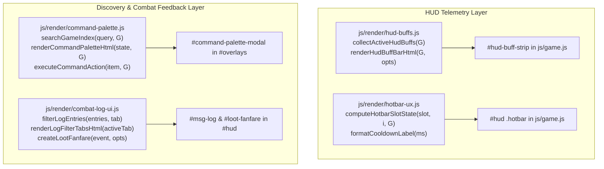

# Aetheria Online — UX/UI Modernization Suite Design Specification

**Date:** 2026-10-16  
**Scope:** Live zero-build ES-module game (`index.html`, `js/game.js`, `js/theme.js`, `js/locale.js`, and four new modular UI subsystems in `js/render/`).  
**References:** Game UI Database (`gameuidatabase.com`), Interface In Game (`interfaceingame.com`), *Ragnarok Online Zero*, *CrossCode*, *Final Fantasy XIV*, and Modern Web Guidance (`soft-edge-content-fade`, `persistent-toast-notifications`).

---

## 1. Design Goals & Global Constraints

1. **Zero-Build ES-Module Architecture:** All UI subsystems live in `js/render/*.js` as pure ES modules with zero external runtime dependencies or build steps.
2. **Aetheria × RO Token Consistency:** Every surface uses existing CSS custom properties from `js/theme.js` (`--wood-deep`, `--gold`, `--gold-bright`, `--parchment`, `--text`, `--text-muted`, `--success`, `--danger`, `--info`, `--warn`). No off-theme hardcoded palettes.
3. **Strict Zero Camera Shake:** All fanfare banners, combo highlights, and HUD state transitions operate strictly in the DOM/CSS layer without mutating viewport or camera coordinates.
4. **100% Bilingual Parity (EN/TH):** Every label, tooltip, tab, placeholder, and notification string is localized in both English and Thai in `js/locale.js` and verified by `js/locale-coverage.test.js`.
5. **Backwards Compatibility:** Preserve `awo_save_v1` and expose new helpers on `window.__AWO` in sorted order for `js/engine-surface.test.js`.

---

## 2. System Architecture



---

## 3. Detailed Component Specifications

### Pillar 1: HUD Buff, Debuff & Status Aura Bar (`js/render/hud-buffs.js`)

#### Purpose
Provide real-time visibility into temporary buffs, debuffs, elemental imbues, pet combat skills, active mounts, and regional equipment set bonuses directly below the top-left `.stat-stack`.

#### Data Contract (`collectActiveHudBuffs(G, nowMs)`)
Returns an ordered array of active status descriptors:
```js
{
  id: string,           // e.g. 'mount_active', 'food_buff', 'imbue_fire', 'pet_atk_buff', 'status_poison', 'set_duneslayer'
  kind: 'mount' | 'food' | 'imbue' | 'pet' | 'buff' | 'debuff' | 'set',
  icon: string,         // emoji or glyph e.g. '🐎', '🍲', '🔥', '🐺', '☠️', '🛡️'
  label: string,        // localized short name
  detail: string,       // localized tooltip description (stat mods + source)
  remainingMs: number | null, // null for permanent/toggle states like Mount or Set Bonus
  durationMs: number | null,  // total duration for radial sweep calculation
  stacks: number,       // default 1
}
```

#### Sources Aggregated
1. **Mount State (`G.mounted`):** Icon `🐎`, label `"Mounted"`, detail `"+40% Movement Speed (Z to dismount)"`.
2. **Homestead Culinary Buff (`G.homestead?.activeBuff`):** Active meal buff when `expiresAt > nowMs`.
3. **Weapon Elemental Imbue (`G.player.imbue`):** Active elemental infusion when `until > nowMs`.
4. **Pet Combat Buffs (`G.player.petAtkBuffUntil`, `G.player.shield`):** Active *Howl of Fury* (+15% ATK) or *Gelatinous Shield* barrier.
5. **Player Status Effects (`G.player.statuses`):** Active combat buffs (`regen`, `aegis`, `haste`, etc.) and debuffs (`poison`, `burn`, `chill`, `stun`, `bleed`, `curse`) with remaining duration.
6. **Regional Equipment Sets (`getActiveSetBonuses(G.player.equip)`):** Active 2pc/4pc set bonuses summarized with piece count (`2/4` or `4/4`).

#### Rendering (`renderHudBuffBarHtml(buffs, opts)`)
- Renders compact `28×28px` framed tiles inside `#hud-buff-strip` anchored at `top: 108px; left: 66px`.
- Positive buffs use a brass/moss border (`var(--gold)` / `var(--success)`); debuffs use a crimson border (`var(--danger)`).
- Time-limited buffs display a compact timer badge (`12s` or `2m`) at the bottom-right and a subtle radial progress overlay.

---

### Pillar 2: Action Hotbar 2.0 (`js/render/hotbar-ux.js` & `js/theme.js`)

#### Purpose
Upgrade the 9-slot action bar with high-clarity combat feedback inspired by *Ragnarok Online* and *Final Fantasy XIV*.

#### Data Contract (`computeHotbarSlotState(slot, index, G, nowMs)`)
Returns rich telemetry for each hotbar slot:
```js
{
  slotIndex: number,
  empty: boolean,
  cooldownRemainingMs: number,
  cooldownTotalMs: number,
  cooldownPct: number,        // 0..100 for conic-gradient
  cooldownText: string,       // e.g. '0.8s' when < 3000ms, '5s' otherwise
  insufficientMp: boolean,    // true when skill.mpCost > player.mp
  insufficientMomentum: boolean, // true when finisher and player.momentum < finisherMin
  outOfRange: boolean,        // true when G.target is alive and distance > skill range
  comboPrimed: boolean,       // true when detonate skill matches G.target status OR finisher has required momentum
}
```

#### Visual Treatments in `js/theme.js`
- **Radial Cooldown Sweep:** `.skill-btn .cd` uses `background: conic-gradient(rgba(5, 8, 13, 0.84) var(--cd-pct, 100%), rgba(5, 8, 13, 0.2) 0)` so players see the clockwise wipe alongside the numeric timer.
- **Insufficient MP / Momentum (`.skill-btn.is-no-mp`):** Desaturated blue-slate tint with a top-right `MP` micro-badge.
- **Out of Range (`.skill-btn.is-out-range`):** Subtle crimson distance indicator when targeting a distant monster.
- **Combo / Finisher Primed (`.skill-btn.is-combo-primed`):** Glowing gold outline (`box-shadow: 0 0 8px var(--gold-bright)`) alerting the player that a Detonator or Finisher is ready to fire.

---

### Pillar 3: Universal Command & Codex Search Palette (`js/render/command-palette.js`)

#### Purpose
Solve the *"many features in many places"* navigation friction identified in `docs/UI_FLOW_AUDIT.md` by providing an instant keyboard-first & touch-friendly search modal (`Ctrl+K`, `Cmd+K`, `/`, or HUD `🔍` button).

#### Search Index & Categories (`searchGameIndex(query, G, opts)`)
Searches across 4 unified categories (matching both English and Thai names/keywords):
1. **Zones & Subdungeons (`category: 'zone'`):** All 26 maps in `MAPS` / `ZONE_ATLAS_NODES`, showing level range and lock status.
   - *Primary Action (`Enter` / Click):* If unlocked, triggers Waystone Fast Travel (or plots auto-route via `activateWorldRoute`).
   - *Secondary Action (`Codex`):* Opens World Atlas (`M`) focused on that zone.
2. **Monsters (`category: 'monster'`):** All monsters in `CONTENT.monsters`, showing Level, Element, and habitat zone.
   - *Primary Action:* Starts focused Auto-Hunt / Route to that monster's habitat (`activateTaskGuide`).
   - *Secondary Action:* Opens `Book › Bestiary` to inspect drops and card stats.
3. **Items & Equipment (`category: 'item'`):** All items in `CONTENT.items` and cards in `CARD_CATALOG`.
   - *Primary Action:* If in player's bag, opens `Satchel` (`inv`) with the item filtered/selected; otherwise opens `Book › Items`.
4. **Panels & Subsystems (`category: 'panel'`):** Direct shortcuts to *Status, Satchel, Abilities, Journal, World Atlas, Companions, Abyssal Spire, Guild Stronghold, Homestead, Mythic Altar, Automation, Loadouts, Settings*.
   - *Primary Action:* Opens the target panel and switches directly to the corresponding sub-tab.

#### Keyboard & Pointer Ergonomics
- `Ctrl+K` / `Cmd+K` toggles the palette from anywhere; `/` opens it when no `<input>` or `<textarea>` is focused.
- `ArrowDown` / `ArrowUp` cycles the active result row; `Enter` executes the primary action; `Escape` closes the palette cleanly via `closeTopmost()`.

---

### Pillar 4: Combat Log 2.0 & Rare Loot / Boss Fanfare (`js/render/combat-log-ui.js`)

#### Purpose
Prevent important loot and combat milestones from being lost in scrolling text, while modernizing the bottom-left message log with category tabs and CSS soft-edge fade masking.

#### Categorized Log Tabs & Soft-Edge Masking
- **Log Classification (`classifyLogChannel(text, kind)`):** Categorizes incoming log lines into `'combat'`, `'loot'`, or `'sys'`.
- **Filter Strip (`.msg-log-tabs`):** Compact pill bar (`All` · `Combat` · `Loot` · `System`) above `#msg-log` allowing players to filter up to 40 buffered log entries without losing history.
- **CSS Soft-Edge Content Fade:** Applies `-webkit-mask-image: linear-gradient(to bottom, transparent 0%, black 22%, black 100%)` and `mask-image: linear-gradient(to bottom, transparent 0%, black 22%, black 100%)` to `#msg-log` so older lines dissolve smoothly into the game canvas.

#### Celebratory Loot & Boss Fanfare Banner (`#loot-fanfare`)
- **Trigger Conditions (`shouldTriggerFanfare(event)`):**
  - Picking up or rolling an **Epic** or **Legendary** gear piece.
  - Obtaining any **Monster Card** (`type === 'card'`).
  - Obtaining a **Boss Catalyst** (`kernel_core`, `colossus_plating`, `voidstone_ore`).
  - Defeating a **Zone Guardian** or **World Raid Boss**.
- **Visual Presentation (`renderLootFanfareHtml(banner)`):**
  - Top-center ceremonial plaque (`top: 48px`) with gilded border, rarity/element crest, item/boss title, and subtitle (`"Monster Card Discovered!"`, `"Mythic Catalyst Acquired!"`, `"Guardian Vanquished!"`).
  - Auto-dismisses after `3500ms` with a manual `✕` close button, stacking up to 2 banners cleanly without blocking canvas clicks.

---

## 4. Verification & Testing Strategy

1. **`js/hud-buffs.test.js`:** Verify `collectActiveHudBuffs` and `renderHudBuffBarHtml` across mount state, food buff, elemental imbue, pet buffs, status effects, and active equipment sets.
2. **`js/hotbar-ux.test.js`:** Verify `computeHotbarSlotState` and `formatCooldownLabel` for radial cooldown percentages, MP insufficiency, range checks, and combo-primed states.
3. **`js/command-palette.test.js`:** Verify `searchGameIndex` across zones, monsters, items, and panels (in both EN and TH), plus `executeCommandAction` routing.
4. **`js/combat-log-ui.test.js`:** Verify `classifyLogChannel`, `filterLogEntries`, and `shouldTriggerFanfare` / `renderLootFanfareHtml` for cards, epic/legendary gear, catalysts, and boss kills.
5. **`js/locale-coverage.test.js` & `js/engine-surface.test.js`:** Verify 100% bilingual EN/TH parity and deterministic engine surface keys.
